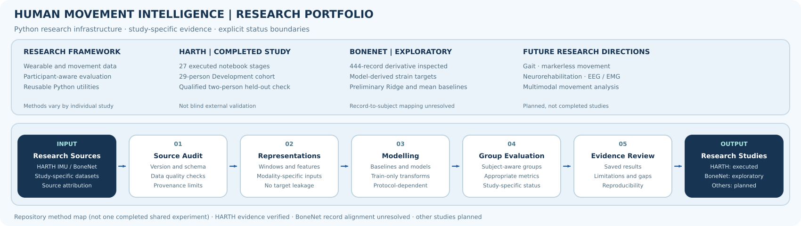

# Human Movement Intelligence

**AI for Human Movement, Biomechanics, Wearable Sensing and Rehabilitation**



*Portfolio-level map of the research workflow and study-specific completion status. This is not a single experiment shared across all research areas.*

A Python-first, multi-study research repository maintained by **Reza Saadatyar**. The project combines reproducible data processing, machine learning, deep learning and participant-aware evaluation for human movement and biomedical signals. Each research study has its own evidence and implementation status. This repository is **not an Essex-specific project** and does not claim all planned studies are complete.

## Research studies

| Study | Verified status | Where to start |
| --- | --- | --- |
| **Wearable Activity Recognition (HARTH v2.0)** | **Executed research study, Stages 01–27; final evidence synthesis complete.** Seven-model Development benchmark, repeated-seed experiments, two frozen final models and qualified same-study held-out evaluation. Documentation/release audit ongoing. | [Study README](studies/wearable_activity_recognition/README.md) · [Notebook 27](studies/wearable_activity_recognition/notebooks/27_final_research_evidence_and_report.ipynb) |
| **Biomechanical Load Estimation** | Source inspection and exploratory derivative-data regression documented; not a verified comprehensive femoral-neck-load benchmark. | [Study README](studies/biomechanical_load_estimation/README.md) · [Notebook 01](studies/biomechanical_load_estimation/notebooks/01_data_loading_and_inspection.ipynb) |
| Gait and Movement Analysis; Markerless Motion Capture; Neurorehabilitation; Multimodal Movement Learning | Future research directions, **not completed studies**. | [Study catalogue](studies/README.md) |

## HARTH research at a glance

The implemented study analyses six lower-back and thigh accelerometer channels from **HARTH v2.0**, with eight documented activity codes and a 50 Hz acquisition rate. After time-continuity and single-label window checks, **29 Development participants** contributed **14,201 windows** (100 samples, stride 50; label-independent cap 500/person). A three-fold participant-disjoint study compared **seven models**; a subsequent repeated-seed/loss study completed **36 training jobs**.

The Development-selected primary model is **1D-ResNet with weighted cross-entropy**, compared with a predeclared **120-tree Random Forest**. The final qualified evaluation involved **S023 and S032**, with 500 selected windows each:

| Predeclared model | Fixed 8-class Macro F1 | Accuracy | Observed-class balanced accuracy |
| --- | ---: | ---: | ---: |
| 1D-ResNet Weighted CE | **0.7182** | 0.9020 | 0.9234 |
| Random Forest | 0.6817 | **0.9270** | 0.7599 |

These scores describe **two participants from the same source study who were descriptively inspected during earlier exploration**. They are **not blind external validation**. Overlapping windows, uneven class support and only two held-out individuals limit inference. Shuffling has just three selected Test windows; ascending/descending stairs have ten/six. Do not infer clinical validity, deployment readiness or population-wide generalisation.

**Primary evidence:** [Executed Notebook 23](studies/wearable_activity_recognition/notebooks/23_unified_matched_model_benchmark.ipynb) · [Notebook 24](studies/wearable_activity_recognition/notebooks/24_multiseed_and_imbalance_robustness.ipynb) · [Frozen selection, Notebook 25](studies/wearable_activity_recognition/notebooks/25_model_selection_and_protocol_freeze.ipynb) · [Qualified evaluation, Notebook 26](studies/wearable_activity_recognition/notebooks/26_final_development_training_and_inference.ipynb) · [Read-only evidence synthesis, Notebook 27](studies/wearable_activity_recognition/notebooks/27_final_research_evidence_and_report.ipynb).

## Getting started

Python 3.11 is used in GitHub Actions. From a cloned checkout:

```powershell
git pull origin main
python -m pip install -r requirements.txt
python -m unittest discover -s tests -v
```

Open [Notebook 27](studies/wearable_activity_recognition/notebooks/27_final_research_evidence_and_report.ipynb) in Cursor/Jupyter to reproduce **saved-evidence reporting** without downloading the source HARTH CSVs, running neural training or rescoring reserved Test people. For neural training dependencies and complete study reproduction, see [the HARTH study guide](studies/wearable_activity_recognition/README.md) and `requirements-dl.txt`. Optional neural tests can be skipped in the CPU-only CI environment.

Data are acquired from their original providers into ignored local `data/raw/` directories; local models and generated outputs in `outputs/` are excluded from version control. **Executed notebooks and documented rounded tables are evidence, not a substitute for archived model artefacts or independent reproduction.** The MIT licence applies to original repository code; external datasets keep their own terms.

## Project structure and standards

**Visual documentation:** [Portfolio-level workflow](images/repository_overview.svg) describes the repository; each implemented study has an independent [study overview](studies/README.md) and each HARTH Notebook retains its own stage-specific SVG. See [research figure hierarchy and design rules](docs/RESEARCH_VISUAL_STANDARDS.md).

- [Research study catalogue](studies/README.md) and [research roadmap](docs/ROADMAP.md)
- [Research standards](docs/RESEARCH_STANDARDS.md) and [architecture](docs/ARCHITECTURE.md)
- Shared Python modules: [code/python/src/core](code/python/src/core/)
- Reusable unit tests: [tests](tests/) and [CI workflow](.github/workflows/python-checks.yml)
- [HARTH study documentation](studies/wearable_activity_recognition/README.md) and [Stage 27 reporting protocol](studies/wearable_activity_recognition/docs/protocols/STAGE_27_FINAL_REPORT_PROTOCOL.md)

**Status:** HARTH research execution and Stage 27 evidence synthesis are complete; documentation checks and any versioned GitHub Release remain separate follow-up work. Other proposed studies are not represented as implemented results.

## Reproducibility and release preflight

Before an optional versioned release, review the [HARTH reproducibility audit](docs/HARTH_REPRODUCIBILITY.md) and run `python scripts/check_harth_release_readiness.py` from the repository root. This read-only check verifies saved research evidence and frozen code/manifest provenance without retraining models or re-opening Test data. Original Stage 26 model files are local and must be checked separately if retained; no release is implied.

HARTH research evidence: [executed Notebooks 01–27](studies/wearable_activity_recognition/notebooks/), [workflow figures](studies/wearable_activity_recognition/images/) and the [provenance audit](docs/HARTH_REPRODUCIBILITY.md). Original approved Stage 23 evidence remains verifiable through pinned Git history.
