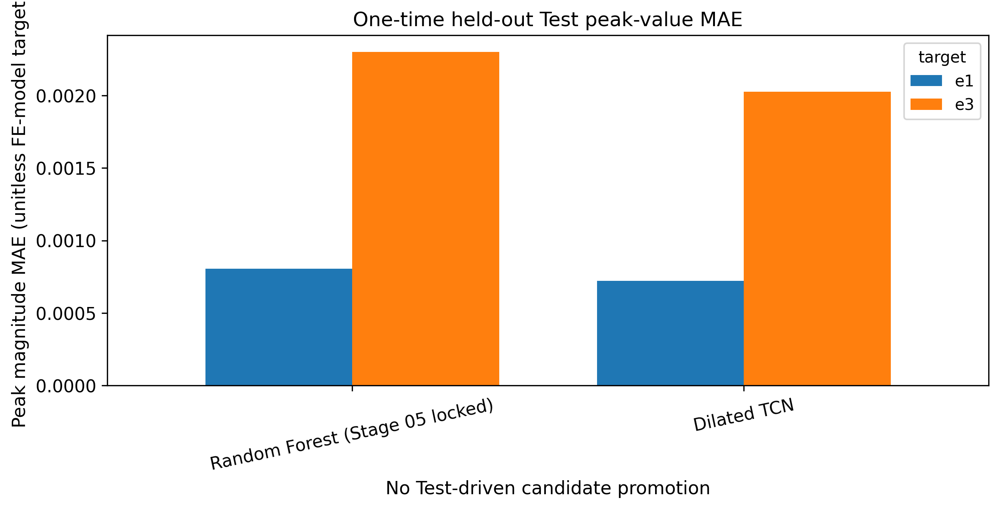

# Essex IMU–FE Strain | Research Methods and Results

**Study:** Biomechanical Load Estimation, Human Movement Intelligence.

**Scope:** Original Essex IMU–finite-element (FE) record recovery, participant-disjoint classical and temporal modelling, peak-error analysis, robustness and held-out Test evaluation. This report covers [Stages 01–08](README.md#2-experimental-programme) and is the companion to the [project README](README.md) and [reproducibility guide](../docs/BONENET_REPRODUCIBILITY.md).

**Recorded results:** This report uses the committed execution outputs and current CSV tables from all eight notebooks. Each rerun replaces the corresponding output files. The study overview is shown in the [README](README.md); the numerical peak-error figure below supports the detailed results.

## 01. Research objective, source and FE target definitions

The central research question is whether lower-body wearable inertial signals can predict **model-derived femoral-neck principal-strain trajectories**, and whether temporal neural models improve average waveform, peak-value or peak-position error compared with classical regression when participants are separated.

The study uses original MATLAB records from the published [Essex Figshare dataset v13](https://doi.org/10.6084/m9.figshare.30225739.v13), described by [Hollinger et al.](https://doi.org/10.1038/s41597-026-07429-3).

The source inventory contained **40 original participants** and **1,897 trials**. Source checks identified **168 trials with empty original FE arrays**, leaving **1,729 eligible paired trials from 37 participants**. Trials with empty FE targets are excluded from supervised modelling.

| Component | Source data and representation |
| --- | --- |
| IMU placement | Seven lower-body inertial sensors, six source channels each |
| IMU tensor | `(N, 101, 42)`, original source time positions |
| Predicted FE tensor | `(N, 11, 2)`, original source positions and targets `e1` and `e3` |
| FE semantics | First and third principal finite-element strain model outputs |
| Published FE target unit | **Unitless**; no conversion to microstrain |
| Source alignment | Original FE-to-IMU indices, verified without target interpolation |
| Prediction unit | A source trial; correlated trials from the same person remain grouped |
| Activities in final Test | BilateralHopping, CounterJumps, Running, SquatJumps, UnilateralHopping and Walking |

These source FE predictions are **simulation-derived numerical targets**, not direct in-vivo bone-strain measurements, diagnoses, clinical decisions or claims of injury prevention.

## 02. Native-time reconstruction, cohort and evaluation units

The original nested MATLAB objects were decoded and numerically reconstructed without treating interpolated derivatives as original evidence. Original trial keys and provenance were retained; the time-coordinate audit established which eleven positions in the 101-sample IMU grid correspond to the original FE target values. For all 1,729 eligible trials, the zero-based IMU indices are `[0, 9, 19, 29, 39, 49, 59, 69, 79, 89, 99]`. The temporal models read network features **at those exact positions**. No synthetic 101-point FE ground truth is used.

**Participant allocation after source recovery (Stage 04):**

| Partition | Participants | Eligible trials | Role |
| --- | ---: | ---: | --- |
| Training | 29 | 1,354 | Grouped model selection and all Stage 07 robustness jobs |
| Diagnostic Validation | 4 | 192 | Predefined diagnostic comparison in Stages 05–06, not new Stage 07 selection |
| Reserved Test | 4 | 183 | Final evaluation, separate from model fitting and selection |
| **Total** | **37** | **1,729** | All source-eligible observations |
| Final Development (Training + Validation) | 33 | 1,546 | Final fitting after model selection |

The initial Training model comparisons reuse **five participant-disjoint GroupKFold assignments**. A held-out participant contributes *all* of their trials to the same fold. There is no between-participant leakage across Train/Validation/Test, and scaling is fitted only on the corresponding training-fold inputs.

The main scoring unit is the **participant**, not the individual FE position. In the primary **subject-balanced waveform MAE**, model error is averaged over both FE targets, eleven FE positions and trials *within each participant*, then the participants receive equal weight. Target-specific pointwise MAE/RMSE, peak **value**, peak **index**, activity-conditioned error and between-participant dispersion are separate endpoints.

The 183 final Test trials therefore represent **four independent human clusters**, not 183 independent people or 4,026 independent physiological measurements.

## 03. Original data audit and classical regression (Stages 01–05)

**Stages 01–03 — source understanding and numerical recovery.** The project inspected the official metadata, original archive inventory, 40-person MATLAB object layout, stable record identities, numerical nested fields and temporal correspondence. The presence and eligibility of each FE series were checked rather than silently filling missing labels. The resulting current trial registry and time-coordinate tables provide the inputs for pairing and modelling.

**Stage 04 — governed paired cohort.** All 1,729 eligible trials were assigned to the fixed **29/4/4 participant split**; channel schema, native FE indices and participant assignments were saved. The local reconstruction cache is intentionally Git-ignored rather than committed.

**Stage 05 — classical regression.** The Training Mean control, Ridge regression and Random Forest benchmark were compared using five per-channel original-IMU summary features: **mean, standard deviation, minimum, maximum and root mean square**. With 42 input channels this yields **210 predictors**. Each model returns 22 values (eleven FE positions × two original FE targets) per trial. Five Training-only participant-disjoint folds determined the model-selection ranking. Ridge uses a fold-fitted StandardScaler and `alpha=10.0`; the Stage 05 Random Forest uses 200 trees, minimum leaf size 3, `max_features=1.0` and seed 2026.

| Stage 05 classical model | Training OOF subject-balanced MAE | Diagnostic Validation subject-balanced MAE |
| --- | ---: | ---: |
| Training mean | 0.0012562 | 0.0012673 |
| Ridge | 0.0012156 | 0.0008758 |
| **Random Forest** | **0.0007950** | **0.0006771** |

The earlier Validation set was inspected during model development. It is therefore an informative **diagnostic** set, but not a prospectively blind, external evaluation. Random Forest had the lowest predefined **Training** metric and was selected as the primary model family; its final Stage 08 settings are documented in Section 06. The Test results did not change that reporting role.

Sources: [Stage 04 participant assignments](output/04_subject_split_assignments.csv), [Stage 05 CV model summary](output/05_training_cv_model_summary.csv), [Stage 05 Validation results](output/05_validation_model_metrics.csv), and the corresponding notebook methods.

## 04. Temporal regression and peak objectives (Stage 06)

Stage 06 compared two compact neural models: a **Temporal CNN** and a residual **Dilated TCN**. Both consume the complete original 101×42 IMU sequence and use an exact 11-position FE index readout. Both used identical predefined training epochs (**35 per fold**), AdamW, training-fold-only standardisation and the same normalised waveform-plus-peak objective (peak weight **0.25**). The architectures have different parameter counts. The saved Stage 06 execution reports CUDA.

| Stage 06 architecture | Training OOF subject-balanced MAE | Diagnostic Validation subject-balanced MAE |
| --- | ---: | ---: |
| Temporal CNN | 0.0009036 | 0.0007517 |
| **Dilated TCN** | **0.0008474** | **0.0007151** |
| Locked earlier Random Forest reference | **0.0007950** | **0.0006771** |

Random Forest remained lower in overall waveform MAE. Yet on the **four-person Validation** set, Dilated TCN had lower e1/e3 **peak-value** errors than Random Forest: **0.0005855 / 0.0014333** versus **0.0006625 / 0.0016423**. The neural model had *higher* e1/e3 **peak-position** errors: **1.615 / 1.495** versus **1.417 / 1.005** original FE indices.

This establishes a development-stage **trade-off**, not blanket deep-learning superiority. The source target peaks are computed on the eleven original FE coordinates; the integer index difference is not a physical time difference in seconds.

Sources: [Stage 06 Training CV](output/06_training_cv_model_summary.csv), [Stage 06 Validation results](output/06_validation_model_metrics.csv).

## 05. Multi-seed robustness, recurrent models and sensor sensitivity (Stage 07)

Stage 07 introduced **GRU** and **bidirectional GRU (BiGRU)** as recurrent architectures alongside Temporal CNN and Dilated TCN. One additional Dilated TCN configuration removed the peak-loss penalty. Each of the **five configurations × three fixed seeds (2026/2027/2028) × five Training-fold assignments** ran for **35 epochs**, producing **75 actual completed neural training jobs** and **2,625 recorded epoch-loss rows**, all using Training only. The recorded GPU was Tesla T4.

| Stage 07 Training OOF model/configuration | Mean subject-balanced MAE | Research role |
| --- | ---: | --- |
| Dilated TCN **without** peak loss | 0.0008624 | Controlled ablation only; not eligible for primary selection |
| **Dilated TCN** | **0.0008769** | Best mean among four predefined principal neural architectures |
| BiGRU | 0.0008800 | Close recurrent comparison |
| GRU | 0.0008898 | Recurrent comparison |
| Temporal CNN | 0.0009152 | Convolutional comparison |
| Random Forest (Stage 05 locked) | **0.0007950** | Previously recorded primary classical comparator |

These neural values are means over three seed-specific, full Training OOF metrics; the classical reference comes from Stage 05's earlier training run. The comparison is **not** a claim of capacity-matched training or a statistically significant architecture ranking.

**Peak-loss ablation.** Removing the 0.25 peak loss lowered three-seed Dilated TCN mean waveform MAE from **0.0008769** to **0.0008624**. Peak-value and peak-index results did not establish a reliable improvement from *adding* the penalty; per-seed and target effects varied, and the exploratory participant bootstrap for the paired waveform difference included zero. The Stage 06 diagnostic Validation peak advantage therefore cannot be causally attributed to the chosen peak penalty.

**Participant-level sensitivity.** A single prespecified Dilated TCN seed (2026) underwent original six-channel IMU-group mean replacement and fixed normalised Gaussian noise tests on out-of-fold Training trials. Replacing the **right-thigh (RTH)** sensor group produced the largest average error increase, about **+0.0001060**. Fixed Gaussian noise (SD 0.10 in fold-standardised units) produced an approximately **+0.00000171** mean change. These are defined *model-response perturbations*, not physical sensor failures or causal biomechanical importance estimates.

**Selection.** A predeclared Training-only rule compared the principal architectures with the locked Random Forest CV score, excluding the no-peak ablation from primary selection. **Random Forest remained the primary Stage 08 candidate.** No new Stage 07 model ranking was performed using the previously inspected Validation or reserved Test sets.

Sources: [Stage 07 model stability](output/07_training_model_stability_summary.csv), [Training-only candidate decision](output/07_training_candidate_decision.csv), [peak-loss ablation](output/07_peak_loss_ablation.csv), [sensor/noise sensitivity](output/07_sensor_noise_sensitivity.csv).

## 06. Final Development fit and held-out Test (Stage 08)

**Model roles and settings.** The Training-only comparisons selected Random Forest as the primary model family; Dilated TCN is the predefined secondary comparison. Final settings are defined in [`final_model_settings()`](code/src/essex_stage08_final.py):

| Setting | Final Random Forest | Final Dilated TCN |
| --- | --- | --- |
| Input | 210 trial-level IMU summary features | Original 101 × 42 IMU sequence |
| Output | 22 values reshaped to 11 × 2 | Two outputs at each of 11 native FE positions |
| Model size | 200 trees | 51,986 trainable parameters |
| Training settings | Minimum leaf size 3; `max_features=1` | 35 epochs; batch size 64; AdamW; learning rate 0.001; weight decay 0.0001 |
| Peak-loss weight | Not applicable | 0.25 |
| Random seed | 2026 | 2128 |

**Classical configuration distinction.** The final Random Forest uses the integer `max_features=1`, so each split considers one candidate predictor. The Stage 05 baseline uses the float `max_features=1.0`, which considers all 210 predictors. These are different settings in the existing implementation. The Stage 05 CV score therefore describes the baseline configuration, while the final Test score describes the Stage 08 configuration and Development fit. Differences between these stages cannot be attributed solely to adding Validation participants to training.

**Final fitting.** Both models were fitted on **33 Development participants / 1,546 trials**, combining Training and diagnostic Validation after selection. The recorded final TCN has **51,986 parameters** and used Tesla T4 CUDA. Test labels are excluded from fitting and model selection.

**Held-out Test.** Four participants excluded from model fitting contributed 183 trials and **8,052 prediction rows** (183 × eleven positions × two targets × two models). Rerunning Notebook 08 refits the predefined models and replaces its current outputs; it does not create a new independent evaluation sample.

| Test metric | Primary Random Forest | Secondary Dilated TCN |
| --- | ---: | ---: |
| Subject-balanced waveform MAE | 0.0009384 | 0.0008759 |
| e1 pointwise MAE | 0.0004926 | 0.0004611 |
| e3 pointwise MAE | 0.0013249 | 0.0012482 |
| e1 pointwise RMSE | 0.0007603 | 0.0007132 |
| e3 pointwise RMSE | 0.0020646 | 0.0019296 |
| e1 peak-value MAE | 0.0008059 | 0.0007222 |
| e3 peak-value MAE | 0.0022999 | 0.0020255 |
| e1 peak-position MAE (FE indices) | 0.9672 | 1.3497 |
| e3 peak-position MAE (FE indices) | 0.8415 | 1.1967 |

The predeclared secondary **Dilated TCN** had about **6.7% lower observed participant-balanced waveform MAE** on the final Test, and lower both-target peak-*value* MAE. The frozen primary **Random Forest** more accurately located the source-grid peaks. These are mixed outcomes and do **not** justify retrospective primary-model replacement.

The exploratory paired whole-participant bootstrap for **TCN − RF subject-balanced waveform MAE** was **−0.0000625**, with a 95% percentile interval of **[−0.0001859, +0.0000431]** over only four Test participants (2,000 draws). The interval includes zero. It is not confirmatory evidence of population-level model superiority.

Additional result figures: [waveform MAE](output/08_test_waveform_mae_comparison.png), [per-person errors](output/08_test_subject_errors.png), [one e1 waveform](output/08_test_waveform_example_e1.png) and [one e3 waveform](output/08_test_waveform_example_e3.png). The last two are **fixed, source-identifiable illustrative trials**, not population summaries.

## 07. Current outputs and reproducibility

The notebooks exchange current data tables. Notebook 01 supplies trial identities, Notebook 02 supplies the pilot column schema, and Notebook 03 supplies FE-to-IMU time mapping. Notebook 04 creates paired arrays and participant assignments. Notebooks 05–07 perform model development; Notebook 08 fits the final recipes and reports Test errors.

The committed [Test prediction table](output/08_test_trial_predictions.csv) contains 8,052 rows. Together with the [metrics](output/08_test_primary_secondary_metrics.csv) and [participant bootstrap](output/08_test_subject_bootstrap.csv), it supports result inspection without retraining. Detailed input/output dependencies and installation instructions are in the [running guide](../docs/BONENET_REPRODUCIBILITY.md).

Raw MATLAB files and numerical NPZ arrays remain local. Existing downloads are reused. The paired NPZ is rebuilt when absent or older than its upstream inputs; its arrays are aligned to the trial table by key. Every Stage 07 run trains all 75 jobs again, and every Stage 08 run refits both final models. GPU results may vary across environments.

## 08. Source coverage and the separate BoneNet derivative

The current participant workbook summary contains 40 recognised, nonconsecutive participant identifiers. Summary rows are excluded. Participant metadata are not used as IMU predictors.

The 168 source-empty FE records comprise 144 trials from three participants without FE targets (`subj16`, `subj29`, `subj32`; 48 each), plus 24 partial gaps (`subj06`: 9, `subj08`: 9, `subj11`: 6). Five files have fewer than 48 records: `subj09` has 42, `subj11` 40, `subj12` 47, `subj14` 42 and `subj36` 46. These counts describe the current registry.

The Notebook 02 pilot contains 28 numeric IMU tables, 27 nonempty FE tables and one empty FE object. The whole-table classifier labels those 27 FE tables `non_numeric_table` because their `timestep` column has object dtype; the `e1` and `e3` columns are numeric. Notebook 03 separates and decodes the time values. Across the full source, 24 canonical empty objects and 144 empty arrays account for the 168 missing targets, leaving 1,729 exact temporal pairs.

The separate [public BoneNet derivative](https://github.com/ZainabAltai/BoneNet-A-Framework-for-Rapid-and-Accurate-Prediction-of-Femoral-Neck-strains-from-Exercise-Data) contains 444 walking/running rows with 101-position targets. It is not the six-activity original dataset used here. Its exploratory scores and unresolved row-label association are excluded from this report's model comparisons.

## 09. Interpretation and limitations

1. **One source and four Test participants.** Participant-held-out performance does not establish independent-site or prospective generalisation. Multiple trials and FE positions do not increase the number of Test participants. The four-participant bootstrap interval for the model difference includes zero.
2. **Model-derived targets.** FE strains are unitless simulation outputs. In-vivo strain, physical peak delays in seconds and clinical validity were not measured by this analysis.
3. **Different development and final protocols.** Stage 07 neural metrics average three seeds, while final models use one fixed seed each. The final RF configuration also differs from the Stage 05 baseline as documented above. Cross-stage scores describe different fits and evaluation samples.
4. **Repeated Validation inspection.** Validation was used for diagnostics in earlier stages, so it is not blind evidence for programme-wide research decisions. Model ranking in the reported code uses Training CV.
5. **Waveform and peak errors differ.** Lower average waveform error does not imply more accurate peak location. The peak-loss ablation did not establish a consistent benefit from adding the penalty.
6. **Perturbation sensitivity is model-specific.** Sensor mean replacement and Gaussian noise measure responses to artificial input changes, not causal biomechanical contributions or validated sensor-removal strategies.
7. **Replication needs source data.** Committed outputs support inspection, but full replication requires the original MATLAB files and compatible dependencies. Trained weights and local prediction files are not published; deterministic settings do not guarantee identical GPU results across systems.

The completed study provides an exploratory, participant-held-out comparison of IMU-to-FE strain predictors within the Essex cohort. Its main observed trade-off is lower waveform and peak-value error for the secondary TCN, with lower peak-position error for the primary Random Forest. The results do not establish a clinical monitoring system.

**Related files:** [Project README](README.md) · [Running guide](../docs/BONENET_REPRODUCIBILITY.md) · [Final model settings](code/src/essex_stage08_final.py) · [Test metrics](output/08_test_primary_secondary_metrics.csv).
