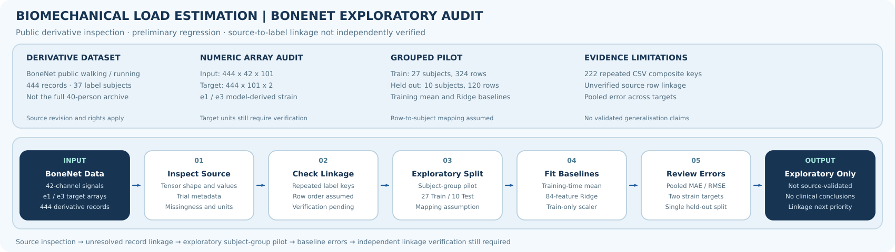

# Biomechanical Load Estimation | BoneNet Exploratory Study

*This diagram describes an exploratory source-data and regression workflow, not a validated biomechanical load-estimation system. Independent record-to-participant linkage remains unresolved.*

**Research question:** Can time-normalised wearable IMU signals support reproducible estimation of selected model-derived femoral-neck strain trajectories, with suitable subject-aware validation?

**Current status:** Public BoneNet derivative tensors have been inspected and a single exploratory regression baseline has been executed. The independently checked source-to-label association, target units, repeat-fold validation and complete original Figshare study have **not** been established.

## Data and provenance

The [BoneNet public derivative](https://github.com/ZainabAltai/BoneNet-A-Framework-for-Rapid-and-Accurate-Prediction-of-Femoral-Neck-strains-from-Exercise-Data) provides a walking/running subset of the broader biomechanical loading material described by [Hollinger et al.](https://doi.org/10.1038/s41597-026-07429-3).

| Item | Inspected derivative |
| --- | --- |
| IMU input array | `X: (444, 42, 101)` |
| Model-derived strain targets | `Y: (444, 101, 2)`, labelled `e1` and `e3` |
| Source labels | 444 rows, 37 subject identifiers |
| Activities | Running: 333 rows; Walking: 111 rows |
| Duplicate `SubjID + Task + TrialNum` keys | 222 repeated combinations |
| Non-finite entries in inspected numeric arrays | None observed |

These are time-normalised derivative arrays, not verified raw 225 Hz signals. The available CSV does not uniquely identify all 444 records. **The pilot's assumed row-order association between `Data.mat` and `labels.csv` remains unverified**; neither the split nor subject-independent performance can be treated as independently validated until this mapping is resolved. The strain outputs are **model-derived**, not direct in-vivo measurements.

Source checks are documented in [the real-data audit](BONENET_REAL_DATA_AUDIT.md) and [the full-record representation audit](ALL_RECORD_AUDIT_FINDINGS.md).

## Preliminary regression experiment

A Python-based exploratory pilot used one `GroupShuffleSplit` (seed 42) with 27 Train subjects / 324 records and ten held-out subjects / 120 records. It compared a training-timepoint-mean predictor with Ridge regression on 84 per-channel temporal descriptors (mean and standard deviation for each of 42 channels). The Ridge features were scaled using Train data only; `alpha=10.0` was used.

| Baseline | Pooled MAE | Pooled RMSE |
| --- | ---: | ---: |
| Training mean | **1325.5737** | **1851.0981** |
| Ridge on 84 descriptors | 1446.1677 | 2191.9425 |

These values pool both targets and all time points in the source's as-yet-unverified target scale. Ridge performed worse than the training-mean comparator in **this particular unoptimised split**; that result does not establish the general superiority of the mean model or the limitations of linear methods.

**Execution evidence:** [exploratory baseline report](BONENET_FIRST_BASELINE_RESULTS.md), which links to the original GitHub Actions run and describes its experimental procedure. The pilot's script is not currently present in the tracked `scripts/` directory, so its complete implementation cannot be reproduced from this checkout alone. The [initial source-inspection Notebook](notebooks/01_data_loading_and_inspection.ipynb) is separate from the later regression pilot.

## What remains to be done

Independent source-record linkage is the immediate priority. Subsequent experiments should verify target units and temporal alignment, report separate `e1`/`e3` and participant-level metrics, and use a well-justified, reproducible grouping policy. Only then should more sophisticated models be compared under an approved protocol.

The original 40-participant Figshare/MCOS representation audit is a **separate workstream** and must not be presented as a completed numerical FE-strain modelling benchmark. See [data-pipeline design](DATA_PIPELINE_DESIGN.md), [source schema findings](NESTED_SCHEMA_FINDINGS.md) and [repository visual standards](../../docs/RESEARCH_VISUAL_STANDARDS.md).

**Scientific boundary:** No independent external validation, clinical prediction or verified participant-level generalisation is claimed.
