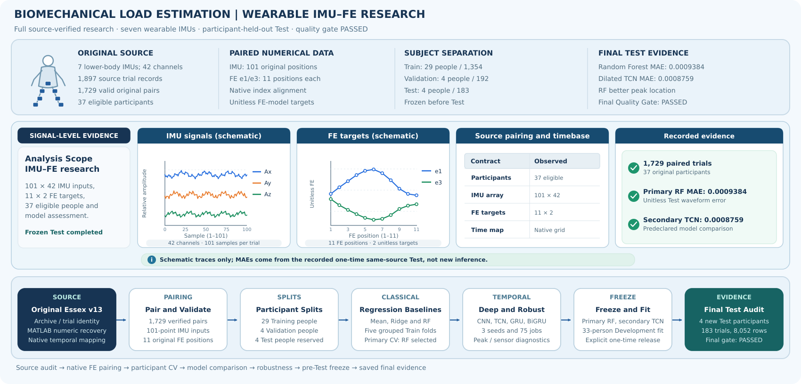
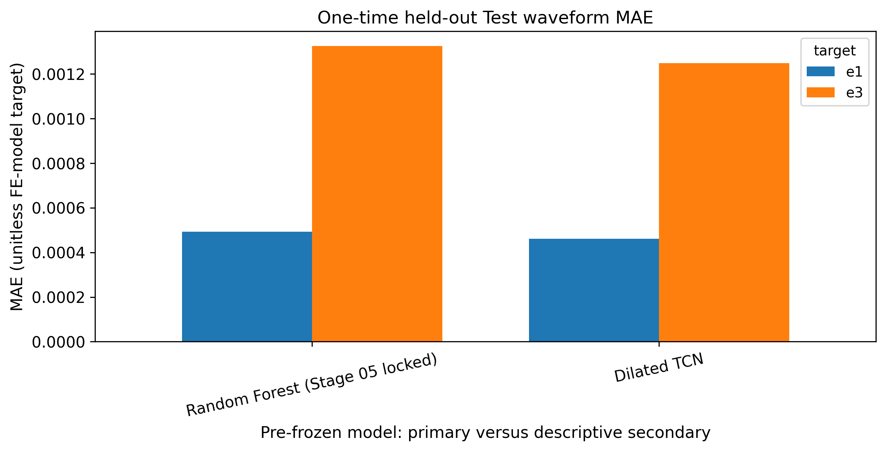
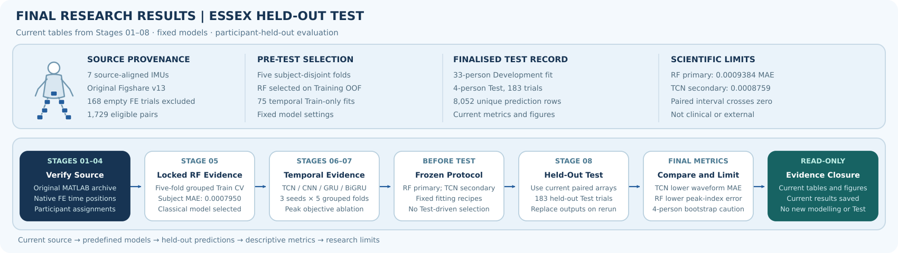

# Biomechanical Load Estimation | Essex IMU–FE Strain Research (BoneNet)

*Study-wide workflow: the diagram summarises the eight-notebook source-verified Essex research pathway and its final authorised same-source Test. Each numbered notebook retains its own stage-specific scientific workflow figure.*

This project investigates **prediction of model-derived femoral-neck finite-element principal strains (\`e1\` and \`e3\`) from seven wearable IMUs**. It compares classical feature-based regression, temporal convolutional models and GRU/BiGRU architectures under participant-disjoint evaluation, with explicit attention to waveform error, peak value, peak position and model robustness.

The project comprises **eight numbered Jupyter notebooks**. Stages 03–08 have all code cells executed in their saved versions; some source-inspection cells in Stages 01–02 remain unexecuted. The [Stage 08 final notebook](code/notebooks/08_frozen_final_model_evaluation_and_research_synthesis.ipynb) has 11 executed code cells, no recorded errors and a committed final **Quality Gate PASSED**. The [before-Test protocol](output/08_frozen_final_protocol.json) was committed independently of Test results. No additional Test fitting or reranking has been conducted.

## 1. Dataset and experimental protocol

| Component | Research setting |
| --- | --- |
| Original source | [Essex Figshare v13](https://doi.org/10.6084/m9.figshare.30225739.v13), [published source description](https://doi.org/10.1038/s41597-026-07429-3); not the older 444-row public BoneNet derivative |
| Source coverage | 40 original participants, 1,897 original trials; 168 trials excluded for empty FE arrays |
| Eligible paired study | **37 participants, 1,729 trials** with source-linked IMU and FE outputs |
| IMU inputs | Seven lower-body six-channel sensors, original **101 × 42** trial tensor |
| Model-derived targets | Original eleven-position **11 × 2** FE trajectories, \`e1\` and \`e3\`; **unitless** |
| Time indexing | Original source-verified FE positions; no FE target interpolation |
| Training | 29 people; 1,354 original trials |
| Diagnostic Validation | 4 people; 192 original trials |
| Final reserved Test | 4 new people; 183 original trials, evaluated once after explicit release |
| Final Development fit | 33 people / 1,546 trials (Training + Validation), only after freezing model choice |
| Main metric | Equal-participant-weighted waveform MAE over original targets and FE coordinates |

The source audit maintained original trial identities, the published MATLAB archive SHA256 and a canonical paired-array fingerprint. All participants were disjoint across the three partitions. Five grouped Training folds supported the model-development comparisons; the previously examined Validation participants were not reused to reselect models in Stage 07.

Only source-verified **model-derived finite-element targets** were evaluated. The output scale is **unitless**; it is not measured in-vivo strain, calibrated microstrain, clinical injury risk or an independent physical bone-load measurement.

## 2. Experimental programme

| Notebooks | Main purpose |
| --- | --- |
| [01](code/notebooks/01_original_dataset_audit_and_trial_registry.ipynb) | Original Figshare archive, trial registry and source representation |
| [02](code/notebooks/02_matlab_object_decoding_and_numeric_recovery.ipynb) | Original nested MATLAB object decoding and numerical recovery |
| [03](code/notebooks/03_full_cohort_numeric_and_temporal_validation.ipynb) | Complete cohort numerical checks and native FE–IMU temporal mapping |
| [04](code/notebooks/04_governed_imu_fe_dataset_and_participant_splits.ipynb) | Source-governed 1,729-trial paired cohort and immutable 29/4/4 participant allocation |
| [05](code/notebooks/05_classical_regression_baselines_and_participant_independent_validation.ipynb) | Training mean, Ridge, Random Forest, grouped CV and diagnostic Validation |
| [06](code/notebooks/06_deep_temporal_regression_and_peak_prediction.ipynb) | Temporal CNN/TCN Training CV, original-grid waveform and peak diagnostics |
| [07](code/notebooks/07_multi_seed_robustness_gru_bigru_and_peak_ablation.ipynb) | Three seeds, five folds, GRU/BiGRU, 75 Training-only fits, peak-loss ablation, sensor sensitivity, pre-Test selection |
| [08](code/notebooks/08_frozen_final_model_evaluation_and_research_synthesis.ipynb) | Frozen Random Forest primary, descriptive TCN secondary, 33-person final fit and authorised one-time four-person Test |

Detailed methods, original FE target geometry, trial accounting and all scientific comparisons are documented in [BoneNet | Research Methods and Experimental Evidence](BONENET_RESEARCH_METHODS_AND_EVIDENCE.md).

The [Stage 08 pre-Test protocol](output/08_frozen_final_protocol.json) and [one-time release receipt](output/08_final_test_release_receipt.json) document the Test boundary. Unlike the HARTH portfolio, this Essex work has **no additional separate FINAL audit notebook**; evidence reconciliation is based on the saved Stage 04–08 quality gates, recorded Stage 08 Test artifacts and the read-only stage evidence register.

## 3. Research results

### Development and model choice

The **Random Forest** was chosen as the **primary model** from the earlier Training-only participant-grouped criterion. A **Dilated TCN** was prespecified as a secondary comparison before opening Test. Stage 07 compared the principal neural architectures over three random seeds and the same five Training folds; its no-peak-loss TCN experiment was a diagnostic ablation, not another eligible primary model.

| Model / condition | Training OOF subject-balanced MAE | Evidence scope |
| --- | ---: | --- |
| **Random Forest** | **0.0007950** | Stage 05 five-fold classical selection; **locked primary** |
| Dilated TCN | 0.0008769 | Stage 07 three-seed average; predefined temporal architecture |
| BiGRU | 0.0008800 | Stage 07 three-seed average |
| GRU | 0.0008898 | Stage 07 three-seed average |
| Temporal CNN | 0.0009152 | Stage 07 three-seed average |
| Dilated TCN without peak loss | 0.0008624 | Ablation only; excluded from primary selection |

Stage 07 completed **75 Training-only model/fold/seed fits**. Its peak-loss ablation did **not** show a dependable benefit from adding the fixed 0.25 penalty; sensitivity analysis found the greatest model-response change when replacing the right-thigh IMU channels with their fold-Training mean. Neither is evidence of causal biomechanical sensor importance.

### Authorised final held-out Test

The primary Random Forest and secondary Dilated TCN were fitted **once** on 33 Development people and evaluated in **one pre-authorised round** on four held-out people from the same original source (183 trials). The model identities, budgets and reporting metrics had been locked beforehand.

| Test metric | **Primary Random Forest** | Predeclared **secondary Dilated TCN** |
| --- | ---: | ---: |
| **Subject-balanced waveform MAE** | 0.0009384 | **0.0008759** |
| e1 pointwise MAE | 0.0004926 | **0.0004611** |
| e3 pointwise MAE | 0.0013249 | **0.0012482** |
| e1 peak-value MAE | 0.0008059 | **0.0007222** |
| e3 peak-value MAE | 0.0022999 | **0.0020255** |
| e1 peak-position MAE (original FE indices) | **0.9672** | 1.3497 |
| e3 peak-position MAE (original FE indices) | **0.8415** | 1.1967 |

The fixed secondary Dilated TCN had **about 6.7% lower observed waveform MAE** and lower peak-value errors for both targets. The frozen primary Random Forest better located the original FE peaks. The four-person paired exploratory bootstrap interval for TCN minus RF waveform MAE was **[−0.0001859, +0.0000431]**, crossing zero. The difference is **not** confirmatory population-wide superiority. **Random Forest remains the pre-Test-selected primary**, regardless of this secondary Test observation.

Results are reported from [Stage 05 classical CV](output/05_training_cv_model_summary.csv), [Stage 07 robustness](output/07_training_model_stability_summary.csv) and [final Test metrics](output/08_test_primary_secondary_metrics.csv). These results involve different fitted model instances and evaluation protocols; they must not be pooled into a single interchangeable score.

## 4. Repository navigation

| Location | Contents |
| --- | --- |
| [\`code/notebooks/\`](code/notebooks/) | All eight numbered source, model development and Test notebooks |
| [\`code/src/\`](code/src/) | Essex source, numeric recovery, paired dataset, regression and final Test utilities |
| [\`output/\`](output/) | Actual source audits, original split gates, model diagnostics, source-indexed figures and 16 \`08_*\` final artifacts |
| [\`images/\`](images/) | Study-wide three-row SVG; eight stage-specific three-row diagrams; final evidence figure and historical derivative-pilot illustration |
| [\`evidence/\`](evidence/stage_01_08_evidence_register.csv) | Source-linked read-only register of 28 scientific records from Stages 01–08 |
| [Shared Python modules](../python_modules/core/) | Colab repository setup, device reporting, plotting and output management |
| [Research Methods and Evidence](BONENET_RESEARCH_METHODS_AND_EVIDENCE.md) | Full source-derived methods, independent-unit accounting, comparison tables and limits |
| [Reproducibility Guide](../docs/BONENET_REPRODUCIBILITY.md) | Environment, source versions, recorded evidence and safe review boundaries |

Saved numerical CSVs and manuscript-style figures are **research outputs**, not replacement original datasets. The public repository does not commit the full MATLAB source, all reconstructed numeric caches, local training-job files or fitted model-weight files.

The study-level workflow is supplemented by eight individual diagrams, named \`01_consolidated_workflow.svg\` through \`08_consolidated_workflow.svg\`, each located in [\`images/\`](images/) and linked from its corresponding notebook. The figures use schematic traces for orientation; numerical results are documented in the executed notebooks and committed output tables.

## 5. Running and reviewing the study

For Colab, use the approved repository-sync cell at the top of the desired notebook and the shared source, plotting and \`computer_device()\` utilities. For local baseline inspection, from the repository root:

\`\`\`bash
python -m pip install -r requirements.txt
\`\`\`

Neural experiments also require the appropriate optional packages from [\`requirements-dl.txt\`](../requirements-dl.txt) and suitable resources. Original source reconstruction may require separate original MATLAB reader dependencies as described in the notebooks and the [reproducibility guide](../docs/BONENET_REPRODUCIBILITY.md).

**To review completed results without retraining**, begin with [executed Notebook 08](code/notebooks/08_frozen_final_model_evaluation_and_research_synthesis.ipynb), its [final Quality Gate](output/08_final_test_quality_gate.json) and [saved Test metrics](output/08_test_primary_secondary_metrics.csv). Then inspect the [Stage 07 pre-Test model decision](output/07_training_candidate_decision.csv) and [Stage 04 source/split gate](output/04_dataset_and_split_quality_gate.json).

**Do not rerun the authorised Test release, refit using Test labels or promote another model based on the observed protected Test outcomes.** The final figures and the **8,052 saved model/trial/FE-position/target prediction rows** already permit read-only error analysis. The local release marker is not a global lock across unrelated machines.

## 6. Final research evidence audit and closure

The independent before-Test protocol was committed first; the Stage 08 notebook then recorded **one explicit Test release** and a completed evaluation for two predeclared models. Its **11 code cells have executed saved outputs and no saved errors**. The final gate reports:

\`STAGE 08 | FROZEN ONE-TIME TEST QUALITY GATE: PASSED\`

There are **16 saved final \`08_*\` files**, including:

| Final evidence | Scientific content |
| --- | --- |
| [Frozen final protocol](output/08_frozen_final_protocol.json) | RF/TCN roles, fit recipes, original-source cohort and fixed Test metrics |
| [Development fit manifest](output/08_development_fit_manifest.json) | 33-person fitting contract, RF feature count and TCN parameter count |
| [Test release receipt](output/08_final_test_release_receipt.json) | Actual manual authorisation for one evaluation |
| [Original Test predictions](output/08_test_trial_predictions.csv) | 183 trials × 11 original positions × two targets × two predeclared models |
| [Primary and secondary metrics](output/08_test_primary_secondary_metrics.csv) | Original unitless e1/e3 waveform and peak errors |
| [Participant and activity breakdown](output/08_test_subject_activity_metrics.csv) | Four-person, six-activity descriptive errors |
| [Exploratory paired bootstrap](output/08_test_subject_bootstrap.csv) | Whole-participant uncertainty; four clusters only |
| [Final quality gate and source hashes](output/08_final_test_quality_gate.json) | Preserved model selection, source lineage, output fingerprints and completeness |

This is a **recorded evidence reconciliation**, not a newly executed independent FINAL audit notebook or another Test evaluation. The saved quality gates verify consistency of artifacts **available in GitHub**, not identical GPU retraining results or external generalisation. Some saved source-inspection code cells in Stages 01–02 are unexecuted; Stages 03–08 have complete saved execution for their code cells. The project is complete **within its source-governed exploratory scope**.

## 7. Scientific documentation, historical pilot and boundaries

- [Research Methods and Experimental Evidence](BONENET_RESEARCH_METHODS_AND_EVIDENCE.md): full original-source method and empirical results.
- [Reproducibility and Evidence Boundaries](../docs/BONENET_REPRODUCIBILITY.md): input sources, dependencies, available outputs and limitations.
- [Stage 01–08 Evidence Register](evidence/stage_01_08_evidence_register.csv): current committed source/results index.
- [Frozen Stage 08 Protocol](output/08_frozen_final_protocol.json): independently committed pre-Test decision.
- [Research figures](images/): study-wide diagram, eight matching stage-specific SVGs and the separate final evidence figure.

**Historical pilot, separate from the completed Essex study.** The earlier [public BoneNet derivative](https://github.com/ZainabAltai/BoneNet-A-Framework-for-Rapid-and-Accurate-Prediction-of-Femoral-Neck-strains-from-Exercise-Data) comprised 444 walking/running rows with derivative tensors \`X: (444,42,101)\` and \`Y: (444,101,2)\` and an unresolved label-row association. The source audit, exploratory baseline results and their limitations are consolidated in [the source provenance and derivative-pilot section](BONENET_RESEARCH_METHODS_AND_EVIDENCE.md#08-source-provenance-earlier-audits-and-the-derivative-pilot); the separate [historical workflow graphic](images/bonenet_derivative_pilot.svg) remains available. Its unverified derivative target scale and assumptions **must not be compared numerically with** the source-verified, original 11-point unitless FE targets.

**Scientific boundaries:** No independent external dataset, measured in-vivo bone strain, physical peak timing in seconds, causal sensor attribution, prospective patient outcome or validated medical/clinical decision-support system was demonstrated. The four-person, same-source final Test supports limited participant-held-out empirical assessment, not universal prediction accuracy.

**Status:** Original source audit, participant-disjoint model development, peak/sensor robustness, frozen-before-Test final refitting and one authorised Test evaluation are recorded and complete within the declared protocol. This is a **research and software portfolio benchmark**, not a certified biomechanical monitor.
