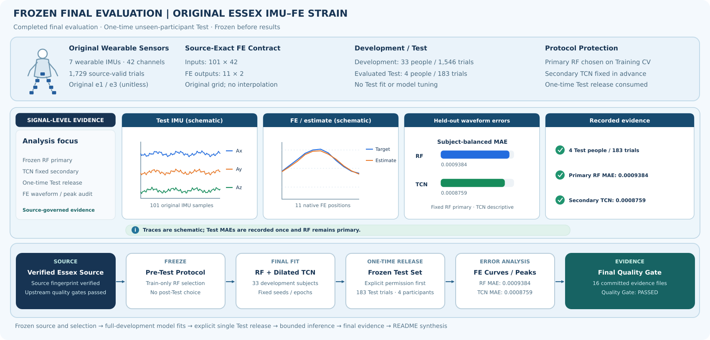

# Biomechanical Load Estimation | Source-Verified Essex IMU–FE Research

**An exploratory, participant-held-out research benchmark for estimating model-derived femoral-neck principal strains from wearable inertial measurements.** The full eight-notebook Essex study is complete. The earlier BoneNet public-derivative pilot is documented separately below and must not be confused with this original-source study.

**Status:** Eight documented research notebooks (Stages 03–08 with complete saved code-cell execution; Stages 01–02 retain some unexecuted cells); pinned original-data lineage; Stage 04–08 Quality Gates **PASSED**; final model frozen before Test; one explicitly authorised Test evaluation completed on **four unseen participants from the same Essex source cohort**. This is **not** independent external-dataset validation, direct measurement of bone strain, or clinical deployment.

## Research question and main finding

Can seven lower-body IMUs support reproducible, source-traceable prediction of the original, model-derived femoral-neck strain trajectories, and how do classic regression and deep temporal models compare when participants are kept separate?

The **primary Random Forest** was selected *before Test* using Training-only grouped cross-validation. On the final participant-held-out Test set, it obtained a subject-balanced waveform MAE of **0.0009384**. A predeclared **secondary Dilated TCN** obtained **0.0008759**, approximately **6.7% lower observed waveform error**, and lower e1/e3 peak-value error, but higher peak-position error. **The primary was not changed after seeing Test.** With four Test participants, the exploratory paired participant-bootstrap interval crossed zero; the observed difference does not establish a definitive population-wide advantage for TCN.

## Original Essex source, provenance and splits

The final study is based on the [original Essex Figshare dataset v13](https://doi.org/10.6084/m9.figshare.30225739.v13), linked to the published dataset description by [Hollinger et al.](https://doi.org/10.1038/s41597-026-07429-3). The project independently audited original source records, recovered numerical arrays and verified original IMU–FE temporal correspondence before creating immutable participant-level partitions.

| Source/property | Verified value |
| --- | --- |
| Original records | 1,897 trials; 40 original participants |
| Eligible source-linked IMU–FE records | 1,729 trials; 37 participants |
| Excluded originally empty FE records | 168 trials |
| IMU input | 101 source positions × 42 channels; seven physical six-channel IMUs |
| FE targets | 11 **original** matched source positions × two targets, \`e1\` and \`e3\` |
| Published FE target unit | **Unitless** finite-element model output |
| Interpolation and strain unit conversion | **None** |
| Training | 29 participants, 1,354 trials |
| Diagnostic Validation | 4 participants, 192 trials |
| Previously reserved final Test | 4 participants, 183 trials |
| Final model fitting | Training + Validation, 33 participants, 1,546 trials |
| Source/protocol integrity | Original source SHA256, paired-array fingerprint, explicit before-Test freeze |

The final Test contains people **not used for Training or Validation**. However, it is a hold-out split **within the same original study**, not data from an unrelated institution, external acquisition protocol or prospective clinical cohort.

## Model selection, independent-participant development and final Test

The principal metric is **subject-balanced waveform mean absolute error**, averaging the eleven source FE values and two targets *within* each participant, then weighting participants equally. All MAE values below refer to the **original published unitless FE-model scale**, not microstrain.

| Development evidence (pre-Test) | Subject-balanced MAE | Role |
| --- | ---: | --- |
| Random Forest, Stage 05 Training GroupKFold | **0.0007950** | **Locked primary** |
| Dilated TCN, Stage 07 three-seed Training OOF | 0.0008769 | Main temporal comparison |
| BiGRU, Stage 07 three-seed Training OOF | 0.0008800 | Recurrent model |
| GRU, Stage 07 three-seed Training OOF | 0.0008898 | Recurrent model |
| Temporal CNN, Stage 07 three-seed Training OOF | 0.0009152 | Convolutional model |
| Dilated TCN *without peak loss*, Stage 07 | 0.0008624 | **Ablation only**, excluded from primary selection |

Random Forest's development figure is from its **Stage 05 locked model-selection run**; the neural development figures average **three Stage 07 seeds**. They are valuable development comparisons, but are not independent Test scores. Stage 07 performed **75 Training-only fits** (five configurations × three seeds × five subject-disjoint folds) with a fixed 35-epoch budget, and examined participant variation, peak-loss ablation and controlled seven-sensor/noise sensitivity.

### Final held-out Test (183 trials, four participants)

Both frozen architectures were fitted **once** to all 1,546 Development trials before the explicit Test release. Random Forest used five fixed statistical features for each of 42 IMU channels (**210 predictors**), **200 trees** and the recorded seed. Dilated TCN used the complete **101 × 42** original trial time series with readout at the eleven verified original FE indices; it used the fixed **35 epochs** and frozen peak-aware objective. Results come from the same single authorised Test evaluation.

| Test metric | Primary Random Forest | Predeclared secondary Dilated TCN |
| --- | ---: | ---: |
| **Subject-balanced waveform MAE** | 0.0009384 | **0.0008759** |
| e1 pointwise MAE | 0.0004926 | **0.0004611** |
| e3 pointwise MAE | 0.0013249 | **0.0012482** |
| e1 peak-value MAE | 0.0008059 | **0.0007222** |
| e3 peak-value MAE | 0.0022999 | **0.0020255** |
| e1 peak-position MAE (original FE indices) | **0.9672** | 1.3497 |
| e3 peak-position MAE (original FE indices) | **0.8415** | 1.1967 |

The exploratory participant-paired difference **TCN − RF** in waveform MAE was approximately **−0.0000625**, with a 95% participant-cluster bootstrap interval **[−0.0001859, +0.0000431]** across only **four** participants (2,000 bootstrap draws). The interval includes zero. No confirmatory claim of generalisable superiority, statistical significance or external clinical validity is made.

The predeclared primary **remains Random Forest**, even though Dilated TCN had a lower observed final Test MAE. The final model ranking cannot be revised using the protected Test outcomes. Peak **value** and peak **location** are distinct: the TCN had lower peak-magnitude error, while RF was better at peak-position identification on the eleven FE indices.

[Original final Test metrics](output/08_test_primary_secondary_metrics.csv) · [Participant/activity metrics](output/08_test_subject_activity_metrics.csv) · [Exploratory bootstrap](output/08_test_subject_bootstrap.csv) · [One-time release receipt](output/08_final_test_release_receipt.json) · [Final Quality Gate](output/08_final_test_quality_gate.json)

## Notebook-by-notebook workflow

The study includes eight documented notebooks with real saved outputs and source-aligned scientific figures. **Stages 03–08 have fully executed saved code cells**; Stages 01–02 retain some earlier unexecuted cells, so their saved execution state must not be described as complete. Independent downstream source fingerprints and quality gates provide the cross-stage scientific integrity evidence.

| Stage | Notebook | Scientific focus |
| --- | --- | --- |
| 01 | [Original Dataset Audit and Trial Registry](code/notebooks/01_original_dataset_audit_and_trial_registry.ipynb) | Source provenance, original files and trial identities |
| 02 | [MATLAB Object Decoding and Numeric Recovery](code/notebooks/02_matlab_object_decoding_and_numeric_recovery.ipynb) | Extract original nested numeric information without changing source |
| 03 | [Full Cohort Numeric and Temporal Validation](code/notebooks/03_full_cohort_numeric_and_temporal_validation.ipynb) | Native time coordinate mapping and source-derived integrity |
| 04 | [Governed IMU–FE Dataset and Participant Splits](code/notebooks/04_governed_imu_fe_dataset_and_participant_splits.ipynb) | 1,729 paired trials, source hashes and **participant-disjoint** 29/4/4 split |
| 05 | [Classical Regression Baselines](code/notebooks/05_classical_regression_baselines_and_participant_independent_validation.ipynb) | Training mean, Ridge and Random Forest, Training CV and diagnostic Validation |
| 06 | [Deep Temporal Regression and Peak Prediction](code/notebooks/06_deep_temporal_regression_and_peak_prediction.ipynb) | Temporal CNN and Dilated TCN, original-grid waveform and peak diagnostics |
| 07 | [Multi-Seed Robustness, GRU/BiGRU and Ablation](code/notebooks/07_multi_seed_robustness_gru_bigru_and_peak_ablation.ipynb) | 75 Training-only fits, seed variation, peak-loss ablation, sensor perturbation and provisional Training-only selection |
| 08 | [Frozen Final Model Evaluation and Synthesis](code/notebooks/08_frozen_final_model_evaluation_and_research_synthesis.ipynb) | Locked RF primary, fixed TCN secondary, 33-person final development fit and one-time 4-person held-out Test |

See the individual workflow figures in [\`images/\`](images/README.md), including the completed [Stage 08 workflow](images/08_consolidated_workflow.svg).

## Evidence, reproducibility and safe re-use

The \`output/\` folder contains small source and model audit records, including stage-specific CSV/JSON/PNG evidence. Original source archives, reconstructed numeric data, per-job model caches and trained estimators are intentionally **not** committed. The reproducible source reconstruction starts from the pinned Essex Figshare v13 original release and verifies it against the committed SHA256. The notebooks use shared repository utilities for Colab setup, plotting, output packaging and hardware reporting.

1. Review the original source, license and the [Stage 04 source/split gate](output/04_dataset_and_split_quality_gate.json).
2. Inspect or reproduce source-governed Stages [01–04](code/notebooks/04_governed_imu_fe_dataset_and_participant_splits.ipynb), then the **Training-only** model development in [05](code/notebooks/05_classical_regression_baselines_and_participant_independent_validation.ipynb)–[07](code/notebooks/07_multi_seed_robustness_gru_bigru_and_peak_ablation.ipynb). Dependency installation and source reconstruction are encoded in each notebook. Some workflows require Colab and additional dependencies from the source.
3. For Stage 08, inspect the independently committed [frozen-before-Test protocol](output/08_frozen_final_protocol.json), [executed notebook](code/notebooks/08_frozen_final_model_evaluation_and_research_synthesis.ipynb) and [recorded Test evidence](output/08_final_test_quality_gate.json). **Do not rerun the one-time Test release to search for improved results.** The saved notebook and public CSVs are the primary reference for this completed assessment.

The project records source checksums, original trial keys, input/target schema, subject-level group splits, fixed model recipes, source-indexed output metrics and release provenance. The local release ledger reduces accidental same-checkout repetition but **does not provide a global single-use lock** across independent machines.

## Earlier BoneNet-derivative pilot (historical, separate)

Before the original-source Essex pathway was developed, a separate preliminary analysis inspected a [public BoneNet derivative](https://github.com/ZainabAltai/BoneNet-A-Framework-for-Rapid-and-Accurate-Prediction-of-Femoral-Neck-strains-from-Exercise-Data) with **444** walking/running rows, resampled derivative tensors \`X: (444, 42, 101)\` and \`Y: (444, 101, 2)\`, and a labels file whose row-level linkage remained **unverified**. It reported one exploratory GroupShuffleSplit with mean/Ridge baseline errors on an **unverified derivative target scale**.

Those older pilot errors, 101-position *derivative* targets and linkage assumptions **must not be directly compared with** the original Essex **11-position unitless FE** results above. The historical findings and limitations remain documented in [\`BONENET_REAL_DATA_AUDIT.md\`](BONENET_REAL_DATA_AUDIT.md), [\`BONENET_FIRST_BASELINE_RESULTS.md\`](BONENET_FIRST_BASELINE_RESULTS.md), [\`ALL_RECORD_AUDIT_FINDINGS.md\`](ALL_RECORD_AUDIT_FINDINGS.md) and [\`DATA_PIPELINE_DESIGN.md\`](DATA_PIPELINE_DESIGN.md). The new source-verified pipeline supersedes the pilot as the project's **main completed research study**, without retrospectively validating its old row-order assumptions.

## Scope, uncertainty and research boundaries

- **Target provenance:** e1/e3 are **published, unitless FE-model-derived strains**. No conversion to microstrain, direct image interpretation, true bone strain measurement or independently measured physiological reference was performed.
- **Population and distribution:** Four held-out Test participants belong to the same original study. No independent multi-centre, external collection, future cohort or clinical validation was conducted.
- **Selection and uncertainty:** The primary model was frozen using participant-disjoint Training evidence; Validation was previously inspected in development, then included in the final Development fit. Four-person bootstrap intervals are **exploratory**, and the final Test must not be reused for tuning or reselecting models.
- **Interpretability and sensor stress:** Stage 07 source-channel perturbations are model-specific artificial sensitivity tests, **not causal biomechanical sensor-importance measures**.
- **Deployment:** This is a reproducible exploratory computational benchmark and portfolio research artifact, **not a certified biomechanical load monitor, medical device or clinical decision-support system**.

**Completed study status:** Original-source audit, model development, multi-seed robustness and the one-time same-source participant-held-out evaluation are complete within the recorded protocol. Future research could address independent cohorts, additional biomechanical ground truth, uncertainty under dataset shift and prospective validation, but these are **not completed claims**.
