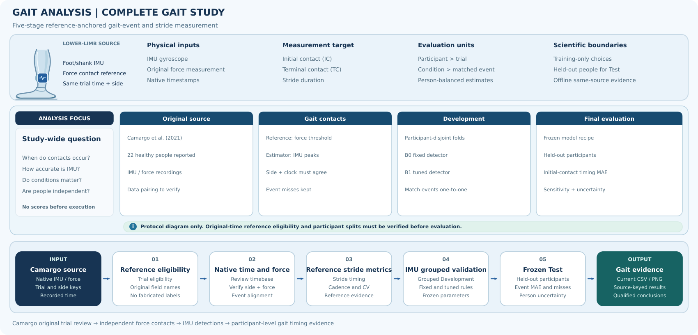

# Gait Analysis | Camargo Lower-Limb Biomechanics

*Figure 1. Proposed five-notebook analytical pipeline: source inspection, independently force-derived contact events, reference stride measures, participant-grouped IMU detectors and a reserved final Test. This is an implementation schematic, not recorded performance.*

This study implements a **reference-anchored, participant-independent gait-event measurement workflow** using [Camargo et al.'s wearable and laboratory biomechanics dataset](https://www.epic.gatech.edu/opensource-biomechanics-camargo-et-al/). Its objective is to estimate initial-contact timing from foot/shank inertial signals, compare it with independent ground-force contact evidence, and assess variation across observed walking conditions.

**Study status (November 2026):** Notebook 01's latest committed execution and **seven published source-audit files** cover **AB06–AB14: nine participants, 27 paired treadmill IMU/force trials and 135 original MAT files**. These comprise 27 IMU, 27 force, 27 `gcRight`, 27 `gcLeft` and 27 `conditions` files. All 27 IMU/force pairs were readable with overlapping native timestamps; the 81 auxiliary files were recorded as available. Notebook 01 source preparation is complete for this selected pilot. Notebook 02 has executed and published 19 source/QC outputs for all 27 selected trials, including 81 auxiliary-file checks, 54 trial/side quality records and 27 original `gcRight` inspections; force-contact references remain independently unverified. Physical force-axis interpretation, independent contact references, the eligible cohort and final Test metrics still require subsequent investigation. No event-detection performance is claimed.

## 1. Dataset and Experimental Protocol

| Feature | Study definition |
| --- | --- |
| Original dataset | [Camargo et al. (2021)](https://doi.org/10.1016/j.jbiomech.2021.110320), 22 healthy participants in the released research dataset |
| Data access | [Georgia Tech/EPIC](https://www.epic.gatech.edu/opensource-biomechanics-camargo-et-al/) · [Mendeley Part 1 v2](https://doi.org/10.17632/fcgm3chfff.2) (CC BY 4.0) |
| IMU inputs | Candidate foot/shank gyroscope channels, to be confirmed against original source headers and units |
| Independent reference | Ground-force-derived contact events with verified vertical-force sign, foot side, native time correspondence and contact threshold |
| Candidate conditions | Initially treadmill, with separate treatment for ground/ramp/stair experiments if source pairing supports them |
| Research unit | Participant → condition → original trial → independent force contact → detected event |
| Primary endpoint | Mean per-participant **Initial Contact absolute timing error (ms)**, for correctly matched events, alongside coverage |
| Essential secondary metrics | Event sensitivity, precision, missed/extra events, Terminal Contact when supported, stride-time error and cadence/variability |
| Independence | Participant-disjoint Development folds and held-out Test participants, assigned only after original eligibility is known |

The original release reports roughly 200-Hz inertial and 1,000-Hz force sensing; recorded timestamps and verified units take precedence over those descriptive rates. The right/left foot mapping of each vertical-force channel must be checked. A phase-normalised gait-cycle curve alone is **not** a native-time reference for millisecond-level event accuracy.

## 2. Experimental Programme

| Stage | Notebook | Actual programmed purpose |
| --- | --- | --- |
| 01 | [Source and Reference Eligibility](code/notebooks/01_source_and_reference_eligibility.ipynb) | Inventory extracted ABxx archives and original files; inspect paired IMU/force candidate paths, field names and timestamps |
| 02 | [Alignment and Event Reference](code/notebooks/02_alignment_and_event_reference.ipynb) | Use a **reviewed** sensor/side/time contract; construct force-contact events, reusable trial arrays and participant roles |
| 03 | [Stride Measurement and Statistics](code/notebooks/03_stride_measurement_and_statistics.ipynb) | Extract force-reference stride intervals, cadence and variability using Development people only |
| 04 | [IMU Baselines and Grouped Validation](code/notebooks/04_imu_event_baselines_and_grouped_validation.ipynb) | Compare fixed and Training-tuned IMU peak detectors in participant-disjoint Development folds; freeze configuration |
| 05 | [Frozen Test and Research Synthesis](code/notebooks/05_frozen_test_and_research_synthesis.ipynb) | Apply the chosen Development configuration to reserved people; report event coverage, timing error and descriptive paired uncertainty |

Individual workflow diagrams are in [`images/`](images/). They show method stages only; **no diagram contains synthetic performance figures**.

## 3. Main Results

**Notebook 01 source-audit results (executed, not a model evaluation):** The tracked [trial inventory](output/01_trial_inventory.csv), [auxiliary-source inventory](output/01_auxiliary_source_inventory.csv), [candidate pairs](output/01_candidate_pairs.csv), [observed columns](output/01_observed_columns.csv), [recorded signal preview](output/01_sensor_source_preview.png), [trial-level timebase audit](output/01_trial_timebase_audit.csv) and [eligibility summary](output/01_source_eligibility_summary.csv) establish:

| Source observation | Recorded pilot |
| --- | --- |
| Recorded participants and source pairs | AB06–AB14, 27 candidate treadmill IMU/force pairs (three per participant) |
| Recorded diagnostic preview pair | 1 of 27 source-matched trial pairs |
| Measurement fields, excluding `Header` | IMU: 24; treadmill force-platform: 18 |
| Median `Header` increments | IMU: 0.005; force platform: 0.001 (source-time units) |
| Source timebase audit | 27/27 pairs readable with positive native-time overlap; not an event-level synchronization validation |
| Independent force-contact labels and final Test metrics | Not yet generated |

The source pairing is **not yet a validated force-contact reference**. No eligible full-cohort count, force-contact performance or participant-level timing error has been established.

Stage 01 results are now saved and tracked; later stages will produce their own files when the required sources and scientific contracts have been verified:

| Evidence | Intended current output |
| --- | --- |
| Executed source inspection (nine participants, 27 pairs) | [`01_trial_inventory.csv`](output/01_trial_inventory.csv), [`01_auxiliary_source_inventory.csv`](output/01_auxiliary_source_inventory.csv), [`01_candidate_pairs.csv`](output/01_candidate_pairs.csv), [`01_observed_columns.csv`](output/01_observed_columns.csv), [`01_trial_timebase_audit.csv`](output/01_trial_timebase_audit.csv), [`01_source_eligibility_summary.csv`](output/01_source_eligibility_summary.csv) and [recorded signal figure](output/01_sensor_source_preview.png) |
| Executed source-contract and 27-pair component inspection (reference pending) | [`02_source_contract_review.csv`](output/02_source_contract_review.csv), [`02_source_contract_diagnostic.png`](output/02_source_contract_diagnostic.png), [`02_contract_evidence_by_trial.csv`](output/02_contract_evidence_by_trial.csv), [`02_force_component_evidence.csv`](output/02_force_component_evidence.csv), [`02_all_force_axes_source_probe.png`](output/02_all_force_axes_source_probe.png), [`02_force_channel_screening.csv`](output/02_force_channel_screening.csv) |
| Force-reference eligibility and original contact events | `02_eligible_trials.csv`, `02_reference_events.csv` |
| Reference-only Development stride measures | `03_reference_trial_metrics.csv`, `03_subject_condition_metrics.csv` |
| Independent Development comparator | `04_development_participant_metrics.csv`, `04_selected_configuration.csv` |
| Frozen Test outcome | `05_test_participant_metrics.csv`, `05_test_model_summary.csv` |

Any result tables will be interpreted alongside event matching support and source exclusions; an artificially low timing MAE obtained by predicting only a few events is not a successful detector.

## 4. Running and Reviewing the Study

**Import policy:** All Python imports in the five Gait notebooks are grouped exclusively in each Notebook's **01. Imports and Research Environment** code cell. The preliminary **00. Colab Repository Setup** cell uses the IPython shell for checkout and contains no Python imports. A dedicated offline test enforces this rule for future edits.

**Use Google Colab:** Open [Notebook 01](code/notebooks/01_source_and_reference_eligibility.ipynb), run **00. Colab Repository Setup** and **01. Imports and Research Environment**, then execute in order. The repository uses the established `setup_colab("gait_analysis")` helper.

The original recordings are **not distributed with this repository**. The original AB06 source pilot was expanded to the complete selected **AB06–AB14** subset. All refreshed `01_*.csv` files are now committed and match the latest executed source-audit notebook; original MAT files remain local and are not included in GitHub. The revised Colab Free acquisition workflow targets the **nine separately available AB06–AB14 participant archives** in [Mendeley Part 1, Version 1](https://data.mendeley.com/datasets/fcgm3chfff/1), not all 22 participants and not Part 1 Version 2's 9.38-GB combined archive. The selected nine-person acquisition is **completed: nine of nine source-paired people**, with three paired treadmill trials per person. This does not establish independent reference eligibility.

**Notebook 01, Section 02, owns original-source acquisition:** the default Colab workflow processes all missing participants AB06–AB14 sequentially in one cell execution (one subject ZIP at a time), keeping **the same three deterministically selected treadmill IMU/force pairs per person**. It also extracts exact matching original `gcRight`, `gcLeft` and `conditions` streams when present, and records actual auxiliary availability in `01_auxiliary_source_inventory.csv`. Only ZIPs downloaded during the current execution are removed. The full initial acquisition can still transfer roughly 9 GB and may need rerunning if interrupted; files already extracted in that active runtime are reused. The original MAT files remain in the temporary local Colab filesystem and are never committed to GitHub. **Run Notebook 01 and Notebook 02 in the same Colab runtime.**

Notebook 01 then inventories the actual source columns and displays a genuine paired trial. This pilot **does not establish a valid shared sensor clock, foot side, vertical-force sign or final cohort**. Notebook 01 installs the pinned `mat-io==1.0.2` dependency when needed, allowing its source adapter to read MATLAB table/MCOS objects as named tabular data rather than treating the object as a numeric matrix. SciPy remains the reader for simple numeric MATLAB structures. The original `Header` time column and channel names are preserved; actual sensor side, physical units and inter-device timing still need source-based review.

**Notebook 02 source-evidence extension (executed on the selected 27 original IMU/force pairs):** Section **02A** inspects all listed treadmill IMU/force pairs and records per-trial timing evidence and right/left force-component summaries as `02_contract_evidence_by_trial.csv` and `02_force_component_evidence.csv`. It also generates a representative three-panel `02_all_force_axes_source_probe.png` when the original files are mounted. Section **02B** requires independently documented gyroscope/force axes, physical side, loading sign, original timestamp units, force conversion to Newtons and common-clock evidence. The three executed source-audit outputs are not IC/TC events or evidence of a valid contact reference. The source paper additionally reports that wearable IMUs were placed unilaterally on the **right side**, and that original same-trial `Header` timestamps are in **seconds**. The modelling axis `foot_Gyro_Y` is fixed a priori as an observed candidate. These source-supported fields are distinct from the still-unconfirmed physical vertical force, force units/sign, R/L belt correspondence and event-level IMU–force clock accuracy.  The additional [`02_force_channel_screening.csv`](output/02_force_channel_screening.csv) summarises the existing force-component table across the inspected trials in original recorded units; it has been calculated from the published component evidence and is reproducible by rerunning 02A. Formal force-reference extraction, participant role assignment and verified alignment remain deferred until these facts are established. Sections 03–05 now also contain an explicitly separate exploratory route when only source-force candidates are available.

**Colab import recovery:** If an existing checkout has local notebook or output changes, the shared synchroniser may correctly defer a conflicting Git fast-forward. Notebook 02 Section 01 now recovers the *missing* `gait_contract_evidence.py` module from `origin/main` into a separate runtime directory without overwriting the checkout, original data or local outputs. This is **not** a full Git synchronisation. Review `git status --short` and preserve current work before explicitly reconciling the checkout. The committed seven-setting [`02_source_contract_review.csv`](output/02_source_contract_review.csv) now explicitly includes force-unit conversion to newtons. All scientific mappings remain unverified. Never treat either table as independent IC/TC validation.

**Notebook 02 Section 02A.1 (executed; individual results committed):** A new diagnostic reopens the selected original force MAT files, measures source-unit contact-onset and offset candidates for both treadmill sides, and compares 10/20/30 **recorded-unit** thresholds. The last committed notebook execution recorded 162 trial/side/threshold diagnostic rows, 1,806 original-unit contact candidates and no unreadable trial; it packaged `02_candidate_contact_trial_audit.csv`, `02_candidate_contact_intervals.csv` and `02_candidate_force_probe.png` in the Colab download ZIP. These three files and the four provisional Section 03–05 outputs are now stored in the GitHub output directory. These are **not** Newton-validated IC/TC reference labels and cannot serve as Notebook 03 inputs. They provide actual contact-timing and exclusion evidence for resolving the outstanding force-axis, side, units and inter-device clock questions. The existing 20-N formal reference threshold and other approved scientific settings remain unchanged.

**Notebook 02 candidate-evidence continuation (executed on original data):** When the physical reference contract is incomplete, Section 03 now summarises actual right-treadmill source-unit onset candidates in `02_provisional_contact_trial_summary.csv` and `02_provisional_contact_candidates.csv`. Section 04 describes participant-level source-candidate coverage in `02_provisional_participant_coverage.csv` without assigning Development/Test roles. Section 05 visualises the measured IMU trace and provisional force onsets in `02_provisional_imu_contact_overlay.png`. This mode produces useful evidence instead of repeating the same deferred message, but **does not create** `02_reference_events.csv`, `02_eligible_trials.csv`, reference numerical caches or model-ready labels. The existing validated workflow remains unchanged and is required before Notebook 03 can analyse trusted reference stride measurements.

**Notebook 02 is an analysis consumer, not a downloader:** Section 02 verifies that **all selected original IMU and force MAT recordings** exist in the same Colab runtime before replacing any scientific outputs. It also cross-checks `gcRight`, `gcLeft` and `conditions` file availability against the executed Notebook 01 trial registry and writes `02_auxiliary_source_crosscheck.csv` when run. This cross-check executed on the selected 27 original trials and confirmed 81 of 81 same-trial auxiliary files in the recorded Colab runtime; availability does not validate contact-reference provenance. If a fresh runtime lacks raw recordings, it stops with instructions to run Notebook 01; earlier CSV summaries do not substitute for original inputs. Sections 02A–02A.2 then analyse measured sources and the `gcRight` streams already prepared by Notebook 01. No extra participant ZIP download, cloud-drive mount, historical file fallback, forced force-unit conversion or automatic reference approval occurs in Notebook 02.

**Targeted reference-readiness follow-up (executed; descriptive outputs published):** A bilateral phase/force comparison has been [recomputed from the already committed phase-reset and candidate-onset tables](output/02_original_phase_both_sides_comparison.csv), using the same one-to-one 150-ms tolerance without fitting an offset. Across 27 trials, source-labelled right-force onsets yield 1,134/1,145 proximity matches with original right gait-phase wraps, whereas left-force onsets yield 0/661. This strongly favours the source-labelled right channel as the corresponding side; it **does not** verify Newton units, force polarity, independence of phase annotations or event-level IMU clock accuracy. The updated Notebook 02 Section 02A.2 now also implements `02_contact_filter_loss_review.csv` to inspect whether short force gaps discard candidate contacts; **that new audit requires one targeted execution with the original MAT files present**. Neither result creates formal reference events or participant roles.

**Notebook 02 Section 02A.2 (executed on original selected trial data; results published):** The same Notebook 02 now checks the source-level audit against its saved 20-unit contact intervals, reports per-trial right/left threshold sensitivity and low candidate yield, and plots a genuine 10/20/30-unit count comparison. It also checks for exact same-trial original `gcRight` phase data. Auxiliary sources are acquired by Notebook 01 for the selected trial identities, so Notebook 02 does not download or extract participant archives. This stage writes `02_candidate_quality_review.csv`, `02_candidate_threshold_sensitivity.png`, `02_original_gcright_source_audit.csv` and `02_original_gcright_phase_resets.csv` and `02_original_phase_force_comparison.csv` (one-to-one source-clock proximity without fitted time shifts). The executed source cross-check confirms all 81 auxiliary files in that runtime; 39 of 54 trial/side records were threshold-sensitive and 21 had low candidate yield. Original `gcRight` yielded 3,538 potential phase wraps, of which 1,134 were close to 1,145 provisional right-channel force onsets within 150 ms; 2,404 phase wraps were not matched. This is descriptive source-clock proximity, not IC sensitivity or independent force-reference validation. These remain diagnostic evidence, not verified force-contact references. The original source [README](https://data.mendeley.com/datasets/fcgm3chfff/1) identifies `gcRight` as a gait-cycle-segmented stream; phase resets cannot independently certify force orientation, native time synchronisation or Ground Truth.

**Recorded contact-filter loss:** The new [54-row source filter audit](output/02_contact_filter_loss_review.csv) identifies 15,805 complete above-threshold right-belt segments, of which 12,274 were rejected for short contacts and 2,386 for short unloaded intervals; 1,145 were retained. The corresponding left-belt counts were 35,349, 31,830, 2,858 and 661. These results demonstrate fragmentation and filtering, not that the rejected intervals are true steps. The newly implemented Section 02A.3 will test bounded internal-gap closure without selecting a final reference algorithm from these counts.

**Notebook 02 Section 02A.3 (implemented, original-data execution pending):** A separate source-only gap-stability analysis now assesses whether bridging bounded internal below-threshold intervals of 0, 10, 20, 40 and 60 ms changes the number of original-force contact candidates. The existing 20-source-unit threshold, 80-ms contact and 60-ms swing criteria are preserved. Both treadmill sides and all 27 selected original trial pairs are included; the unbridged results must exactly match the previously recorded Section 02A.1 audit. The stage will write `02_source_gap_stability_review.csv` and a raw-signal figure, `02_source_gap_stability_probe.png`, illustrating the heavily fragmented `AB06/treadmill_08_01` trial. **These outputs have not yet been produced by the new code**, and no gap setting is selected for reference generation. Original force units, sign, physical axis and independent event synchronisation still require verification before formal IC/TC labels or participant splits are created.

**Notebook 02 has an intentional source-contract boundary:** Section 02 has executed, saving `02_source_contract_review.csv` and a recorded two-panel `02_source_contract_diagnostic.png`. The Force signal is present, but its definitive physical mapping and event-reference contract are unresolved. With unresolved gyroscope/vertical-force mapping, sign, foot side, physical timestamp units or event-level timing, Formal reference labels, verified trial caches and Development/Test role assignments remain **deferred**. Sections 03–05 can now generate separately named provisional candidate summaries and an IMU overlay while those scientific prerequisites remain open. Similarly, Notebook 04 cannot run until Notebook 02 has established enough independent eligible people for grouped Development folds. These are scientific validity requirements, not approval/status-file gates.

**Research output download:** Every Notebook now ends with a **Research Summary and Output Download** cell. It packages only that notebook's saved `01_`–`05_` outputs as `/content/gait_analysis_Notebook_XX_Outputs.zip` (where `XX` is the notebook number). Retrieve the ZIP from **Colab Contents / Files**; packaging does not trigger GitHub commit/push or include raw Camargo archives. The Notebook 01 source plot displays observed `foot_Gyro_Y` / `shank_Gyro_Y` and `Treadmill_R_vy` / `Treadmill_L_vy` channels when present. The waveform figure is source evidence, **not** an independently validated vertical-force contact reference.

Notebooks 03–05 consume explicit current results from their producers. Original raw recordings remain local; the study's useful CSV tables/PNG charts are written under `gait_analysis/output/` and numeric per-trial caches under `data/processed/camargo/paired_trials/`. Execution overwrites each stage's named current outputs; a material source or protocol change requires affected downstream outputs to be recomputed.

Use the repository's existing [dependencies](../requirements.txt) and the [data access guide](../docs/DATASETS.md) for original-source instructions. The original-data **Notebook 01 AB06–AB14 inventory and 27-pair timebase audit have executed**, and all **seven** `01_` outputs are published, including the 81-file supplementary-source inventory. Notebook 02's recorded diagnostic and source-contract table have also executed, but no force-contact labels or participant roles are yet validated; the full source-to-Test experiment has **not** been validated. Under the existing 20% person-disjoint split, nine eligible subjects would give approximately seven Development and two Test people; this is an **exploratory within-dataset pilot**, with substantial Test uncertainty. Do not claim terrain transfer from the treadmill-only sample.

## 5. Files and Saved Outputs

| Location | Responsibility |
| --- | --- |
| [`code/notebooks/`](code/notebooks/) | Five numbered Colab/Jupyter scientific stages |
| [`code/src/`](code/src/) | Source inventory, timebase/force pairing, reference events, detectors and metrics |
| [`images/study_overview.svg`](images/study_overview.svg) | Study-wide editable five-band method diagram |
| [`images/`](images/) | Five additional stage-specific editable SVGs |
| [`output/`](output/) | Seven recorded Notebook 01 source-audit files and 21 published Notebook 02 exploratory source/QC outputs; validated IC/TC events, eligible trials and participant roles remain unavailable |
| `../data/raw/camargo/` | Original participant files (local or mounted; not tracked) |
| `../data/processed/camargo/` | Reusable numeric paired-trial arrays (local or mounted) |
| [Scientific methods document](GAIT_RESEARCH_METHODS_AND_EVIDENCE.md) | Full scientific design, model interfaces, evaluation and limits |

No Excel stage tracker, administrative approval document or mandatory history/manifest file is part of this study.

## 6. Interpretation and Scope

The programmed research question is **how accurately a simple, source-aligned IMU detector can estimate force-referenced initial contacts for unseen participants**. Measurement must use the same trial, genuine physical time and a validated foot/force assignment. The principal result will be a participant-balanced timing error **together with missed/extra event counts and event sensitivity**.

The analysed population comes from healthy volunteers. This workflow does **not** establish clinical gait validity, fall-risk prediction, pathological gait detection, online inference or deployment. The filtering in the initial detectors is zero-phase and therefore **offline**. Generalisation across terrains is not claimed unless actual eligible source trials support comparisons.

If independent original-time references cannot be constructed, the appropriate next step is to revisit the research question **before** interpreting IMU predictions as contact-timing accuracy. Read [Research Methods and Evidence](GAIT_RESEARCH_METHODS_AND_EVIDENCE.md) for the complete scientific contract and pending original-data validation.

**Source attribution:** Camargo, J., Ramanathan, A., Flanagan, W. and Young, A. (2021), *Journal of Biomechanics*, 119, 110320, [DOI](https://doi.org/10.1016/j.jbiomech.2021.110320); [dataset Part 1 v2](https://doi.org/10.17632/fcgm3chfff.2).
