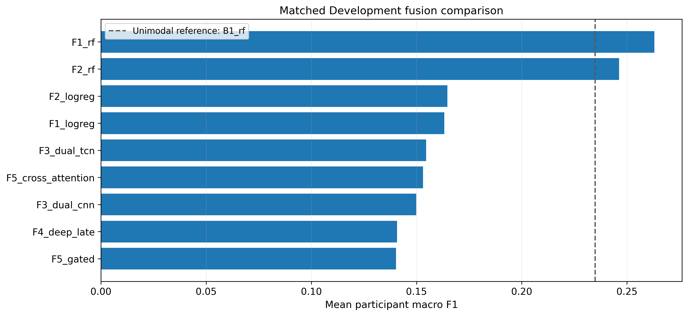
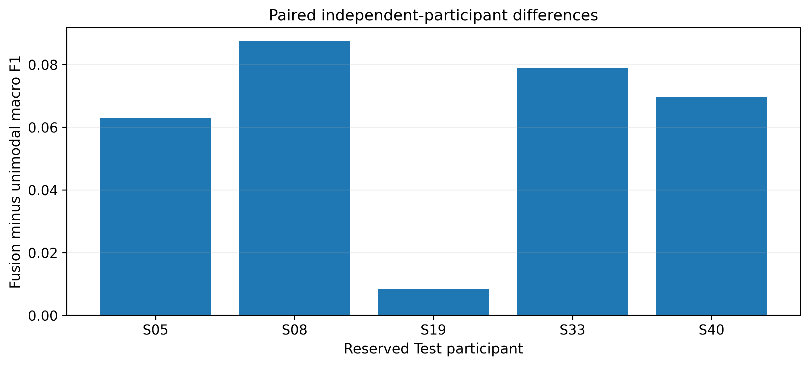
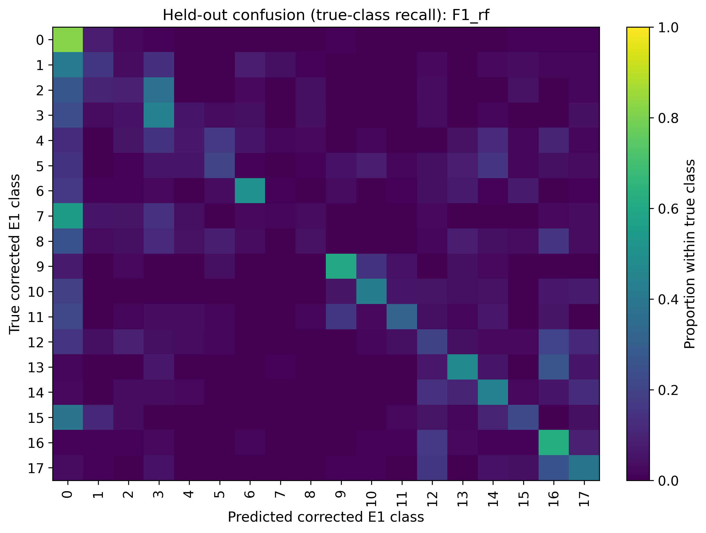

# Multimodal Movement Learning | NinaPro DB2: Research Methods and Evidence

**Study:** Multimodal Movement Learning, Human Movement Intelligence. **Maintained implementation:** [Notebooks 01–05](code/notebooks/). This document records the original-source cohort, data representations, experimental protocol, implemented model configurations, Development comparisons, frozen Test evaluation, robustness analyses and scientific interpretation. For the concise overview, study figures and practical execution guide, see the [study README](README.md) and [Running and Reviewing the Study](README.md#4-running-and-reviewing-the-study).

**Evidence status:** The five notebook stages contain recorded original-source, Development and held-out Test outputs. All numerical findings below refer to the stated NinaPro DB2 Exercise E1 cohort and saved result files; this is an **offline, within-source participant-disjoint evaluation**, not external or prospective validation.

## 1. Research Objective and Scope

The primary research question is whether adding **paired triaxial acceleration** to **surface electromyography (sEMG)** improves recognition of corrected finger-movement classes for previously unseen people, compared with the stronger Development-selected unimodal model. Both modalities originate from the same released source intervals and must be compared under a common window, participant and class definition.

The implemented study evaluates three related questions:

1. **Unimodal evidence:** How do classical statistical-feature models and temporal 1D-CNN, TCN and BiGRU networks compare for sEMG alone and acceleration alone?
2. **Complementary information:** Does early, late or learned multimodal fusion improve **participant-mean fixed-class macro F1** over the stronger unimodal Development comparator?
3. **Consistency and robustness:** Does the observed effect vary by participant, corrected movement class, neural seed or synthetic acceleration perturbation?

Five notebooks form a single experimental sequence: source inspection (01), paired-window cohort and fixed partitions (02), unimodal Development models (03), fusion Development models and frozen selection (04), and final refitting and evaluation on five reserved Test people (05). [Model selection](output/04_model_selection.csv) precedes the last comparison; Test outcomes do not replace the selected model pair.

The intended contribution is a **controlled, source-aligned comparison and reproducible research workflow**, not a claim of a new neural architecture, a prosthetic controller, a clinical system or a physiological causal mechanism. Reduced-sensor and other exercise analyses are not reported as completed experiments.

## 2. Data Sources, Cohort and Target Definitions

### 2.1 Original source and acquisition context

The data are from [NinaPro Database 2 (DB2)](https://ninapro.hevs.ch/instructions/DB2.html) and its [original Dryad deposition](https://doi.org/10.5061/dryad.1k84r), described by Atzori et al. (2014), ‘[Electromyography data for non-invasive naturally-controlled robotic hand prostheses](https://doi.org/10.1038/sdata.2014.53)’, *Scientific Data*, 1, 140053. DB2 comprises recordings from **40 intact participants** across several prompted movement exercises. This study processes only **Exercise 1 (E1)**, the basic non-force finger-movement task.

The original sensor system includes **12 sEMG channels** and **12 triaxial accelerometers (36 acceleration columns)**. sEMG was acquired at approximately **2,000 Hz** and acceleration at approximately **148 Hz**; the released arrays were synchronised onto a common **2,000-Hz stored sample-row grid**. The common row grid is essential to paired-window extraction but does **not** mean that the acceleration channels contain 2,000 independent native measurements per second.

The released MATLAB fields distinguish original displayed-cue annotations (`stimulus`, `repetition`) from retrospectively corrected `restimulus` and `rerepetition`. Corrections used information derived from sEMG. The implemented supervised target is **`restimulus`**, not an assumed ground-truth motor-onset marker independent of both sensing modalities. The original corrected repetition identifier is retained for segment provenance.

### 2.2 Observed source coverage and modelling cohort

[Notebook 01](code/notebooks/01_ninapro_pairing_and_label_audit.ipynb) examined the original S01 archive: E1 contained **1,808,331** matched released rows, with shapes **(1,808,331, 12)** for sEMG and **(1,808,331, 36)** for acceleration. Its 18 corrected labels and repeated movements produced **205** source-derived contiguous label/repetition segments. Both inspected sensor arrays had complete finite-value coverage for that participant. The observed corrected repetition values were 0–6, consistent with six non-Rest movement repetitions; the source website's broader repetition descriptions are not used to relabel data.

[Notebook 02](code/notebooks/02_signal_processing_and_aligned_windows.ipynb) then processed all 40 original E1 participant recordings. Its current source and selection accounting is:

| Analytical level | Observed count | Meaning |
| --- | ---: | --- |
| Source participants inspected | **40** | Original DB2 E1 participants |
| Eligible paired E1 windows | **337,853** | Source-derived, label-pure, finite paired intervals before the selection cap |
| Retained modelling windows | **40,000** | 1,000 windows per participant, selected independently of model scores |
| Development | **35 people / 35,000 windows** | Candidate comparison and model selection |
| Reserved Test | **5 people / 5,000 windows** | Frozen-model comparison only |
| Development outer folds | **5 × 7 people** | Person-disjoint out-of-fold assessment |

The reserved Test identities are **S05, S08, S19, S33 and S40**. Participant allocations are saved in [`02_participant_split_assignments.csv`](output/02_participant_split_assignments.csv), with outer folds in [`02_development_fold_assignments.csv`](output/02_development_fold_assignments.csv). The [selected window index](output/02_window_index.csv) preserves each original source-window key and row order.

### 2.3 Inputs, target and unit hierarchy

The target consists of the **18 original corrected E1 codes (0–17)**: Rest (0) and 17 finger-movement classes. It is a **window-level classification**, with the participant as the independent evaluation unit. Source samples, overlapping windows and repeated movements are nested observations, not extra independent people.

Only the measured **sEMG and acceleration** channels enter predictive models. `subject_id`, corrected label, `repetition_id`, `segment_id`, window indices, file references and timestamps are used for provenance, eligibility, folds or evaluation. The released `glove`, `force` and cue fields, along with participant demographics, are **not predictors**. The audited [class dictionary](output/01_label_dictionary.csv) fixes class codes; source eligibility is not modified after observing Test scores.

## 3. Data Preparation and Representations

### 3.1 Source pairing, segment eligibility and temporal windows

The [NinaPro source adapter](code/src/ninapro_source.py) reads the original subject archive and matched E1 MATLAB fields; the [dataset module](code/src/ninapro_dataset.py) constructs source-keyed windows and feature arrays. The pipeline preserves the distributed temporal representation rather than independently upsampling acceleration again.

A candidate window has **300 ms / 600 released sample rows**, with starts advanced by **100 ms / 200 rows** inside a contiguous corrected-label/repetition segment. Windows must contain finite sEMG and acceleration observations and cannot cross a corrected-class transition, repetition boundary, participant boundary or exercise boundary. Both modalities share the exact half-open source interval `[start_sample, end_sample)` and a unique `window_key`.

Eligible windows are ordered within each person. A fixed, **label-blind 1,000-window-per-participant cap** selects approximately time-uniform positions in that eligible order; it does not oversample favourable labels or apply a model-dependent class balancing procedure. Original class imbalance is therefore retained in the selected cohort.

### 3.2 Statistical and temporal model inputs

Two paired, float32 statistical feature matrices were created from the same 40,000 window keys:

| Modality | Implemented window statistics | Matrix |
| --- | --- | --- |
| sEMG (12 channels) | Per-channel root mean square, mean absolute value, waveform length normalised by sample differences, and log variance | **40,000 × 48** |
| Acceleration (36 columns) | Per-axis mean and standard deviation (72 values), plus mean and SD of each of 12 triaxial sensor magnitudes (24 values) | **40,000 × 96** |
| Classical early fusion | Concatenation of paired sEMG and acceleration statistics from the same `window_key` | **40,000 × 144** |

Temporal models consume the **original 600-row paired windows**, with 12 sEMG or 36 acceleration channels (both modalities for learned fusion). The [training interface](code/src/ninapro_training.py) performs required channel-layout conversion and Training-derived channel normalisation. Memory-eligible windows may be staged on a GPU for efficiency; that engineering choice does not change the participant groups or scientific inputs.

Numerical arrays are aligned to `window_row` in the [canonical window index](output/02_window_index.csv). Class labels and participant identifiers are not concatenated as numerical predictors. Logistic Regression uses a **Training-fold-fitted StandardScaler**; Random Forest does not require a fitted scaler. Neural channel statistics and inner-Training stopping decisions are obtained without outer Validation or reserved Test labels.

## 4. Experimental Design and Evaluation

### 4.1 Fixed participant roles and Development selection

Notebook 02 used deterministic seed **42** for participant-level Development/Test allocation and a separate seeded permutation for the five Development folds. Each person's full set of windows stays within one assigned role, and the five outer folds each evaluate **seven unseen Development participants** against a fitting group of 28 Development participants.

Notebooks 03 and 04 use the same original source-window identities, 18-class label order, 35 Development people and fixed outer folds. Candidate rankings use the **mean of the 35 individual out-of-fold participant macro-F1 scores**; they are not rankings by pooled-window accuracy. Models are selected in Development, before the final comparison. The [selection file](output/04_model_selection.csv) freezes `B1_rf` (unimodal) and `F1_rf` (fusion).

Notebook 05 refits these **unchanged classical recipes** on all **35 Development participants** and applies them once to the **five reserved Test participants**. Test labels are used for scoring, not for preprocessing fitting, hyperparameter changes, fusion-weight selection or a retrospective change of the comparator.

### 4.2 Metrics and aggregation

For a given participant, fixed-class macro F1 is the arithmetic mean of F1 over all **18 corrected E1 classes**, with zero-division cases mapped to zero. The primary result is the **equal-participant mean** of these 18-class macro-F1 scores. Fixed-class balanced accuracy similarly averages the 18 source-class recalls, assigning zero to classes without true support. These definitions deliberately differ from metrics that average only over observed classes.

Secondary evidence includes accuracy, per-participant scores, pooled-window per-class precision/recall/F1 and support, paired participant differences, count-based and **true-class-row-normalised** confusion matrices, and fit/inference cost. The per-class pooled metrics use individual windows as the calculation denominator; they must not be substituted for the participant-mean selection endpoint.

The final comparison uses **`F1_rf − B1_rf` macro F1 for each of the same five Test people**. Descriptive uncertainty is a **2,000-draw paired whole-participant bootstrap** over those five differences (seed 42; 2.5th and 97.5th percentiles). Overlapping Test windows are never treated as independent bootstrap units. This interval is conditional on the fitted models and evaluated participants.

## 5. Methods, Models and Configurations

### 5.1 Implemented classical and unimodal candidates

[Notebook 03](code/notebooks/03_unimodal_grouped_baselines.ipynb) compares **11 candidates**: one Training-prior control, four classical modality-specific classifiers and six temporal neural classifiers.

| Arm or models | Input and implemented configuration | Evaluation role |
| --- | --- | --- |
| `B0_prior` | Training-derived class-prior classifier; no sensor input | No-signal reference |
| `B1_logreg` / `B2_logreg` | sEMG or acceleration statistics; StandardScaler plus class-balanced Logistic Regression (`C=1.0`, `max_iter=2000`) | Classical unimodal comparison |
| `B1_rf` / `B2_rf` | Same modality-specific feature matrices; 120-tree Random Forest, `min_samples_leaf=2`, `max_features="sqrt"`, `class_weight="balanced_subsample"` | Classical unimodal comparison |
| `D1_emg_cnn` / `D1_acc_cnn` | Source-aligned single-modality windows; compact temporal 1D-CNN | Neural baseline |
| `D2_emg_tcn` / `D2_acc_tcn` | Single-modality windows; dilated/residual temporal convolution | Temporal alternative |
| `D3_emg_bigru` / `D3_acc_bigru` | Single-modality windows; bidirectional GRU-based encoder | Recurrent alternative |

### 5.2 Implemented fusion candidates and neural protocol

[Notebook 04](code/notebooks/04_fusion_and_modality_ablations.ipynb) compares **nine fusion arms** on matched Development participants and classes:

| Model family | Implemented fusion operation | Models |
| --- | --- | --- |
| Early classical fusion | Concatenate 48 sEMG and 96 acceleration statistics, fit a matched classifier | `F1_logreg`, `F1_rf` |
| Classical late fusion | Fixed equal-weight (0.5/0.5) average of matched, class-aligned unimodal OOF probabilities | `F2_logreg`, `F2_rf` |
| Neural late fusion | Fixed equal-weight average of independently fitted Development-selected unimodal neural outputs | `F4_deep_late` |
| Learned embedding fusion | Separate sEMG/acceleration encoders with concatenated representations and shared classifier | `F3_dual_cnn`, `F3_dual_tcn` |
| Learned gated and attention fusion | Paired temporal branches with a gate or compact two-head cross-attention | `F5_gated`, `F5_cross_attention` |

The temporal models were trained on **five person-disjoint Development folds** using primary seed **42**, maximum **10 epochs**, patience **3**, batch size **96**, **AdamW** (`learning_rate=1e-3`, `weight_decay=1e-3`), Training-derived class-weighted cross-entropy and gradient clipping at norm **1.0**. Checkpoint selection uses an inner holdout of Training people, not outer Validation/Test labels. [`ninapro_models.py`](code/src/ninapro_models.py) defines the networks; [`ninapro_training.py`](code/src/ninapro_training.py) implements training and prediction.

The final Test did **not** retrain a neural finalist: the frozen winners were the **classical** `B1_rf` and `F1_rf`. Notebook 05 refitted their original 120-tree configurations on 35 Development people using seed 42. The sEMG comparator receives **48 features**; the fused model receives **144 features**. Neither fit introduces a Test-derived transformation or altered hyperparameter. The [classical constructor](code/src/ninapro_evaluation.py) is the maintained configuration reference.

### 5.3 Sensor sensitivity and implementation boundaries

Notebook 04 tested **three synthetic acceleration mean-replacement conditions** on the fitted `F3_dual_cnn` and `F5_cross_attention` methods: replacing all acceleration columns, replacing one triaxial accelerometer group, or replacing a contiguous acceleration interval. These are **inference-time interventions**, not training for missing-sensor conditions or observations of physical device failures. Their scope is limited to those two neural arms and the tested synthetic changes.

Shared repository utilities provide Colab setup, device selection and plotting. NinaPro-specific data ingestion, source-window pairing, fitting and evaluation remain in [`code/src/`](code/src/), separate from other studies' datasets, model settings and reported results.

## 6. Results and Comparative Analysis

### 6.1 Source and Development unimodal findings

The original-source review established common stored-row pairing for E1; Notebook 02 retained **40,000 of 337,853 eligible windows** across 40 people. The final 35-person Development subset comprised **35,000 windows** and five seven-person outer folds.

[Notebook 03's current results](output/03_all_unimodal_metrics.csv) report the following **equal-participant mean fixed-18-class Development macro F1**:

| Model family | sEMG | Acceleration |
| --- | ---: | ---: |
| Logistic Regression | 0.208411 | 0.103442 |
| Random Forest | **0.234836** | **0.128978** |
| 1D-CNN | 0.218176 | 0.067476 |
| TCN | 0.212824 | 0.070928 |
| BiGRU | 0.187360 | 0.065538 |

The `B0_prior` reference scored **0.034971**. `B1_rf` was the highest-scoring unimodal Development model, while `D1_emg_cnn` (0.218176) was the strongest sEMG neural alternative. These observations are based on the same Development protocol; they do not imply that acceleration lacks physiological value outside the tested representations or that Random Forest is universally preferable.

### 6.2 Matched Development fusion findings and frozen selection

[Notebook 04's fusion scores](output/04_all_fusion_metrics.csv) were measured on the same **35 Development people**, using the same participant-mean endpoint.

| Fusion candidate | Development participant-mean macro F1 |
| --- | ---: |
| **`F1_rf` — early Random Forest** | **0.263012** |
| `F2_rf` — fixed late Random Forest | 0.246213 |
| `F2_logreg` — fixed late Logistic Regression | 0.164609 |
| `F1_logreg` — early Logistic Regression | 0.163162 |
| `F3_dual_tcn` | 0.154582 |
| `F5_cross_attention` | 0.153039 |
| `F3_dual_cnn` | 0.149861 |
| `F4_deep_late` | 0.140728 |
| `F5_gated` | 0.140232 |

The Development comparison favoured `F1_rf` over the fixed `B1_rf` unimodal reference (**0.234836**) by **+0.028176** macro-F1 units. Its [paired participant comparison](output/04_oof_paired_differences.csv) was positive for **25 people** and negative for **10**. The selection was recorded in [`04_model_selection.csv`](output/04_model_selection.csv) before the frozen Test.

*Figure 1. Participant-mean Development fusion scores; the dashed line marks the selected sEMG-only reference. The comparison does not contain Test outcomes.*

### 6.3 Frozen five-person Test findings

[Notebook 05](code/notebooks/05_frozen_person_independent_test.ipynb) refitted both selected Random Forests using all 35 Development people and scored **identical windows** from the five reserved Test participants. The [source-keyed Test prediction table](output/05_test_predictions.csv) records 10,000 model/window prediction rows: 5,000 distinct windows evaluated by each of two models.

| Test participant | `B1_rf` macro F1 | `F1_rf` macro F1 | Fusion minus unimodal |
| --- | ---: | ---: | ---: |
| S05 | 0.284875 | 0.347756 | +0.062881 |
| S08 | 0.201423 | 0.288869 | +0.087445 |
| S19 | 0.257163 | 0.265490 | +0.008327 |
| S33 | 0.266220 | 0.345043 | +0.078822 |
| S40 | 0.246208 | 0.315845 | +0.069637 |
| **Equal-participant mean** | **0.251178** | **0.312600** | **+0.061423** |

Mean fixed-class balanced accuracy was **0.287890** for `B1_rf` and **0.350991** for `F1_rf`. The overall observation is a higher **participant-mean Test macro F1** for early fusion, but the benefit was smaller for S19 and only **five independent Test people** contribute to the paired estimate.

*Figure 2. Each bar is one held-out person's `F1_rf − B1_rf` macro-F1 difference. The 5,000 windows do not constitute 5,000 independent participants.*

### 6.4 Class-level errors and uneven movement recognition

[Per-class Test precision, recall, F1 and support](output/05_per_class_support.csv) demonstrate that aggregate improvement does not mean reliable recognition of every corrected movement:

| Class under `F1_rf` | True Test windows | Pooled recall | Pooled F1 |
| --- | ---: | ---: | ---: |
| Rest (0) | **2,691** | **0.819398** | 0.817121 |
| Movement 7 | 175 | 0.017143 | **0.028986** |
| Movement 8 | 131 | 0.045802 | **0.069364** |

Rest represented **53.8%** of Test windows compared with **46.7%** in Development. Consequently, pooled-window accuracy is affected by the differing class mix and is not interchangeable with the primary participant-mean, fixed-class macro F1. The [count confusion matrix](output/05_confusion_matrix.png) and [true-class-normalised version](output/05_confusion_matrix_normalised.png) show complementary views of these errors.

*Figure 3. Rows are normalised by their true-class support. The uneven diagonal indicates limited recognition of some movement classes despite the positive aggregate paired result.*

## 7. Robustness, Uncertainty and Additional Analyses

### 7.1 Additional neural seeds and synthetic acceleration perturbations

The principal Development neural results use seed **42**. The selected sEMG and acceleration neural finalists in Notebook 03 were repeated with seeds **43 and 44**, maintaining the same participant folds. The selected neural fusion finalist `F3_dual_tcn` was similarly repeated in Notebook 04:

| Neural finalist | Seed 42 | Seed 43 | Seed 44 | Context |
| --- | ---: | ---: | ---: | --- |
| `D1_emg_cnn` | 0.218176 | 0.213478 | 0.216074 | Development sEMG finalist |
| `D2_acc_tcn` | 0.070928 | 0.070353 | 0.074801 | Development acceleration finalist |
| `F3_dual_tcn` | 0.154582 | 0.119353 | 0.124863 | Development fusion finalist |

These are **additional fittings on the same Development participants**, not independent participant replications. The original seed-42 selection was not retroactively replaced. Source evidence: [unimodal seed metrics](output/03_neural_multiseed_metrics.csv), [fusion seed metrics](output/04_F3_dual_tcn_extra_seed_metrics.csv).

The [synthetic acceleration perturbation results](output/04_fusion_robustness.csv) examine all-channel, single-sensor and contiguous-interval mean replacement in two fitted neural fusion models. Their results are descriptive stress tests of those fitted models and **not** a demonstration of actual sensor failures or trained missing-modality tolerance. Reduced-sensor retraining, external sensors and online disturbance experiments were not performed.

### 7.2 Five-person Test uncertainty and measured computation

The [paired Test summary](output/05_test_summary.csv) reports an observed equal-participant mean difference (`F1_rf − B1_rf`) of **+0.061423**, with **2,000 whole-person bootstrap draws** and descriptive 2.5th–97.5th percentile limits **0.033337–0.080434**. All five observed differences were positive, although the smallest was only **+0.008327**. With five independent people, the interval is a limited descriptive characterisation of this sample and does not establish population-wide superiority.

The [recorded Test model costs](output/05_model_costs.csv) were:

| Recorded resource | `B1_rf` | `F1_rf` |
| --- | ---: | ---: |
| Development-only refit time | 42.1 s | 78.1 s |
| Serialised model size | 307.8 MB | 260.8 MB |
| Small-sample CPU inference | 0.579 ms/window | 0.551 ms/window |

The CPU timing used a **64-window sample**, warm-up calls and repeated `predict_proba` operations. These are environment-specific, limited measurements; the small observed latency difference should not be interpreted as a robust deployment speed ranking. Size denotes serialised fitted estimator bytes, not neural parameter count, and no streaming system was benchmarked.

## 8. Current Outputs and Reproducibility

### 8.1 Current public numerical evidence

The stage-prefixed output files provide sufficient original evidence to inspect the reported comparisons. They are written by the corresponding notebook and replaced by that stage on a rerun.

| Evidence | Current file | Producing stage and scientific use |
| --- | --- | --- |
| Corrected E1 classes | [`01_label_dictionary.csv`](output/01_label_dictionary.csv) | 01; fixed source target definition |
| Source-keyed selected cohort | [`02_window_index.csv`](output/02_window_index.csv) | 02; paired source intervals, labels and row order |
| Person roles and folds | [Split](output/02_participant_split_assignments.csv) · [folds](output/02_development_fold_assignments.csv) | 02; fixed Development/Test boundary |
| Unimodal Development metrics | [`03_all_unimodal_metrics.csv`](output/03_all_unimodal_metrics.csv) | 03; 11-arm participant comparisons |
| Source-aligned OOF probabilities | [`03_oof_probabilities.npz`](output/03_oof_probabilities.npz) | 03; genuine soft inputs for late fusion |
| Fusion Development metrics | [`04_all_fusion_metrics.csv`](output/04_all_fusion_metrics.csv) | 04; nine-arm participant comparisons |
| Frozen Development decisions | [`04_model_selection.csv`](output/04_model_selection.csv) | 04; selected `B1_rf` and `F1_rf` |
| Final Test predictions | [`05_test_predictions.csv`](output/05_test_predictions.csv) | 05; aligned labels, predictions and 18 class probabilities for both models |
| Participant scores and paired uncertainty | [`05_test_metrics.csv`](output/05_test_metrics.csv) · [`05_test_summary.csv`](output/05_test_summary.csv) | 05; main endpoint and participant-level bootstrap |
| Class-wise errors and costs | [Per-class scores](output/05_per_class_support.csv) · [costs](output/05_model_costs.csv) | 05; secondary diagnostic and compute measurements |

The [five research notebooks](code/notebooks/) preserve their recorded outputs and the [stage-specific SVGs](images/) illustrate the implemented workflows. The numeric plots in [`output/`](output/) are computed figures rather than decorative or simulated measurement traces.

### 8.2 Source access, environment and regeneration

For a new source-based run, use the [official NinaPro DB2 files](https://ninapro.hevs.ch/instructions/DB2.html) and the [repository requirements](../requirements.txt), then follow the [notebook execution order](README.md#4-running-and-reviewing-the-study). Notebook 01 inspects source pairing; Notebook 02 produces source-window identities, feature matrices and participant assignments; Notebooks 03–04 perform the Development comparison; Notebook 05 consumes the frozen choice.

The two compact Notebook 02 statistical arrays, `02_emg_features.npy` and `02_acc_features.npy`, are available at [`data/processed/ninapro_db2/`](../data/processed/ninapro_db2/) for the current classical Test. A complete neural re-execution also requires the original per-person time-series arrays, which the source-aware loader reconstructs as needed. Readers **do not need to retrieve the entire original source corpus merely to inspect the saved result tables**.

Implementation and methodological roles are split across [`ninapro_source.py`](code/src/ninapro_source.py), [`ninapro_dataset.py`](code/src/ninapro_dataset.py), [`ninapro_experiments.py`](code/src/ninapro_experiments.py), [`ninapro_fusion_experiments.py`](code/src/ninapro_fusion_experiments.py), [`ninapro_models.py`](code/src/ninapro_models.py), [`ninapro_training.py`](code/src/ninapro_training.py) and [`ninapro_evaluation.py`](code/src/ninapro_evaluation.py). The offline [NinaPro contract tests](../tests/test_ninapro_fusion_contracts.py) check important alignment, source-key and saved-score properties; synthetic and static tests are not substitutes for independent reproduction of every original model fit.

Rerunning a notebook writes its own current stage outputs. A change in source cohort, feature construction, participant assignment, class definition or frozen selection requires compatible downstream stages to be regenerated; existing stored Test outcomes must not be mixed with a different scientific protocol.

## 9. Discussion, Limitations and Future Work

The central comparison was answered for the defined NinaPro DB2 E1 experiment: **adding paired acceleration features in an early-fusion Random Forest increased the observed participant-mean fixed-class macro F1 relative to the Development-selected sEMG-only Random Forest** on the reserved Test cohort. The Development result and final Test result are separate measurements; neither provides grounds to retune the frozen model pair after inspecting Test.

The main limitation is **only five independent held-out Test participants**, selected before model selection from the 40-person source cohort. They contribute 5,000 windows but only five independent person-level observations, restricting the precision and wider generalisability of the measured benefit. Recognition quality also varies sharply by movement class and Rest is frequent. The approximately 148-Hz native accelerometer stream is represented on a 2,000-Hz released row grid, and movement-boundary corrections were informed by sEMG; these source properties matter to any modality-specific interpretation.

The study is limited to **offline, prompted, non-force E1 movements from one collection of intact volunteers**. It does not report external-device or site validation, real-time prosthetic control, clinical benefit, amputee or stroke performance, or naturally occurring sensor failures. Broader evaluation would require more independent participants and a separately defined external/online protocol. Other exercise sets or sensor-reduction experiments would be **new studies**, not retroactive additions to these Test results.

**Original-source references:** [NinaPro DB2](https://ninapro.hevs.ch/instructions/DB2.html); [Atzori et al. (2014)](https://doi.org/10.1038/sdata.2014.53); [Dryad data deposition](https://doi.org/10.5061/dryad.1k84r). Related fusion literature noted in the earlier design includes [Hu et al. (2024)](https://doi.org/10.3390/s24092702) and [Zhang et al. (2023)](https://doi.org/10.1109/JSEN.2023.3266872); their separate designs and metrics are **not** pooled into this study's findings.
