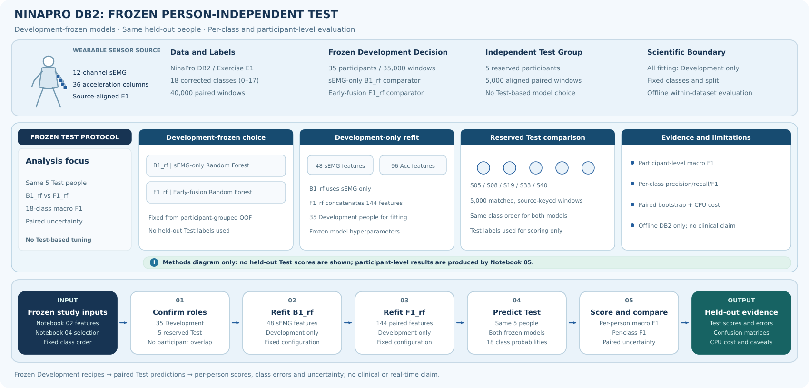
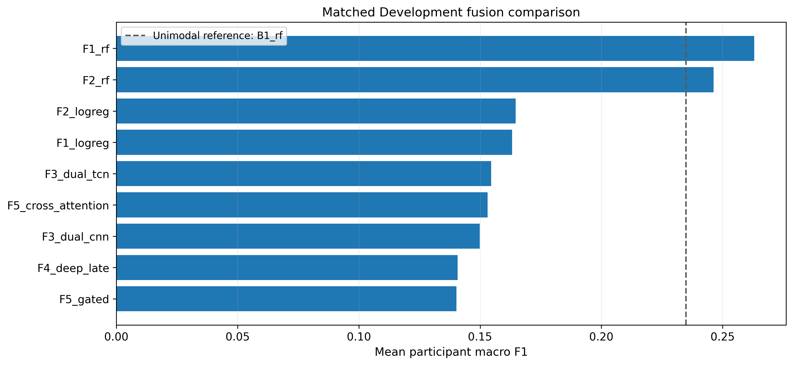
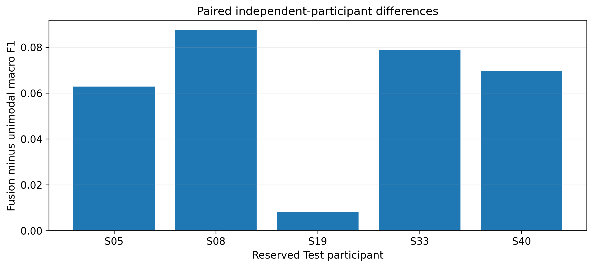

# Multimodal Movement Learning | NinaPro DB2



*Figure 1. The frozen final-evaluation workflow. The diagram is a methodological schematic; numerical scores are documented in the saved Test tables and figures.*

This completed five-notebook study examines whether **paired accelerometer measurements improve surface electromyography (sEMG)-based finger-movement classification for previously unseen participants**. It uses original NinaPro Database 2 (DB2) Exercise E1 recordings, fixed participant-disjoint Development folds, classical and temporal neural models, and a separately reserved five-person Test group.

**Recorded finding:** Development selected an **early-fusion Random Forest (`F1_rf`)** and an **sEMG-only Random Forest (`B1_rf`)**. After both were refitted on Development participants, their observed participant-mean, fixed-18-class Test macro F1 scores were **0.3126** and **0.2512**, respectively. The difference is a within-dataset result, not an external or clinical validation claim.

**Detailed scientific account:** [Research Methods and Evidence](MULTIMODAL_RESEARCH_METHODS_AND_EVIDENCE.md). **Execution guidance:** [Running and Reviewing the Study](#4-running-and-reviewing-the-study).

## 1. Dataset and Experimental Protocol

| Component | Implemented study definition |
| --- | --- |
| Source | [NinaPro DB2](https://ninapro.hevs.ch/instructions/DB2.html), described by [Atzori et al. (2014)](https://doi.org/10.1038/sdata.2014.53); [original Dryad deposition](https://doi.org/10.5061/dryad.1k84r) |
| Source cohort | 40 intact participants; Exercise E1 (finger movements), not a mixture of all three exercises |
| Inputs | 12 sEMG channels and 36 acceleration columns (three axes at each of 12 sensor modules) |
| Released time base | Common 2,000-Hz sample-row grid; accelerometers were originally acquired at approximately 148 Hz and represented on the released grid |
| Prediction target | Corrected `restimulus` labels **0–17**: Rest and 17 finger movements |
| Eligible E1 windows | **337,853** source-paired, label-pure windows across 40 participants |
| Selected cohort | **40,000** paired windows: 1,000 per person, chosen in eligible-window order without using model outcomes |
| Window representation | **300 ms / 600 released samples**, with a 100-ms candidate stride; selected windows retain their original source keys |
| Development | **35 participants / 35,000 windows**; five person-disjoint Validation folds of seven people each |
| Reserved Test | **5 participants / 5,000 windows**: S05, S08, S19, S33 and S40 |
| Primary endpoint | Fixed-18-class macro F1 calculated **per participant**, then averaged equally over people |
| Compared methods | Training-prior reference, Logistic Regression, Random Forest, unimodal 1D-CNN/TCN/BiGRU, classical early/late fusion and four learned fusion architectures |

The **participant** is the independent evaluation unit; overlapping windows do not constitute independent participants. Source keys and repetition/participant identifiers support alignment and grouping but are **not predictors**. The models use sEMG and acceleration only; glove, force, cue and demographic information are excluded from model inputs. The [class dictionary](output/01_label_dictionary.csv), [window index](output/02_window_index.csv), [participant roles](output/02_participant_split_assignments.csv) and [Development folds](output/02_development_fold_assignments.csv) preserve the study definition.

## 2. Experimental Programme

The five executed notebooks are kept in their scientific order. Each notebook contains a stage-specific diagram, numbered methods and original recorded outputs.

| Stage | Notebook | Scientific role |
| --- | --- | --- |
| 01 | [Source Pairing and Label Audit](code/notebooks/01_ninapro_pairing_and_label_audit.ipynb) | Inspect an original participant archive, released sEMG/acceleration pairing, corrected classes and repetitions |
| 02 | [Signal Processing and Aligned Windows](code/notebooks/02_signal_processing_and_aligned_windows.ipynb) | Process 40 E1 participants, form label-pure paired windows, construct features and freeze participant roles/folds |
| 03 | [Participant-Grouped Unimodal Baselines](code/notebooks/03_unimodal_grouped_baselines.ipynb) | Compare 11 unimodal/control candidates, retain out-of-fold (OOF) predictions and assess neural seed variability |
| 04 | [Multimodal Fusion and Sensor Perturbation](code/notebooks/04_fusion_and_modality_ablations.ipynb) | Compare nine early, late and learned fusion candidates on matched Development people; freeze the final comparator pair |
| 05 | [Frozen Person-Independent Test](code/notebooks/05_frozen_person_independent_test.ipynb) | Refit `B1_rf` and `F1_rf` on Development only; evaluate both on the five reserved Test people and report class and cost diagnostics |

The notebook-specific workflow diagrams are in [`images/`](images/). The implementation modules are in [`code/src/`](code/src/), and each stage writes its current named research results to [`output/`](output/).

## 3. Main Results

### Development model selection: 35 independent participants

All principal model comparisons used the same five participant-disjoint Development folds and fixed 18-class, equal-participant macro F1 measure.

| Development model or control | Mean participant macro F1 | Role |
| --- | ---: | --- |
| Training-prior baseline (`B0_prior`) | 0.0350 | No-signal reference |
| sEMG Logistic Regression (`B1_logreg`) | 0.2084 | Classical unimodal |
| **sEMG Random Forest (`B1_rf`)** | **0.2348** | **Frozen unimodal comparator** |
| Acceleration Random Forest (`B2_rf`) | 0.1290 | Strongest acceleration-only candidate |
| sEMG 1D-CNN (`D1_emg_cnn`) | 0.2182 | Strongest unimodal neural candidate |
| **Early-fusion Random Forest (`F1_rf`)** | **0.2630** | **Frozen fusion comparator** |
| Late-fusion Random Forest (`F2_rf`) | 0.2462 | Strongest alternative fusion candidate |
| Dual-branch TCN (`F3_dual_tcn`) | 0.1546 | Strongest learned fusion candidate |

The early-fusion Random Forest improved the Development participant mean by **+0.0282 macro-F1 units** relative to the selected sEMG-only reference. Paired differences were positive for 25 of 35 Development people and negative for 10; improvement was not universal. Full 11-model and nine-model tables are available in [unimodal metrics](output/03_all_unimodal_metrics.csv) and [fusion metrics](output/04_all_fusion_metrics.csv), with the [frozen selection](output/04_model_selection.csv) recorded before final Test evaluation.



*Figure 2. Development candidate comparison; the dashed line is the selected unimodal reference. These are not Test scores.*

### Frozen final Test: five reserved participants

The original Development-selected **120-tree Random Forest** recipes were refitted using all 35 Development participants, then applied to the identical 5,000 Test windows.

| Test outcome | sEMG only: `B1_rf` | Early fusion: `F1_rf` |
| --- | ---: | ---: |
| **Participant-mean fixed-class macro F1** | **0.2512** | **0.3126** |
| Participant-mean fixed-class balanced accuracy | 0.2879 | 0.3510 |
| Pooled-window accuracy | 0.5108 | 0.5738 |

The observed paired macro-F1 difference was **+0.0614** units. All five Test participants showed positive differences, ranging from **+0.0083** to **+0.0874**. A 2,000-resample **participant-level** paired bootstrap produced descriptive percentile limits of **0.0333–0.0804**. Five people remain five independent Test observations, regardless of the number of windows; this interval does not establish population-wide superiority.



*Figure 3. Each bar represents the Test macro-F1 difference (fusion minus sEMG-only) for one reserved participant.*

The Test set contained **2,691 Rest windows (53.8%)**; movement-class performance was uneven. For `F1_rf`, pooled F1 for classes **7 and 8** was only **0.0290** and **0.0694**. See [participant metrics](output/05_test_metrics.csv), [paired summary](output/05_test_summary.csv), [class-specific results](output/05_per_class_support.csv) and the [true-class-normalised confusion matrix](output/05_confusion_matrix_normalised.png). The main scores should not be read as reliable recognition of every movement class.

## 4. Running and Reviewing the Study

**Review without retraining:** Read the five executed [notebooks](code/notebooks/), the current [Development results](output/04_model_selection.csv), [Test metrics](output/05_test_metrics.csv), [Test predictions](output/05_test_predictions.csv) and [figures](output/). Original sensor archives are **not needed** just to inspect the recorded comparisons.

**Full reproduction:** From the repository root, install the maintained dependencies:

```bash
python -m pip install -r requirements.txt
```

Run Notebooks **01 → 05** in order when reconstructing the full study. In Colab, start each notebook with **00. Colab Repository Setup** and **01. Imports and Research Environment**. The first stages use official NinaPro participant archives; source acquisition, temporal neural modelling and the complete fusion benchmark can be computationally intensive.

### Notebook dependencies and current-file ownership

| Notebook | Essential inputs | Main outputs or downstream role |
| --- | --- | --- |
| 01 | Original S01 E1 MATLAB record | Source pairing, label and sensor dictionaries |
| 02 | Original 40-person E1 recordings and Notebook 01 labels | `02_window_index.csv`, fixed participant/fold assignments, source-aligned feature matrices |
| 03 | Notebook 02 index, folds, statistical features and temporal recordings | Unimodal OOF predictions, metrics and `03_oof_probabilities.npz` |
| 04 | Notebook 03 matched OOF probabilities, Notebook 02 identities, both modalities | Development fusion comparisons and `04_model_selection.csv` |
| 05 | Frozen selection, Notebook 02 source-window index and two statistical feature arrays | Final Test predictions, participant/class metrics, uncertainty and figures |

For the **recorded classical Notebook 05 Test**, the required `02_emg_features.npy` and `02_acc_features.npy` are available under the repository-root `data/processed/ninapro_db2/`. Notebook 04 uses the original `output/03_oof_probabilities.npz`. Full neural re-execution additionally needs the original subject-level time-series recordings; the notebooks rebuild missing source-dependent inputs through the documented source loader. Each stage replaces its own named `output/` products on rerun; downstream outputs must be regenerated if their scientific inputs or configuration change.

Source access and data-use guidance: [Research Datasets and Access](../docs/DATASETS.md#23-ninapro-db2--multimodal-movement-learning-executed).

## 5. Files and Saved Outputs

| Location | Purpose |
| --- | --- |
| [`code/notebooks/`](code/notebooks/) | Five executed scientific notebook stages |
| [`code/src/`](code/src/) | NinaPro source reading, paired windows, models, training and evaluation |
| [`output/`](output/) | Current source/cohort, Development and Test CSV/PNG evidence |
| [`images/`](images/) | Five editable stage-specific workflow diagrams |
| [Notebook 02 feature matrices](../data/processed/ninapro_db2/) | Compact statistical inputs for the frozen classical evaluation |
| [Shared research modules](../python_modules/core/) | Repository setup, device and plotting utilities |
| [Detailed methods and evidence](MULTIMODAL_RESEARCH_METHODS_AND_EVIDENCE.md) | Method definitions, full model comparison, robustness and limitations |

| Key evidence | Direct file |
| --- | --- |
| Participant and window identity | [Selected window index](output/02_window_index.csv) |
| Unimodal Development comparison | [11-model metrics](output/03_all_unimodal_metrics.csv) |
| Fusion Development comparison | [Nine-model metrics](output/04_all_fusion_metrics.csv) |
| Final frozen model choice | [Model selection](output/04_model_selection.csv) |
| Independent-participant Test predictions | [Source-keyed probabilities and labels](output/05_test_predictions.csv) |
| Independent-participant Test metrics | [Per-person metrics](output/05_test_metrics.csv) |
| Paired uncertainty | [Five-person summary](output/05_test_summary.csv) |
| Class-wise Test limitations | [Precision, recall, F1 and support](output/05_per_class_support.csv) |

The output tables and figures allow the **recorded findings to be inspected without a new model fit**. Full source-data reproduction follows the original NinaPro access route and the notebook sequence above.

## 6. Interpretation and Scope

Within NinaPro DB2 E1, **early fusion achieved a higher observed participant-mean Test macro F1** than the preselected sEMG-only Random Forest. This answers the study's fixed comparison for the evaluated five people, while leaving substantial movement-class errors and participant variation visible in the detailed results.

The final Test consists of **five independent participants selected before model development** from a 40-person intact-volunteer dataset. Its small independent sample limits the precision and broader generalisability of the estimated fusion gain. The source already provides an interpolated acceleration representation and corrected movement boundaries informed by sEMG, which also matter when interpreting modality differences. The analysis is **offline and within one dataset**; it does not demonstrate cross-device, real-time prosthetic or clinical performance.

For scientific settings, robustness analyses and the full evidence trail, read the [Research Methods and Evidence](MULTIMODAL_RESEARCH_METHODS_AND_EVIDENCE.md). Original-source attribution: [NinaPro DB2](https://ninapro.hevs.ch/instructions/DB2.html), [Atzori et al. (2014)](https://doi.org/10.1038/sdata.2014.53) and the [Dryad deposition](https://doi.org/10.5061/dryad.1k84r).
