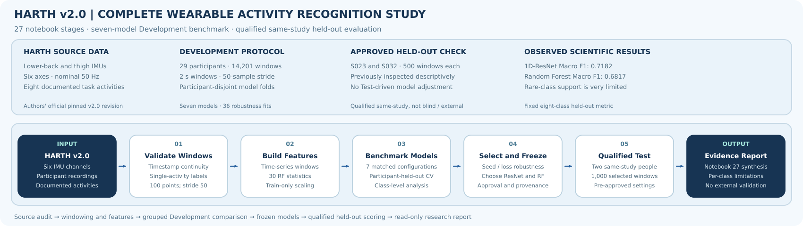

# HARTH research workflow diagrams

The **study-level overview** above summarises the full HARTH research pipeline and its qualified evaluation boundary. The separate **27 stage-specific SVG illustrations** are landscape, left-to-right source → process → output diagrams for HARTH Notebooks 01–27. Each is an actual, editable SVG file in this folder and is referenced in the opening Markdown of the corresponding notebook. These figures describe the workflow; they are not experimental outputs, independently validated measurements or model explanations. The full-study diagram is not a substitute for a stage-specific figure.

| Stages | Diagram assets | Notebook location |
| --- | --- | --- |
| **Full study** | [**study_overview.svg**](study_overview.svg) | [Study README](../README.md), scientific end-to-end summary |
| 01–06 | `01_workflow.svg` through `06_workflow.svg` | [Active notebooks](../notebooks/) |
| 07–12 | `07_workflow.svg` through `12_workflow.svg` | [Active notebooks](../notebooks/) |
| 13–18 | `13_workflow.svg` through `18_workflow.svg` | [Active notebooks](../notebooks/) |
| 19–22 | `19_workflow.svg` through `22_workflow.svg` | [Active notebooks](../notebooks/) |
| 23 | `23_workflow.svg` | [Primary Notebook 23](../notebooks/23_unified_matched_model_benchmark.ipynb); exact historical evidence separately archived |
| 24–25 | `24_workflow.svg` and `25_workflow.svg` | [Primary study notebooks](../notebooks/) |
| 26–27 | `26_workflow.svg` and `27_workflow.svg` | [Primary research notebooks](../notebooks/); scientific execution unchanged |

Images use SVG text/paths, so they remain sharp at different screen sizes and are not stock illustrations. Do not delete these paths without first updating the related Markdown reference.

Keep the portfolio, study and individual Notebook figures separate; see [research visual standards](../../../docs/RESEARCH_VISUAL_STANDARDS.md).
