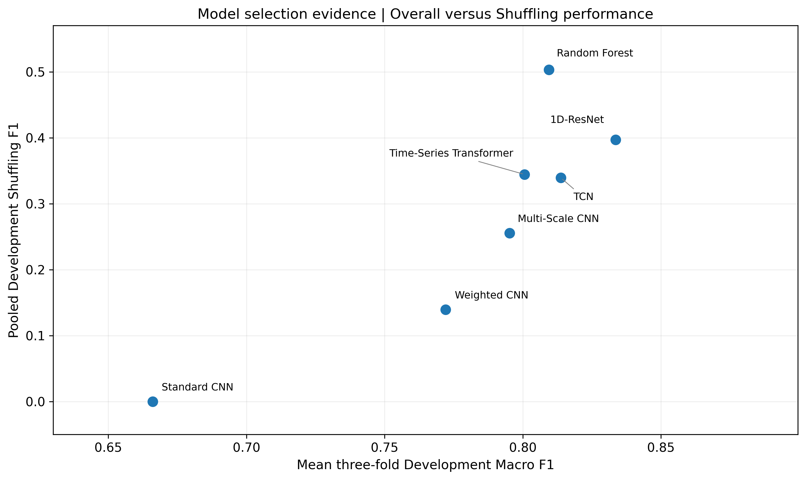
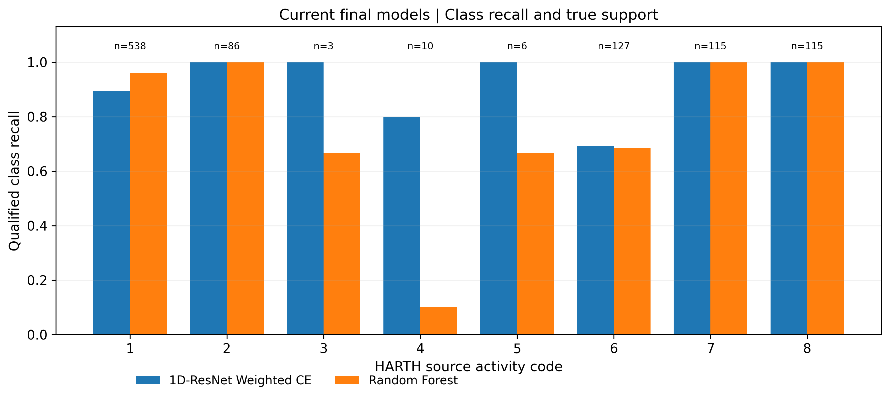

# HARTH v2.0 Wearable Activity Recognition: Research Methods and Evidence

**Study:** Wearable Activity Recognition, Human Movement Intelligence. **Maintained implementation:** [Notebooks 01–13](code/notebooks/). This document records the actual source, cohort, representations, experimental designs, model configurations, saved results and scientific limitations. For a concise entry point and practical starting locations, use the [study README](README.md); for file dependencies and model recovery, use the [study execution instructions](README.md#4-running-and-reviewing-the-study).

**Experimental evidence:** The study includes Development model comparisons, robustness analyses and source-aligned predictions for S023/S032. Numerical results are reported with their corresponding cohort and evaluation design; they do not imply external validation.

## 1. Research Objective and Scope

The central question is how **statistical-feature classical classifiers** compare with **raw-window temporal neural models** for eight-class recognition from two body-worn accelerometers under participant-disjoint Development evaluation. Supporting questions address minority-activity coverage, source annotation and timing integrity, sensitivity to window sampling and Training volume, optimisation budget, stochastic stability, loss-function choice, confidence and probability calibration.

The study progresses from source-level inspection through controlled Development comparisons to a selected final weighted 1D-ResNet and fixed Random Forest reference. The final models are fitted on Development subjects and assessed on S023/S032, whose recordings were **excluded from model fitting and selection but had been examined descriptively earlier**. Consequently, the final assessment is deliberately termed **qualified same-study held-out evaluation**, not a blind Test or external validation.

Study outputs are research predictions and measured classification errors; there is no prospective deployment, real-time streaming validation, clinical inference or causal attribution of human movement mechanisms. Comparisons across the 13 notebooks must be interpreted in their own populations, budgets and selection roles.

## 2. Data Sources, Cohort and Target Definitions

### 2.1 Source and activities

The data source is the official [NTNU AI Lab HARTH v2.0 repository](https://github.com/ntnu-ai-lab/harth-ml-experiments), using source revision `dad2cfbe89a26f72f19770419469ac037de200df`. This is **not** the UCI HARTH v1.2 release. Source recordings provide six acceleration channels from lower-back and thigh sensors (`back_x`, `back_y`, `back_z`, `thigh_x`, `thigh_y`, `thigh_z`), at nominal **50 Hz**, with source activity codes and participant identities.

The task preserves these eight original class meanings:

| Source code | Activity | Source code | Activity |
| ---: | --- | ---: | --- |
| 1 | Walking | 5 | Stairs descending |
| 2 | Running | 6 | Standing |
| 3 | Shuffling | 7 | Sitting |
| 4 | Stairs ascending | 8 | Lying |

Codes 10, 11 and 17 occur in inspected recordings but are **not assigned speculative meanings**. Other observed cycling-related codes, including 13, 14, 130 and 140, remain outside the predefined eight-class task. Out-of-task segments are retained in audit accounting and excluded from the supervised task only after label-safe window construction. These source annotations are treated as supplied labels, not independently verified observations of every activity boundary.

### 2.2 Source accounting and evaluated populations

The inspected source inventory has **31 participants**. Of these, 29 contribute to Development; S023 and S032 are reserved from Development fitting and model selection. The 29-person source-quality audit records **8,006,741 samples** and **160,090 candidate windows**. The label-purity/time-continuity audit rejects 14,459 for label purity alone, 397 for continuity alone and 1,129 for both (**15,985** combined), yielding **144,105** pure/time-safe windows. Another **11,708** carry out-of-task labels, leaving **132,397 eligible eight-class Development windows**. Counts describe windows, not independent people. Source: [Notebook 09 accounting](output/09_development_source_accounting.csv).

| Population or sampling policy | Independent participants | Eligible or selected windows | Role |
| --- | ---: | ---: | --- |
| Full eight-class Development | 29 | 132,397 | Source audit and full-cohort classical evaluation |
| Independent maximum-250 cap | 29 | 7,201 | Sampling-coverage sensitivity |
| Label-blind maximum-500 cap | 29 | 14,201 | Main bounded Development benchmark and final fit |
| Independent maximum-1,000 cap | 29 | 28,201 | Sampling sensitivity; separate nested expansion |
| Qualified S023/S032 cohort | 2 | 1,000 (500 each) | Previously inspected same-source held-out assessment |

For final assessment, [qualified cohort accounting](output/13_qualified_cohort_summary.csv) records S023 with 2,567 eligible windows and S032 with 3,037 eligible windows (after one out-of-task exclusion). A label-independent cap selects 500 from each. S023 has eight observed classes in its sampled windows; S032 has six. No S023/S032 windows enter the 14,201-window final Training population.

### 2.3 Units and scope of the target

The supervised target is the **original eight-class activity code** of each eligible two-second window. The model predicts a window-level activity, while the person is the principal independent evaluation group. Overlapping and temporally adjacent windows create correlated observations; one thousand windows from two people do not provide one thousand independent participant-level trials.

## 3. Data Preparation and Representations

### 3.1 Original signal handling and window eligibility

Each participant's chronological recording is processed separately. A window contains **100 samples (2 seconds nominally)**; starts advance by **50 samples** for 50% overlap. Retained windows must have a single source activity label and valid timestamp continuity. The pipeline does not bridge a label transition or an irregular time gap to create a fictitious continuous activity sequence. Source identities and window positions are retained for downstream alignment.

The audit distinguishes label-only, continuity-only and combined failures rather than discarding all mismatches under an opaque filter. Out-of-task labels remain visible in audit summaries; they are not recoded as one of the eight task classes. The [HARTH source adapter](code/src/harth_data.py) and [Notebook 09](code/notebooks/09_harth_source_quality_and_minority_activity_audit.ipynb) provide the current implementation and observed exclusions.

### 3.2 Classical and temporal representations

Classical models use **30 features**: for each of six acceleration channels, the mean, population standard deviation, root-mean-square magnitude, peak-to-peak range and normalised waveform length. Neural models consume raw input windows with shape **`(N, 6, 100)`** and eight activity classes. These are **different input representations**; a comparison of their configured pipelines does not isolate architecture alone.

In learned preprocessing, each Training fold supplies its own channel mean and standard deviation, fitted without Validation subjects. Logistic Regression scaling is likewise Training-derived. Final ResNet inference uses Development-fitted six-channel statistics stored in the ordered inference CSV; Random Forest uses the recorded 30-feature ordering. The final assessment does not fit new transformations on S023/S032.

### 3.3 Sampling policies and nested Training data

The independent 250-, 500- and 1,000-window cap policies sample fixed chronological positions **without consulting labels**. Their resulting class frequencies can nevertheless differ. A separate strictly nested Training-size comparison retains the selected 500-cap Training windows inside a larger 1,000-cap Training sample. These are **not interchangeable designs** and are never treated as if both estimated exactly the same sampling intervention.

The bounded 500-cap cohort contains **219 Shuffling**, **192 ascending-stairs** and **182 descending-stairs** windows. Source Shuffling coverage is **1,946 windows from 28 participants**; the cap retains **219/1,946 (11.25%)** with 26 contributing people. Counts and effects on representation precede any model-based causal interpretation.

## 4. Experimental Design and Evaluation

### 4.1 Partition and selection boundaries

The maintained programme contains distinct experiments:

1. **Full Development classical evaluation (Notebook 03):** five participant-disjoint folds on 132,397 eligible windows.
2. **Bounded fixed-split comparisons (Notebooks 04–06):** a specified participant-disjoint Training/Validation split with 10,000 Training windows (20 people) and 2,701 Validation windows (six people) in the cap-500 protocol; three other Development people are unused in that comparison.
3. **Grouped and nested Development analyses (Notebooks 05, 07, 10–11):** three participant-disjoint folds on the 29-person bounded cohort, with clearly declared Training sizes and optimisation budgets.
4. **Confidence and separate calibration (Notebook 08):** held-out outer-fold predictions, and a distinct experiment separating Training, four Calibration participants per outer fold and Validation subjects.
5. **Final selection and fit (Notebooks 12–13):** choose weighted 1D-ResNet and a 120-tree Random Forest **from Development evidence**, fit both on the 14,201 selected Development windows and assess on S023/S032 without tuning to their outcomes.

A held-out participant is not interchangeable with an unseen dataset. Prior descriptive inspection of S023/S032 prevents a claim that the last assessment was fully blind, despite exclusion of their rows from final fitting, scaling and class-weight estimation.

### 4.2 Metrics and aggregation

The principal classifier-selection metric is **fixed-eight-class Macro F1**. Class-wise precision, recall, F1 and support; balanced accuracy; accuracy; participant-level F1 and confusion counts supplement it. The three-fold benchmark reports **mean and SD of fold scores**; its aggregate is not the same statistic as pooled window F1. Notebook 11's across-seed SD describes stochastic training variation over the stated folds and seeds, not population uncertainty across independently sampled people.

The final qualified assessment computes fixed-eight-class Macro F1 using all eight task labels, including a zero contribution when a true class is absent from a participant's observed samples. Its **observed-class balanced accuracy** averages recall only over the true classes present. The two metric denominators therefore differ. Reported model-level metrics are computed from [1,000 aligned prediction rows](output/13_qualified_aligned_predictions.csv), not from transcribed confusion counts.

Confidence analyses report a ten-bin expected calibration error (ECE), multiclass Brier score, negative log-likelihood (NLL), accuracy and high-confidence mistakes. Temperature fitting uses only permitted Calibration labels and is **not** part of the selected final model.

### 4.3 Interpretation of comparisons and uncertainty

Matched Training/Validation membership supports paired descriptive model comparisons within a given experiment. It does not make nested caps, different losses, alternative representations or Test observations independent replicates. Thousands of overlapping windows do not increase the independent participant count. No population-wide participant confidence interval or external-replication result is claimed for the two-person qualified assessment.

## 5. Methods, Models and Configurations

### 5.1 Classical, convolutional and recurrent alternatives

The [full-source classical experiment](code/notebooks/03_harth_full_development_audit_and_classical_cv.ipynb) compares a Dummy baseline, scaled Logistic Regression and Random Forest on the same feature family. The [fixed-split temporal comparison](code/notebooks/04_harth_temporal_cnn_and_matched_random_forest.ipynb) pairs a compact two-convolution CNN with a Random Forest using the identical selected source windows but different derived inputs. [Notebook 05](code/notebooks/05_harth_class_weighting_and_grouped_model_comparison.ipynb) compares standard and inverse-square-root training-weighted CNN losses.

[Notebook 06](code/notebooks/06_harth_sampling_sensitivity_and_nested_training_scaling.ipynb) varies sampling and strictly nested Training size; [Notebook 07](code/notebooks/07_harth_grouped_nested_training_and_fixed_update_comparison.ipynb) separately considers grouped scaling and **fixed-400-update** CNN fits. Five epochs do not imply the same number of optimiser updates across differently sized Training sets.

The advanced model implementations and their saved benchmarks include:

| Model | Actual design or feature scope | Relevant execution |
| --- | --- | --- |
| Random Forest | 30 features from six channels; 120 trees in selected reference | [10](code/notebooks/10_harth_advanced_temporal_architectures_and_matched_benchmark.ipynb), [13](code/notebooks/13_harth_final_development_training_and_research_synthesis.ipynb) |
| Standard / weighted temporal CNN | Two-convolution temporal architecture; optional Training-derived class weights | [04–05](code/notebooks/) |
| TCN | Dilated temporal residual convolutions, dilations 1, 2, 4, 8 | [10–11](code/notebooks/) |
| Multi-Scale CNN | Parallel kernel widths 3, 7 and 15 with residual connections | [10](code/notebooks/10_harth_advanced_temporal_architectures_and_matched_benchmark.ipynb) |
| 1D-ResNet | Convolutional stem and three residual stages; selected neural model | [10–13](code/notebooks/) |
| Time-Series Transformer | Embedding dimension 48, two encoder layers, four attention heads | [10](code/notebooks/10_harth_advanced_temporal_architectures_and_matched_benchmark.ipynb) |

The Transformer operates over the full window and is not evidence of causal physiological explanation. The described TCN is not a demonstrated real-time streaming implementation. A smoke test of a model's shapes or gradients is not a scientific evaluation; the recorded performance comes from the matched Development runs.

### 5.2 Selected final fitted pair

Notebook 12 records selection decisions and the exact [Training configuration](output/12_recorded_training_configuration.csv). Notebook 13 implements:

| Property | Weighted 1D-ResNet primary | Random Forest classical reference |
| --- | --- | --- |
| Inputs | Six-channel, 100-sample raw windows | 30 deterministic statistical features |
| Class task | Original codes 1–8 | Original codes 1–8 |
| Fitting cohort | 29 Development people, 14,201 selected windows | Same Development people and windows |
| Important settings | 32 hidden channels; inverse-square-root weighted CE | 120 trees; minimum leaf size 3; `balanced_subsample` class weights |
| Optimisation | Adam, learning rate 0.001; batch size 128; 400 updates; seed 42 | Random state 42; fitted on recorded feature ordering |
| Selection/checkpoint | Final 400th update; no qualified-cohort checkpoint selection | Fixed selected configuration |
| Final calibration | None | None |

The source [`12_recorded_source_protocol.csv`](output/12_recorded_source_protocol.csv), [`13_final_training_configuration.csv`](output/13_final_training_configuration.csv) and [`13_inference_config.csv`](output/13_inference_config.csv) document the source revision, final model settings and ordered inference configuration.

The shared [`harth_final_inference.py` module](../python_modules/core/harth_final_inference.py) saves the ResNet `state_dict`, fitted Random Forest and typed CSV settings, then supports loading and inference on eligible new windows. Trusted local loading normally uses `inference_config.csv` in the model directory; a flat Stage 13 export uses the equivalent stage-prefixed `13_inference_config.csv` and an explicit loader filename argument. No Test-derived scaler or calibration parameter is introduced.

## 6. Results and Comparative Analysis

### 6.1 Earlier classical and matched Development comparisons

The **full-cohort classical five-fold Development** experiment (Notebook 03) records mean fold Macro F1 **0.8353** for Random Forest, **0.7707** for Logistic Regression and **0.0815** for Dummy. It uses 132,397 windows, so these scores are not directly matched to later capped neural studies.

On the fixed six-person, **2,701-window Validation** split (Notebook 04), the Random Forest records **0.8140 Macro F1** and **0.8259 balanced accuracy**, compared with **0.6659** and **0.6459** for the standard temporal CNN. Random Forest scores higher on all six Validation participants; the descriptive paired mean signed difference (CNN minus Random Forest) is **−0.1505**. The standard CNN has **Shuffling F1 0** on 15 true Shuffling windows in that specific Validation set.

Notebook 05 raises fixed-split CNN Macro F1 from **0.6659 to 0.7973** using Training-only inverse-square-root weighting; balanced accuracy changes from **0.6459 to 0.8126**. In its *separate* three-fold Development comparison, mean Macro F1 is **0.8094** for Random Forest, **0.7832** for weighted CNN and **0.6301** for standard CNN. Weighted CNN exceeds standard CNN for **27/29** Development participants, but Random Forest for only **14/29**. Evidence: [loss comparison](output/05_loss_validation_metrics.csv) and [grouped summary](output/05_cv_model_summary.csv).

### 6.2 Sampling volume and optimisation budgets

Notebook 06's strictly nested fixed-split Training expansion from **10,000 to 20,000** windows leaves the same 2,701 Validation windows: RF fifth/final Validation Macro F1 increases **0.8140 → 0.8644**, while weighted CNN at the predefined fifth epoch changes **0.7973 → 0.7807**. The expanded CNN reached **0.8454 at epoch four**, but that was not its predefined final endpoint. Five of six participant scores improve for RF; three improve and three deteriorate for weighted CNN. Evidence: [nested model metrics](output/06_nested_validation_model_metrics.csv), [paired people](output/06_nested_paired_summary.csv).

In Notebook 07's separate **three-fold** nested Training comparison (caps 500 → 1,000), RF mean Macro F1 is **0.8094 → 0.8080**, and weighted CNN's five-epoch mean is **0.7832 → 0.7964**. With a *fixed 400-update budget* the weighted CNN changes **0.7721 → 0.7921** in Macro F1 while balanced accuracy changes **0.8021 → 0.7968**. These different endpoints and budgets preclude attributing every result solely to more data.

### 6.3 Seven-model Development benchmark

[Notebook 10's matched summary](output/10_matched_cv_model_summary.csv) covers **seven models, three grouped folds, 21 model-fold records, 29 people and 14,201 selected windows**:

| Model | Fixed-eight-class fold-mean Macro F1 | Fold SD |
| --- | ---: | ---: |
| **1D-ResNet** | **0.8336** | 0.0427 |
| TCN | 0.8138 | 0.0658 |
| Random Forest | 0.8094 | 0.0500 |
| Time-Series Transformer | 0.8006 | 0.0602 |
| Multi-Scale CNN | 0.7953 | 0.0483 |
| Weighted CNN | 0.7721 | 0.0269 |
| Standard CNN | 0.6660 | 0.0628 |

*Figure 1. Development-only model-selection trade-off. Overall fold-mean Macro F1 and pooled Shuffling F1 represent different aggregations; the chart does not demonstrate significance or unseen-source generalisation.*

The [Notebook 12 selection decision](output/12_development_model_selection_decisions.csv) retains weighted 1D-ResNet as primary and RF as a classical comparator. Despite the highest mean overall Macro F1, the ResNet did **not** have the best recorded pooled Shuffling F1 in this comparison: RF **0.5032**, ResNet **0.3969**. These trade-offs justify retaining both models; the final selection was not made on the S023/S032 scores.

### 6.4 Current fitted models on S023 and S032

[Notebook 13](code/notebooks/13_harth_final_development_training_and_research_synthesis.ipynb) produces [source-window-aligned predictions](output/13_qualified_aligned_predictions.csv) with subject identifiers, original start/end positions, reference labels and predictions from each **Development-fitted** model. The two models score the **same 1,000 windows**.

| Model | Fixed-eight-class Macro F1 | Accuracy | Observed-class balanced accuracy |
| --- | ---: | ---: | ---: |
| **1D-ResNet weighted CE** | **0.7182** | 0.9020 | **0.9234** |
| Random Forest | 0.6817 | **0.9270** | 0.7599 |

Sources: [model metrics](output/13_qualified_model_summary.csv), [confusion-count tables](output/) and [per-class report](output/13_qualified_per_class.csv).

| Participant (500 windows each) | ResNet Macro F1 | RF Macro F1 | ResNet accuracy | RF accuracy | Observed classes |
| --- | ---: | ---: | ---: | ---: | ---: |
| S023 | 0.7384 | **0.7391** | 0.900 | **0.956** | 8 |
| S032 | **0.5662** | 0.4597 | **0.904** | 0.898 | 6 |

The overall ResNet has higher fixed-task Macro F1, while RF has higher window accuracy. These effects are not uniform across the two people. The observed qualified class support is **538 Walking, 86 Running, 3 Shuffling, 10 ascending-stairs, 6 descending-stairs, 127 Standing, 115 Sitting and 115 Lying**. A recall of 1.0 on only three examples is not reliable evidence of robust Shuffling recognition.

*Figure 2. Recall and true-class window support for the same 1,000 qualified S023/S032 windows. The very small supports of activities 3–5 and overlapping sampling limit inference.*

No qualified-cohort score is used to retrospectively select a different model or tune the final pipeline. The assessment is **same-source and previously inspected**, not an untouched independent Test.

## 7. Robustness, Uncertainty and Additional Analyses

### 7.1 Multi-seed, loss-function and minority-class robustness

Notebook 11 compares four neural model/loss conditions over seeds **42, 123 and 2026** and three participant folds: **36 fits**. Weighted CE uses Training-derived inverse-square-root class weights; ResNet alternatives are Focal Loss (`gamma=2`) and effective-number class-balanced CE (`beta=0.9999`). Source: [robustness metrics](output/11_robustness_model_summary.csv), [fold table](output/11_robustness_fold_metrics.csv) and [paired loss evidence](output/11_resnet_paired_loss_scores.csv).

| Configuration | Mean Macro F1 across seed-level fold means | Across-seed SD |
| --- | ---: | ---: |
| **1D-ResNet + weighted CE** | **0.8289** | 0.0053 |
| TCN + weighted CE | 0.8106 | 0.0078 |
| 1D-ResNet + focal loss | 0.8057 | 0.0051 |
| 1D-ResNet + class-balanced CE | 0.7915 | 0.0190 |

These repeated fits characterise training stochasticity conditional on this Development design. The 36 jobs are not 36 independent participant samples and do not establish a population confidence interval. Different losses create minority-class precision/recall trade-offs; none is retroactively called universally superior.

### 7.2 Confidence and separately fitted calibration

[Notebook 08](code/notebooks/08_harth_oof_confidence_and_temperature_calibration.ipynb) contains **two independent Development experiments** rather than reusing fitted predictions for both:

- **Uncalibrated out-of-fold audit:** on 14,201 bounded Development windows, accuracy **0.9457**, average maximum confidence **0.9003**, ten-bin ECE **0.0454**, multiclass Brier **0.0907** and **39** incorrect predictions at confidence ≥0.90. Shuffling recall is **0.1187** on 219 windows, with 193 errors. Twenty of the 39 confident errors are Standing misclassified as Sitting.
- **Separate scalar temperature scaling:** fresh CNNs and subject-disjoint Training/Calibration/Validation roles. Fold temperatures are **0.6274**, **0.3973** and **0.5050**; Calibration participants do not become Training or outer Validation participants.

| Mean outer-Validation metric | Uncalibrated | Temperature scaled |
| --- | ---: | ---: |
| NLL (lower better) | **0.2494** | 0.2580 |
| Ten-bin ECE (lower better) | 0.0494 | **0.0286** |
| Multiclass Brier (lower better) | 0.1085 | **0.1044** |
| Accuracy | 0.9275 | 0.9275 |

ECE and Brier improve on average; NLL worsens, and **Fold 1 deteriorates on all three probability metrics**. Temperature scaling preserves class argmax and was **not applied to the final fitted models**. The first audit's pooled ECE and the second experiment's fold-mean ECE are not identical estimands. Evidence: [OOF confidence](output/08_confidence_summary.csv), [calibration means](output/08_calibration_mean_metrics.csv) and [fold metrics](output/08_calibration_fold_metrics.csv).

### 7.3 Source integrity and minority activities

[Notebook 09](code/notebooks/09_harth_source_quality_and_minority_activity_audit.ipynb) measures source eligibility and annotation coverage independently of model performance. The full Development cohort has **1,946 Shuffling windows from 28 people (1.47%)**, **1,332 ascending-stairs from 26 (1.01%)** and **1,066 descending-stairs from 25 (0.81%)**. Among **3,359** observed Shuffling annotation bouts, **2,342 (69.72%)** are shorter than the nominal two-second analysis window; median nominal bout duration is **1.28 s**. Annotation bouts are not independently verified physical movement events.

The [source-to-OOF context table](output/09_source_support_and_oof_error_context.csv) relates representation coverage to Development prediction errors for descriptive comparison only. It cannot identify the cause of those errors. The [channel summary](output/09_sensor_channel_summary.csv) records finite signals and notable extrema; atypical sensor values are not alone proof of hardware failure.

### 7.4 Limits of uncertainty claims

The observed variation across folds, seeds, activities and two qualified people is useful but cannot substitute for an adequately sized independent-participant uncertainty analysis. Overlapping windows and cross-validation dependence make naive independent-window confidence intervals inappropriate. No prospective, cross-device, cross-dataset, clinical or treatment-outcome robustness study is reported.

## 8. Current Outputs and Reproducibility

### 8.1 Current public evidence and producing stages

Each notebook produces stage-prefixed tables and figures in `output/`. Later analyses use the corresponding outputs and their stated data definitions.

| Evidence | Current source | Scientific role |
| --- | --- | --- |
| Full-source cohort and exclusions | [`09_development_source_accounting.csv`](output/09_development_source_accounting.csv) | Label/time eligibility and denominator audit |
| Development baseline/comparative results | [`05_cv_model_summary.csv`](output/05_cv_model_summary.csv), [`06_nested_validation_model_metrics.csv`](output/06_nested_validation_model_metrics.csv) | Grouped and fixed-split evidence under their own protocols |
| Matched seven-model results | [`10_matched_cv_model_summary.csv`](output/10_matched_cv_model_summary.csv) | Primary Development model selection |
| Seed/loss robustness | [`11_robustness_model_summary.csv`](output/11_robustness_model_summary.csv) | Stochastic and loss sensitivity |
| Selection and source configuration | [`12_recorded_training_configuration.csv`](output/12_recorded_training_configuration.csv), [`12_recorded_source_protocol.csv`](output/12_recorded_source_protocol.csv) | Frozen Development-to-final specification |
| Final fitting and ordered inference settings | [`13_final_training_configuration.csv`](output/13_final_training_configuration.csv), [`13_inference_config.csv`](output/13_inference_config.csv) | Recorded selected-model implementation and scaler/feature order |
| Qualified predictions and metrics | [`13_qualified_aligned_predictions.csv`](output/13_qualified_aligned_predictions.csv), [`13_qualified_model_summary.csv`](output/13_qualified_model_summary.csv) | Same-source two-person prediction-level evidence |

The complete Stage 03 participant-aligned statistical-feature matrix is generated locally from the source data rather than distributed in the repository; its production and reuse are described in the [study execution instructions](README.md#4-running-and-reviewing-the-study). Published aggregate results remain available without that matrix.

Additional derived confusion counts, class reports, figures and source-support tables live in [`output/`](output/). The principal workflow diagrams are in [`images/`](images/) and are distinct from numerical results.

### 8.2 Source data, model files and reproducibility

HARTH source recordings are obtained through the version-specific source loader and stored locally under paths such as `data/raw/harth_v2/`. The study's models and results can be regenerated using the specified data, environment and notebook sequence.

[Notebook 13](code/notebooks/13_harth_final_development_training_and_research_synthesis.ipynb) exports the two fitted models and stage 13 results as a flat 25-file archive. It includes `resnet_state_dict.pt`, `random_forest.joblib` and the stage-specific `13_inference_config.csv`. The local model-loading directory uses `inference_config.csv`, while loading directly from the extracted archive uses the `config_filename` parameter. See the [study execution instructions](README.md#4-running-and-reviewing-the-study) for the file interface.

The [README](README.md#4-running-and-reviewing-the-study) describes the environment and entry points. Loading a `.joblib` file deserialises Python objects and therefore requires a trusted file source. Changes in data revision, cohort, windowing, representation or model configuration require corresponding downstream analyses to be updated.

Hardware, library versions and stochastic optimisation can affect exact training behaviour; the reported results describe the specified experimental configuration.

## 9. Discussion, Limitations and Future Work

The Development benchmark provides evidence that a weighted 1D-ResNet achieved the highest **observed mean fixed-eight-class Macro F1** among the seven configured models on the study's selected folds. A Random Forest remained a useful classical comparator, including higher Development pooled Shuffling F1. On the separately fitted two-person qualified assessment, ResNet yields higher Macro F1 but lower accuracy than RF; performance also differs by person and by activity. This is a bounded comparison, **not** evidence that one architecture is universally best.

Important limitations include:

1. **Single-source, historically inspected final cohort.** S023/S032 were withheld from fitting but not entirely unseen during the wider exploratory history. The assessment is neither blind external validation nor prospective evaluation.
2. **Only two independent assessed people.** One thousand overlapping windows do not resolve participant-level generalisation uncertainty.
3. **Rare-activity insufficiency.** The final qualified assessment includes just three Shuffling, ten ascending-stairs and six descending-stairs windows; apparent recall can be unstable or misleading.
4. **Different exploratory protocols.** The full Development source, capped and nested subsets, model input types, fold roles, calibration experiments and training budgets differ. Their numbers are not pooled as one benchmark or attributed causally to architecture or sample size alone.
5. **Annotations and recording integrity.** Task labels are inherited from source annotations. Undocumented codes are not guessed; unusual signal values and short annotated bouts have not been independently validated as faults or events.
6. **Confidence and interpretation.** Softmax probabilities are not automatically calibrated or explanatory; temperature scaling has mixed outcomes and is not part of the final model.
7. **Reproducibility conditions.** Reproducing model fitting requires the specified source revision, feature and window definitions, software dependencies, random seeds and training configuration; computation environments may affect exact outcomes.

Justified future work would use genuinely untouched participant groups or an independent dataset, increase rare-activity support, examine device/placement variation and evaluate inference under appropriately defined real-time information constraints. These directions would require separate experiments and evaluation.

The [01–13 notebooks](code/notebooks/) provide the implementations, and the [result tables](output/) provide the corresponding numerical findings.