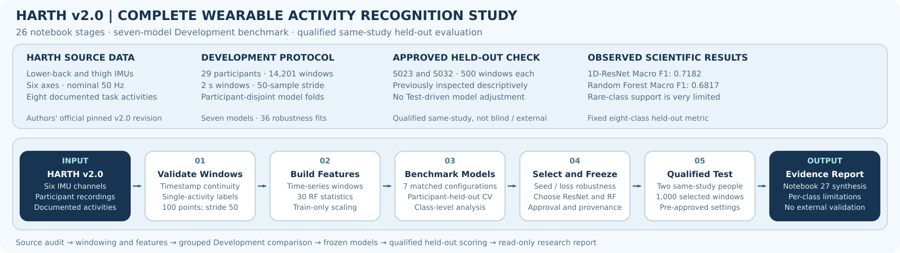

# Wearable Activity Recognition | HARTH v2.0



*Study-wide workflow: the diagram summarises the full HARTH research programme and the completed FINAL evidence audit. The numbered notebooks retain their individual workflow figures.*

This study investigates **eight-class human activity recognition from two wearable
accelerometers**. It compares classical machine learning and temporal deep learning
under participant-disjoint Development evaluation, with particular attention to rare
activities, sampling limits, model stability and the interpretation of held-out results.

The experimental work was originally arranged as 26 numbered stages. The
current notebook sequence includes consolidated **01–05**, followed by
remaining historical **14–26**, and a separate
[FINAL evidence audit](code/notebooks/final_harth_research_audit_and_closure.ipynb).
The [Stage 26 evidence report](code/notebooks/26_final_research_evidence_and_report.ipynb)
contains the executed, saved-results synthesis. The independent
[FINAL audit](code/notebooks/final_harth_research_audit_and_closure.ipynb)
has also been executed and committed, with its cross-stage quality gate **PASSED**
and ten saved `final_*` outputs.

## 1. Dataset and experimental protocol

| Component | Research setting |
| --- | --- |
| Source | [NTNU AI Lab HARTH v2.0](https://github.com/ntnu-ai-lab/harth-ml-experiments), pinned revision `dad2cfbe89a26f72f19770419469ac037de200df`; not the UCI HARTH v1.2 release |
| Inputs | Six accelerometer channels: `back_x/y/z` and `thigh_x/y/z`; nominal 50 Hz |
| Target | Walking, Running, Shuffling, Stairs ascending, Stairs descending, Standing, Sitting and Lying (source codes 1–8) |
| Windowing | 100 samples (2 seconds), stride 50 (50% overlap), with label-purity and timestamp-continuity checks |
| Full Development cohort | 29 participants, 132,397 eligible eight-class windows |
| Bounded Development benchmark | Up to 500 chronologically sampled windows per participant; 14,201 windows in three participant-disjoint folds |
| Qualified held-out assessment | S023 and S032, 500 selected windows each, from the same HARTH collection |

Source codes **10, 11 and 17** are not given invented activity meanings.
Out-of-task windows are excluded after safe window construction. Learned scaling,
class weighting and calibration are fitted only within their authorised training or
calibration splits.

S023 and S032 were inspected descriptively during exploratory work. The qualified
held-out assessment therefore **is not fully blind or external validation**, even
though those participants were excluded from subsequent Development model fitting
and selection.

## 2. Experimental programme

| Notebooks | Main purpose |
| --- | --- |
| [01–03](code/notebooks/) | Source inspection, annotation-safe windows, 30 statistical features and classical participant-disjoint Development evaluation |
| [04](code/notebooks/04_harth_temporal_cnn_and_matched_random_forest.ipynb) | Bounded raw-signal temporal CNN and matched Random Forest on identical participant-disjoint Validation windows |
| [05](code/notebooks/05_harth_class_weighting_and_grouped_model_comparison.ipynb) | Matched standard/weighted CNN loss ablation and three-model participant-grouped Development comparison |
| [06](code/notebooks/06_harth_sampling_sensitivity_and_nested_training_scaling.ipynb) | Full-source sampling retention and fixed-Validation comparison of strictly nested 500/1,000 Train sizes for Random Forest and weighted CNN |
| [07](code/notebooks/07_harth_grouped_nested_training_and_fixed_update_comparison.ipynb) | Three-fold grouped nested Train-size comparison and matched 400-update weighted CNN evaluation |
| [08](code/notebooks/08_harth_oof_confidence_and_temperature_calibration.ipynb) | Executed uncalibrated OOF confidence audit and independently fitted participant-disjoint temperature calibration |
| [09](code/notebooks/09_harth_source_quality_and_minority_activity_audit.ipynb) | Full HARTH source integrity, minority-class support, annotation bouts, sampling-cap and sensor audit; integrated execution pending |
| [20](code/notebooks/20_minority_class_and_data_quality.ipynb) | Historical source-quality notebook, temporarily retained pending successful Notebook 09 execution |
| [21](code/notebooks/21_advanced_temporal_architectures.ipynb) | Engineering checks for TCN, Multi-Scale CNN, 1D-ResNet and Time-Series Transformer |
| [22](code/notebooks/22_unified_matched_model_benchmark.ipynb) | Seven-model matched, three-fold Development benchmark (21 model-fold jobs) |
| [23](code/notebooks/23_multiseed_and_imbalance_robustness.ipynb) | Three-seed architecture/loss robustness (36 neural model-fold-seed jobs) |
| [24](code/notebooks/24_model_selection_and_protocol_freeze.ipynb) | Development-only model selection and frozen-protocol checks |
| [25](code/notebooks/25_final_development_training_and_inference.ipynb) | Final Development fitting and separately approved qualified held-out evaluation |
| [26](code/notebooks/26_final_research_evidence_and_report.ipynb) | Evidence report using committed full-precision results and recorded provenance |
| [FINAL](code/notebooks/final_harth_research_audit_and_closure.ipynb) | Cross-study evidence reconciliation, source traceability and limitations of qualified held-out assessment |

Detailed methods and experimental comparisons are documented in
[HARTH | Research Methods and Experimental Evidence](HARTH_RESEARCH_METHODS_AND_EVIDENCE.md).

## 3. Research results

The matched Development benchmark selected **1D-ResNet with training-only
inverse-square-root weighted cross-entropy** as the primary model. **Random Forest**
was retained as a fixed classical comparator. Both were configured using
Development evidence, not the qualified held-out results.

| Model | Three-fold Development Macro F1 (mean ± SD) | Qualified held-out eight-class Macro F1 | Qualified held-out accuracy |
| --- | ---: | ---: | ---: |
| **1D-ResNet Weighted CE** | **0.8328 ± 0.0435** | **0.7182** | 0.9020 |
| Random Forest | 0.8094 ± 0.0500 | 0.6817 | **0.9270** |

The Development and qualified held-out columns represent **different participant
sets and evaluation conditions**; the values must not be treated as a matched
performance-difference test. On the final 1,000 overlapping windows, Shuffling
has only **3** true examples, stairs ascending **10** and stairs descending **6**.
The study does not establish population-level, prospective or clinical validity.

The bounded, single-partition comparison in [Notebook 04](code/notebooks/04_harth_temporal_cnn_and_matched_random_forest.ipynb) uses **14,201 Development windows**. On the same **2,701 Validation windows** from six held-out participants, the 120-tree Random Forest attains Macro F1 **0.8140**, compared with **0.6659** for the five-epoch temporal CNN. Random Forest scores higher for all six Validation participants. These figures describe a separate restricted protocol and must not be pooled with the three-fold benchmark or the qualified held-out evaluation.

The integrated [Notebook 05](code/notebooks/05_harth_class_weighting_and_grouped_model_comparison.ipynb)
tests training-only inverse-square-root CNN class weighting on that fixed split:
Validation Macro F1 rises from **0.6659** to **0.7973**. Across three
participant-disjoint Development folds, mean Macro F1 is **0.8094**
(Random Forest), **0.7832** (weighted CNN) and **0.6301** (standard CNN).
The weighted CNN exceeds the standard CNN for **27 of 29** held-out
participants but exceeds Random Forest for only **14 of 29**. These
are bounded Development results, not the qualified held-out assessment.
Full-precision evidence is in
[the loss-ablation metrics](output/05_loss_validation_metrics.csv)
and [the grouped model summary](output/05_cv_model_summary.csv).

The executed [Notebook 06](code/notebooks/06_harth_sampling_sensitivity_and_nested_training_scaling.ipynb)
shows that independent per-person caps of 250, 500 and 1,000 windows
retain **7,201**, **14,201** and **28,201** of **132,397** eligible
Development windows. At cap 500, only **219 of 1,946** Shuffling windows
remain, with support from **26 of 28** original contributors.
In the separate strictly nested Train-size experiment, Random Forest
final Validation Macro F1 changes from **0.8140 to 0.8644**, while the
weighted CNN changes from **0.7973 to 0.7807** at the specified fifth
epoch. Four model conditions share the same **2,701** Validation windows.
The audit does not equate independent cap policies with nested Train sets,
or these fixed-split estimates with grouped or qualified assessment.
Full-precision evidence is in the
[sampling policy counts](output/06_sampling_policy_class_counts.csv),
[model metrics](output/06_nested_validation_model_metrics.csv) and
[paired-subject summary](output/06_nested_paired_summary.csv).

[Notebook 08](code/notebooks/08_harth_oof_confidence_and_temperature_calibration.ipynb)
reports **0.9457** window accuracy, **0.0454** ten-bin ECE and
**39 high-confidence errors** in a 14,201-window uncalibrated
Development audit, with Shuffling recall only **0.1187**.
A *separately fitted*, participant-disjoint temperature-scaling
experiment reduces mean fold ECE from **0.0494** to **0.0286** and
Brier from **0.1085** to **0.1044**, but increases NLL from
**0.2494** to **0.2580**; Fold 1 worsens on all three metrics.
Accuracy remains **0.9275**. The 17 published CSV/PNG files
are current execution evidence, not independent external validation.
See [confidence summary](output/08_confidence_summary.csv),
[calibration fold metrics](output/08_calibration_fold_metrics.csv) and
[calibration means](output/08_calibration_mean_metrics.csv).

[Notebook 07](code/notebooks/07_harth_grouped_nested_training_and_fixed_update_comparison.ipynb)
reports three-fold Development mean Macro F1 at nested Train caps
500/1,000: **0.8094/0.8080** for Random Forest and **0.7832/0.7964**
for weighted CNN with five epochs. In the separate fixed-400-update
comparison, weighted CNN means are **0.7721/0.7921**. Training
representations and optimisation budgets differ between experiments;
the notebook's saved outputs support these numerical summaries, but
its standalone `07_` CSV/PNG files have not yet been committed.

The full seven-model and robustness results are reported in
[Notebook 22](code/notebooks/22_unified_matched_model_benchmark.ipynb),
[Notebook 23](code/notebooks/23_multiseed_and_imbalance_robustness.ipynb) and
the [research methods report](HARTH_RESEARCH_METHODS_AND_EVIDENCE.md).
Qualified per-class and participant-level results are available from
[Notebook 25](code/notebooks/25_final_development_training_and_inference.ipynb).

## 4. Repository navigation

| Location | Contents |
| --- | --- |
| [`code/notebooks/`](code/notebooks/) | Consolidated Stages 01–09, temporarily retained legacy Stage 20, remaining historical Stages 21–26, and the separate FINAL notebook |
| [`code/src/`](code/src/) | HARTH-specific data and quality-audit utilities |
| [`output/`](output/) | Executed experiment CSVs, figures, Stage 26 report and ten committed FINAL audit outputs (including SHA256 provenance) |
| [`images/`](images/) | Study-level and individual notebook SVG workflow figures |
| [`evidence/`](evidence/) | Research evidence register and original protocol proposal/approval records |
| [Shared Python modules](../python_modules/core/) | Reusable processing, splitting, training, evaluation, plotting and Colab utilities |

The output directory contains recorded results, **not** a new data source.
Full-precision CSV exports are available for active Stages 22, 23 and 25;
Stage 26 reads these without retraining or repeating the qualified Test.
The saved FINAL audit records a historical 20-table comparison across
Stages 08–26. Some recorded input filenames were superseded by the
consolidated notebooks and are not available in the current checkout.
Its saved outputs document the earlier run; a fresh FINAL execution against
the consolidated inputs has not been verified. It does not require model
retraining or new qualified Test predictions.

## 5. Running and reviewing the study

For a fresh Google Colab session, clone the repository once and open a notebook
under `wearable_activity_recognition/code/notebooks/`. The notebooks use a
common **Colab Repository Setup** cell followed by their project imports and
shared environment utilities. Do not force-pull over uncommitted Colab work.

For optional local inspection, from the repository root:

```bash
python -m pip install -r requirements.txt
```

Some temporal experiments also require [deep-learning dependencies](../requirements-dl.txt)
and GPU resources. The original raw data and trained model-weight files
are **not committed**, so independent re-execution of every experiment is not
guaranteed by the public repository alone.

To review completed scientific results **without retraining**, start with
[Notebook 26](code/notebooks/26_final_research_evidence_and_report.ipynb)
and its report tables in [`output/`](output/). Then inspect the executed
[FINAL audit notebook](code/notebooks/final_harth_research_audit_and_closure.ipynb)
and its recorded output files. FINAL performs evidence reconciliation, not
additional fitting or held-out Test prediction.

## 6. FINAL research evidence audit and closure

The separate [FINAL notebook](code/notebooks/final_harth_research_audit_and_closure.ipynb)
has **11 executed code cells, no recorded execution errors and a saved
`FINAL HARTH | CROSS-STAGE EVIDENCE AUDIT: PASSED` Quality Gate**. Its
20-input CSV register checks the recorded study results without reloading
source accelerometer signals, retraining models or repeating the qualified
assessment.

The committed audit reconciles the **29-person** full Development cohort
(**132,397** task-eligible windows), the **14,201-window** 500-cap cohort
and the **28,201-window** nested 1,000-cap cohort. It labels the different
evaluation protocols rather than pooling incompatible model scores.
It also examines rare-class retention, subject-disjoint calibration,
the seven-model benchmark, robustness evidence and the qualified held-out
results.

| Final audit output | Contents |
| --- | --- |
| [Source inventory](output/final_source_inventory.csv) | 20 named source/result tables with row and column counts |
| [Development cohort audit](output/final_development_cohort_audit.csv) | Participant and eligible-window reconciliation |
| [Development comparisons](output/final_earlier_development_comparisons.csv) and [protocol comparability](output/final_protocol_comparability.csv) | Source-labelled results and rules for interpreting comparisons |
| [Minority sampling audit](output/final_minority_sampling_audit.csv) and [retention figure](output/final_minority_class_retention.png) | Rare-activity availability under sampling caps |
| [Temperature scaling audit](output/final_temperature_scaling_audit.csv) | ECE, Brier, NLL and accuracy contrasts |
| [Qualified results snapshot](output/final_qualified_results_snapshot.csv) | Recorded ResNet and Random Forest outcomes, without new Test inference |
| [Research closure and limitations](output/final_research_closure_and_limitations.csv) | Completed evidence, scientific constraints and future validation needs |
| [FINAL source provenance](output/final_research_audit_provenance.json) | SHA256 fingerprints of 20 input CSVs, the Stage 26 report and protocol records |

The provenance record and saved Quality Gate verify agreement of the
**available files**, not independent reproduction of the neural training
runs or external generalisation. The qualified assessment remains limited
to S023 and S032 and 1,000 overlapping windows.

## 7. Scientific documentation and boundaries

- [Research Methods and Experimental Evidence](HARTH_RESEARCH_METHODS_AND_EVIDENCE.md):
  full research methods, matched comparisons, recorded results and limitations.
- [Reproducibility guide](../docs/HARTH_REPRODUCIBILITY.md):
  source version, availability of artefacts and verification limits.
- [Stage 01–19 evidence register](evidence/stage_01_19_evidence_register.csv):
  summary of the earlier Development experiments.
- [Qualified evaluation approval](evidence/stage_25_protocol_approved_qualified_test.json):
  frozen model specifications and the authorised evaluation boundary.

**Status:** Integrated Notebooks **01–08** have saved executions; Notebook 09 is implemented but not yet executed, and its `09_` outputs are pending. All 17 CSV/PNG outputs for Notebook 08 are published. Independent CSV/PNG outputs for Notebook 07 are not yet committed; historical Stages 20–26 and the FINAL
audit retain their historical recorded work. The saved FINAL audit passed
in its earlier source-file context; its execution against the consolidated
current-file names remains unverified. The study is **not** independently
replicated, externally validated or ready for clinical deployment.
