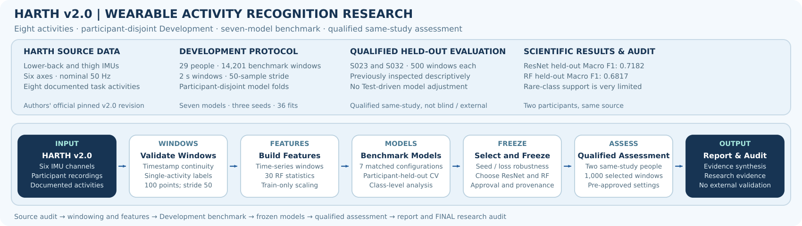

# Wearable Activity Recognition | HARTH v2.0



*Figure 1. Study-wide workflow with a scientific-context layer, illustrated sensor and windowing representations, Development and qualified-assessment results, and the end-to-end research process. Signal traces are schematic; the displayed Macro F1 values are drawn from saved outputs.*

This study investigates **eight-class activity recognition from lower-back and thigh accelerometers** using classical statistical-feature classifiers and temporal deep-learning models. Its 13 maintained notebooks examine source integrity, participant-independent Development comparisons, minority-activity support, training-data sensitivity, probability calibration, model selection and final fitting. The study uses the **official NTNU AI Lab HARTH v2.0 source**, not the UCI HARTH v1.2 release.

**Study:** The 13 notebooks cover source-quality analysis, participant-disjoint Development evaluation, model selection and assessment of the fitted models on S023 and S032. Their prior descriptive inspection makes this a **qualified same-study evaluation**, not a blind or external assessment.

**Detailed scientific account:** [HARTH Research Methods and Evidence](HARTH_RESEARCH_METHODS_AND_EVIDENCE.md). **Execution and artefact guide:** [HARTH Reproducibility](../docs/HARTH_REPRODUCIBILITY.md).

## 1. Dataset and Experimental Protocol

| Aspect | Implemented study definition |
| --- | --- |
| Source | [NTNU AI Lab HARTH v2.0](https://github.com/ntnu-ai-lab/harth-ml-experiments); see the [scientific methods](HARTH_RESEARCH_METHODS_AND_EVIDENCE.md#2-data-sources-cohort-and-target-definitions) for the exact source revision |
| Analysed participants | 31 source participants: 29 Development; S023 and S032 held out from Development fitting and selection |
| Inputs | Lower-back and thigh acceleration: `back_x`, `back_y`, `back_z`, `thigh_x`, `thigh_y`, `thigh_z`; nominal 50 Hz |
| Task | Source codes 1–8: Walking, Running, Shuffling, Stairs ascending, Stairs descending, Standing, Sitting and Lying |
| Segmentation | 100-sample (2-second) windows; 50-sample stride; single-label and timestamp-continuity requirements |
| Full eligible Development | 29 participants; **132,397** eight-class windows |
| Matched Development benchmark | Label-blind maximum of 500 windows per participant: **14,201 windows**, evaluated in three participant-disjoint folds |
| Final model fitting | Selected 1D-ResNet and 120-tree Random Forest fitted on those **14,201 Development windows** |
| Qualified assessment | **1,000** aligned windows: 500 from S023 and 500 from S032; both previously inspected descriptively |

Source codes outside the eight-class task are not silently reclassified. In particular, codes 10, 11 and 17 have no verified activity mapping in this study. The independent grouping unit is the **participant**, not an overlapping window. Preprocessing parameters, class weights and model selection are derived from the authorised Development or Training portions; separate calibration experiments use their stated Calibration participants.

## 2. Experimental Programme

The notebooks follow the research workflow below. Each stage contains its methodology, figures and relevant numerical outputs.

| Stage | Notebook | Scientific role |
| --- | --- | --- |
| 01 | [HARTH data foundation](code/notebooks/01_harth_data_foundation.ipynb) | Inspect source labels, accelerometer signals and eligible windows |
| 02 | [Exploratory classical ML](code/notebooks/02_harth_exploratory_classical_ml.ipynb) | Establish statistical features and initial classical comparisons |
| 03 | [Full Development audit and classical CV](code/notebooks/03_harth_full_development_audit_and_classical_cv.ipynb) | Evaluate grouped classical baselines on the full eligible cohort |
| 04 | [Temporal CNN and matched Random Forest](code/notebooks/04_harth_temporal_cnn_and_matched_random_forest.ipynb) | Compare two representations on the same bounded Validation split |
| 05 | [Class weighting and grouped comparison](code/notebooks/05_harth_class_weighting_and_grouped_model_comparison.ipynb) | Assess weighted CNN learning and participant-fold differences |
| 06 | [Sampling sensitivity and nested Training size](code/notebooks/06_harth_sampling_sensitivity_and_nested_training_scaling.ipynb) | Quantify retained source support and fixed-split scaling |
| 07 | [Grouped nested Training and fixed updates](code/notebooks/07_harth_grouped_nested_training_and_fixed_update_comparison.ipynb) | Separate larger Training sets from optimiser-budget effects |
| 08 | [OOF confidence and temperature calibration](code/notebooks/08_harth_oof_confidence_and_temperature_calibration.ipynb) | Evaluate confidence errors and separately trained calibration |
| 09 | [Source-quality and minority-activity audit](code/notebooks/09_harth_source_quality_and_minority_activity_audit.ipynb) | Examine annotations, source exclusions, activity support and cap effects |
| 10 | [Advanced architectures and matched benchmark](code/notebooks/10_harth_advanced_temporal_architectures_and_matched_benchmark.ipynb) | Compare seven configurations on three grouped Development folds |
| 11 | [Multi-seed and imbalance robustness](code/notebooks/11_harth_multiseed_stability_and_imbalance_robustness.ipynb) | Assess four model/loss conditions over three seeds and three folds |
| 12 | [Development selection and protocol](code/notebooks/12_harth_development_model_selection_and_protocol_specification.ipynb) | Record the primary, classical reference and final fitting specification |
| 13 | [Final Development fitting and qualified evaluation](code/notebooks/13_harth_final_development_training_and_research_synthesis.ipynb) | Save/reload fitted models and report aligned S023/S032 predictions |

The full-source classical experiment, capped Development benchmark, nested training-size experiments, calibration experiment and qualified assessment have **different designs**. Their scores are not combined into a single leaderboard.

## 3. Main Results

### Matched Development selection

Notebook 10 compares seven configurations using the same 29 Development participants and 14,201 selected windows. The fixed-eight-class **Macro F1 mean across three participant folds** is:

| Model | Development Macro F1 mean ± fold SD |
| --- | ---: |
| **1D-ResNet** | **0.8336 ± 0.0427** |
| TCN | 0.8138 ± 0.0658 |
| Random Forest | 0.8094 ± 0.0500 |
| Time-Series Transformer | 0.8006 ± 0.0602 |
| Multi-Scale CNN | 0.7953 ± 0.0483 |
| Weighted CNN | 0.7721 ± 0.0269 |
| Standard CNN | 0.6660 ± 0.0628 |

Source: [current matched model summary](output/10_matched_cv_model_summary.csv). Notebook 11 separately records a three-seed mean Macro F1 of **0.8289** for weighted-CE 1D-ResNet (across-seed SD **0.0053**), against **0.8106** for weighted-CE TCN. This is Development robustness evidence, not an independent Test result: [robustness summary](output/11_robustness_model_summary.csv).

### Qualified S023/S032 assessment

Notebook 13 applies the **same newly fitted models** to 1,000 source-aligned windows from two reserved, previously inspected people.

| Final fitted model | Fixed-eight-class Macro F1 | Accuracy | Observed-class balanced accuracy |
| --- | ---: | ---: | ---: |
| **1D-ResNet weighted CE** | **0.7182** | 0.9020 | **0.9234** |
| Random Forest | 0.6817 | **0.9270** | 0.7599 |

Sources: [model summary](output/13_qualified_model_summary.csv), [aligned predictions](output/13_qualified_aligned_predictions.csv) and [participant results](output/13_qualified_per_subject.csv). The ResNet has higher Macro F1; the Random Forest has higher accuracy. Only **3 Shuffling**, **10 ascending-stairs** and **6 descending-stairs** windows are present, so rare-class results are particularly uncertain. The two people and overlapping windows do not establish population-level performance.

### Supporting findings

- **Source and sampling:** The full Development cohort has 1,946 Shuffling windows, but the 500-window cap retains only **219 (11.25%)**. See [source support](output/09_activity_support_summary.csv) and [sampling policy counts](output/06_sampling_policy_class_counts.csv).
- **Class weighting:** On one fixed six-participant Validation split, weighted CNN Macro F1 is **0.7973**, versus **0.6659** for standard CNN. These values are not from the three-fold model-selection benchmark: [loss metrics](output/05_loss_validation_metrics.csv).
- **Probability calibration:** A separately trained Development temperature-scaling experiment reduces mean fold ECE from **0.0494** to **0.0286**, but NLL worsens from **0.2494** to **0.2580**. It is **not** part of the final model: [calibration means](output/08_calibration_mean_metrics.csv).

Detailed model, fold, participant and minority-class comparisons are retained in the [scientific methods document](HARTH_RESEARCH_METHODS_AND_EVIDENCE.md).

## 4. Running and Reviewing the Study

To explore the results, open [Notebooks 10–13](code/notebooks/) and the linked CSV tables. Running the complete workflow requires the original HARTH recordings and the dependencies listed below.

From the repository root, install the study dependencies from the single requirements file:

```bash
python -m pip install -r requirements.txt
```

This includes PyTorch for neural-network stages. For a platform-specific CUDA build, consult the official PyTorch installation guidance. In Google Colab, start with each notebook's **00. Colab Repository Setup** and **01. Imports and Research Environment** sections. Use the original sequence and actual upstream files when performing full reproduction; do not rerun later stages with incompatible or missing upstream artefacts.

Notebook 13 exports the fitted models and its associated research outputs in a single archive. For the file structure, inference settings and model-loading instructions, see the [execution guide](../docs/HARTH_REPRODUCIBILITY.md).

## 5. Files and Saved Outputs

| Location | Purpose |
| --- | --- |
| [`code/notebooks/`](code/notebooks/) | Current 01–13 research workflow and saved execution displays |
| [`code/src/`](code/src/) | HARTH-specific source and sampling implementation |
| [Shared research modules](../python_modules/core/) | Common modelling, evaluation, plotting, setup and final inference helpers |
| [`output/`](output/) | Current stage-prefixed research tables, predictions and generated figures |
| [`images/`](images/) | Curated notebook workflows and explanatory figures |
| [Scientific methods and evidence](HARTH_RESEARCH_METHODS_AND_EVIDENCE.md) | Detailed protocols, cross-stage results and limitations |
| [Reproducibility guide](../docs/HARTH_REPRODUCIBILITY.md) | Practical inputs, regeneration boundaries and model-file interface |

Each notebook replaces its own named current outputs on rerun. The original recordings, the full Stage 03 statistical-feature table and fitted model binaries are obtained or generated locally. See the [reproducibility guide](../docs/HARTH_REPRODUCIBILITY.md) for the required inputs and reconstruction steps.

## 6. Interpretation and Scope

The experiments demonstrate activity-classification modelling and participant-disjoint comparisons within HARTH v2.0. The final S023/S032 results concern two previously inspected participants from the same collection, so they should not be interpreted as independent external generalisation.

Overlapping windows and sparse Shuffling and stairs samples are important limits on the per-class findings. The [scientific methods and evidence](HARTH_RESEARCH_METHODS_AND_EVIDENCE.md) document provides the full evaluation protocol, results and interpretation.
