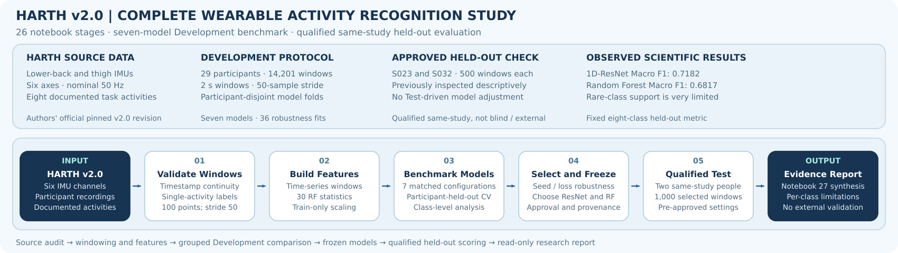

# Wearable Activity Recognition | HARTH v2.0



This study investigates **eight-class human activity recognition from two wearable
accelerometers**. It compares classical machine learning and temporal deep learning
under participant-disjoint Development evaluation, with particular attention to rare
activities, sampling limits, model stability and the interpretation of held-out results.

The research comprises **26 numbered Jupyter notebooks** and an independent
[FINAL research evidence audit](code/notebooks/final_harth_research_audit_and_closure.ipynb).
The [Stage 26 evidence report](code/notebooks/26_final_research_evidence_and_report.ipynb)
contains the executed, saved-results synthesis. The FINAL audit notebook is available
in GitHub, but **its execution and `final_*` exports have not yet been committed**.

## 1. Dataset and experimental protocol

| Component | Research setting |
| --- | --- |
| Source | [NTNU AI Lab HARTH v2.0](https://github.com/ntnu-ai-lab/harth-ml-experiments), pinned revision `dad2cfbe89a26f72f19770419469ac037de200df`; not the UCI HARTH v1.2 release |
| Inputs | Six accelerometer channels: `back_x/y/z` and `thigh_x/y/z`; nominal 50 Hz |
| Target | Walking, Running, Shuffling, Stairs ascending, Stairs descending, Standing, Sitting and Lying (source codes 1–8) |
| Windowing | 100 samples (2 seconds), stride 50 (50% overlap), with label-purity and timestamp-continuity checks |
| Full Development cohort | 29 participants, 132,397 eligible eight-class windows |
| Bounded Development benchmark | Up to 500 chronologically sampled windows per participant; 14,201 windows in three participant-disjoint folds |
| Qualified held-out assessment | S023 and S032, 500 selected windows each, from the same HARTH collection |

Source codes **10, 11 and 17** are not given invented activity meanings.
Out-of-task windows are excluded after safe window construction. Learned scaling,
class weighting and calibration are fitted only within their authorised training or
calibration splits.

S023 and S032 were inspected descriptively during exploratory work. The qualified
held-out assessment therefore **is not fully blind or external validation**, even
though those participants were excluded from subsequent Development model fitting
and selection.

## 2. Experimental programme

| Notebooks | Main purpose |
| --- | --- |
| [01–09](code/notebooks/) | Source inspection, annotation-safe windowing, 30 statistical features, classical baselines and expanding participant-disjoint evaluation |
| [10–13](code/notebooks/) | Temporal CNN, training-only scaling and class weighting, matched CNN/Random Forest comparisons |
| [14–17](code/notebooks/) | Label-blind sampling, nested training-size experiments and fixed 400-update comparisons |
| [18–20](code/notebooks/) | Out-of-fold confidence, subject-disjoint temperature scaling, minority-activity and source-data quality audits |
| [21](code/notebooks/21_advanced_temporal_architectures.ipynb) | Engineering checks for TCN, Multi-Scale CNN, 1D-ResNet and Time-Series Transformer |
| [22](code/notebooks/22_unified_matched_model_benchmark.ipynb) | Seven-model matched, three-fold Development benchmark (21 model-fold jobs) |
| [23](code/notebooks/23_multiseed_and_imbalance_robustness.ipynb) | Three-seed architecture/loss robustness (36 neural model-fold-seed jobs) |
| [24](code/notebooks/24_model_selection_and_protocol_freeze.ipynb) | Development-only model selection and frozen-protocol checks |
| [25](code/notebooks/25_final_development_training_and_inference.ipynb) | Final Development fitting and separately approved qualified held-out evaluation |
| [26](code/notebooks/26_final_research_evidence_and_report.ipynb) | Evidence report using committed full-precision results and recorded provenance |
| [FINAL](code/notebooks/final_harth_research_audit_and_closure.ipynb) | Cross-stage scientific consistency, source-file SHA256 checks and research closure (execution pending) |

Detailed methods and experimental comparisons are documented in
[HARTH | Research Methods and Experimental Evidence](HARTH_RESEARCH_METHODS_AND_EVIDENCE.md).

## 3. Research results

The matched Development benchmark selected **1D-ResNet with training-only
inverse-square-root weighted cross-entropy** as the primary model. **Random Forest**
was retained as a fixed classical comparator. Both were configured using
Development evidence, not the qualified held-out results.

| Model | Three-fold Development Macro F1 (mean ± SD) | Qualified held-out eight-class Macro F1 | Qualified held-out accuracy |
| --- | ---: | ---: | ---: |
| **1D-ResNet Weighted CE** | **0.8328 ± 0.0435** | **0.7182** | 0.9020 |
| Random Forest | 0.8094 ± 0.0500 | 0.6817 | **0.9270** |

The Development and qualified held-out columns represent **different participant
sets and evaluation conditions**; the values must not be treated as a matched
performance-difference test. On the final 1,000 overlapping windows, Shuffling
has only **3** true examples, stairs ascending **10** and stairs descending **6**.
The study does not establish population-level, prospective or clinical validity.

The full seven-model and robustness results are reported in
[Notebook 22](code/notebooks/22_unified_matched_model_benchmark.ipynb),
[Notebook 23](code/notebooks/23_multiseed_and_imbalance_robustness.ipynb) and
the [research methods report](HARTH_RESEARCH_METHODS_AND_EVIDENCE.md).
Qualified per-class and participant-level results are available from
[Notebook 25](code/notebooks/25_final_development_training_and_inference.ipynb).

## 4. Repository navigation

| Location | Contents |
| --- | --- |
| [`code/notebooks/`](code/notebooks/) | Stages 01–26 and the separate FINAL notebook |
| [`code/src/`](code/src/) | HARTH-specific data and quality-audit utilities |
| [`output/`](output/) | Executed experiment CSVs, figures, source summaries and Stage 26 provenance record |
| [`images/`](images/) | Study-level and individual notebook SVG workflow figures |
| [`evidence/`](evidence/) | Research evidence register and original protocol proposal/approval records |
| [Shared Python modules](../python_modules/core/) | Reusable processing, splitting, training, evaluation, plotting and Colab utilities |
| [Tests](../tests/) | Offline Python regression tests for shared and study-specific modules |

The output directory contains recorded results, **not** a new data source.
Full-precision CSV exports are available for active Stages 22, 23 and 25;
Stage 26 reads these without retraining or repeating the qualified Test.
The study-level outputs and research provenance are independent of the
presence of a README inside `output/`.

## 5. Running and reviewing the study

For a fresh Google Colab session, clone the repository once and open a notebook
under `wearable_activity_recognition/code/notebooks/`. The notebooks use a
common **Colab Repository Setup** cell followed by their project imports and
shared environment utilities. Do not force-pull over uncommitted Colab work.

For optional local inspection, from the repository root:

```bash
python -m pip install -r requirements.txt
python -m unittest discover -s tests -v
```

Some temporal experiments also require [deep-learning dependencies](../requirements-dl.txt)
and GPU resources. The offline test command is provided for verification; its
success is not presumed. The original raw data and trained model-weight files
are **not committed**, so independent re-execution of every experiment is not
guaranteed by the public repository alone.

To review the completed scientific results **without retraining**, start with
[Notebook 26](code/notebooks/26_final_research_evidence_and_report.ipynb)
and its files in [`output/`](output/). The separate
[FINAL audit notebook](code/notebooks/final_harth_research_audit_and_closure.ipynb)
reads saved evidence and does not rescore held-out recordings; its first
successful execution still needs to be saved and committed.

## 6. Scientific documentation and boundaries

- [Research Methods and Experimental Evidence](HARTH_RESEARCH_METHODS_AND_EVIDENCE.md):
  full research methods, matched comparisons, recorded results and limitations.
- [Reproducibility guide](../docs/HARTH_REPRODUCIBILITY.md):
  source version, availability of artefacts and verification limits.
- [Stage 01–19 evidence register](evidence/stage_01_19_evidence_register.csv):
  summary of the earlier Development experiments.
- [Qualified evaluation approval](evidence/stage_25_protocol_approved_qualified_test.json):
  frozen model specifications and the authorised evaluation boundary.

**Status:** All 26 numbered experimental/report notebooks and their saved
results are present. The separate FINAL audit has no committed execution or
`final_*` exports yet. HARTH is a completed experimental research study with
explicit limitations, **not** an externally validated or deployable system.
