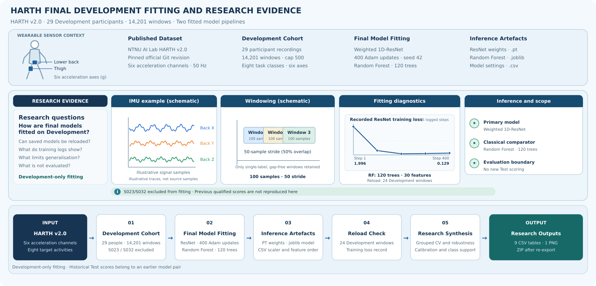

# Wearable Activity Recognition | HARTH v2.0

This study investigates **eight-class human activity recognition using two wearable accelerometers**. It compares classical models and temporal neural networks with participant-disjoint Development validation, source-quality checks, minority-activity analysis, robustness experiments and calibrated probability assessments.

**Current study notebooks:** [01–13](code/notebooks/). Notebook 12 records the Development-supported selection of a weighted 1D-ResNet and a fixed Random Forest reference; Notebook 13 fits those models on Development, verifies the saved inference interface and synthesises the supported evidence. The former 24–26 and FINAL notebooks have been consolidated; their original executed versions remain recoverable from Git history.

The older S023/S032 evaluation was performed on two previously inspected participants. Its **historically reported** results belong to a separate earlier fitted model pair and do not validate the newly fitted Notebook 13 artefacts. The current Notebook 13 did not re-score Test data.

## 1. Dataset and experimental protocol

| Component | Research setting |
| --- | --- |
| Source | [NTNU AI Lab HARTH v2.0](https://github.com/ntnu-ai-lab/harth-ml-experiments), pinned revision `dad2cfbe89a26f72f19770419469ac037de200df`; not the UCI HARTH v1.2 release |
| Inputs | Six accelerometer channels: `back_x/y/z` and `thigh_x/y/z`; nominal 50 Hz |
| Target | Walking, Running, Shuffling, Stairs ascending, Stairs descending, Standing, Sitting and Lying (source codes 1–8) |
| Windowing | 100 samples (2 seconds), stride 50 (50% overlap), with label-purity and timestamp-continuity checks |
| Full Development cohort | 29 participants, 132,397 eligible eight-class windows |
| Bounded Development benchmark | Up to 500 chronologically sampled windows per participant; 14,201 windows in three participant-disjoint folds |
| Qualified held-out assessment | S023 and S032, 500 selected windows each, from the same HARTH collection |

Source codes **10, 11 and 17** are not given invented activity meanings.
Out-of-task windows are excluded after safe window construction. Learned scaling,
class weighting and calibration are fitted only within their authorised training or
calibration splits.

S023 and S032 were inspected descriptively during exploratory work. The qualified
held-out assessment therefore **is not fully blind or external validation**, even
though those participants were excluded from subsequent Development model fitting
and selection.

## 2. Experimental Programme

| Notebook | Research purpose |
| --- | --- |
| [01–03](code/notebooks/) | Source inspection, safe window construction, 30 statistical features and classical participant-disjoint Development evaluation |
| [04](code/notebooks/04_harth_temporal_cnn_and_matched_random_forest.ipynb) | Matched temporal CNN and Random Forest comparison |
| [05](code/notebooks/05_harth_class_weighting_and_grouped_model_comparison.ipynb) | CNN weighting and three-model grouped comparison |
| [06](code/notebooks/06_harth_sampling_sensitivity_and_nested_training_scaling.ipynb) | Sampling limits and nested training-set sizes |
| [07](code/notebooks/07_harth_grouped_nested_training_and_fixed_update_comparison.ipynb) | Grouped nested training and matched optimisation budgets |
| [08](code/notebooks/08_harth_oof_confidence_and_temperature_calibration.ipynb) | OOF confidence and separate temperature calibration |
| [09](code/notebooks/09_harth_source_quality_and_minority_activity_audit.ipynb) | Source integrity, labels, rare-class and sampling audit |
| [10](code/notebooks/10_harth_advanced_temporal_architectures_and_matched_benchmark.ipynb) | Seven-model participant-grouped Development benchmark |
| [11](code/notebooks/11_harth_multiseed_stability_and_imbalance_robustness.ipynb) | Three-seed and loss-function robustness comparison |
| [12](code/notebooks/12_harth_development_model_selection_and_protocol_specification.ipynb) | Model selection, reference choice and fitting specification |
| [13](code/notebooks/13_harth_final_development_training_and_research_synthesis.ipynb) | Final Development fitting, model artefacts and research synthesis |

For the complete interpretation of the earlier research protocols and recorded qualified assessment, see [HARTH Research Methods and Experimental Evidence](HARTH_RESEARCH_METHODS_AND_EVIDENCE.md).

## 3. Main Results

The matched Development benchmark selected **1D-ResNet with training-only
inverse-square-root weighted cross-entropy** as the primary model. **Random Forest**
was retained as a fixed classical comparator. Both were configured using
Development evidence, not the qualified held-out results.

| Model | Current three-fold Development Macro F1 (mean ± SD) | Historical qualified held-out Macro F1 | Historical qualified accuracy |
| --- | ---: | ---: | ---: |
| **1D-ResNet Weighted CE** | **0.8336 ± 0.0427** | **0.7182** | 0.9020 |
| Random Forest | 0.8094 ± 0.0500 | 0.6817 | **0.9270** |

The Development values above come from the current Notebook 10/12 evidence. The qualified values are **historically reported from the previous fitted pair**, not reproduced or attributable to Notebook 13's new models. These columns have different participants and model-fit provenance; they cannot be used as a matched performance-difference test. On the final 1,000 overlapping windows, Shuffling
has only **3** true examples, stairs ascending **10** and stairs descending **6**.
The study does not establish population-level, prospective or clinical validity.

The bounded, single-partition comparison in [Notebook 04](code/notebooks/04_harth_temporal_cnn_and_matched_random_forest.ipynb) uses **14,201 Development windows**. On the same **2,701 Validation windows** from six held-out participants, the 120-tree Random Forest attains Macro F1 **0.8140**, compared with **0.6659** for the five-epoch temporal CNN. Random Forest scores higher for all six Validation participants. These figures describe a separate restricted protocol and must not be pooled with the three-fold benchmark or the qualified held-out evaluation.

The integrated [Notebook 05](code/notebooks/05_harth_class_weighting_and_grouped_model_comparison.ipynb)
tests training-only inverse-square-root CNN class weighting on that fixed split:
Validation Macro F1 rises from **0.6659** to **0.7973**. Across three
participant-disjoint Development folds, mean Macro F1 is **0.8094**
(Random Forest), **0.7832** (weighted CNN) and **0.6301** (standard CNN).
The weighted CNN exceeds the standard CNN for **27 of 29** held-out
participants but exceeds Random Forest for only **14 of 29**. These
are bounded Development results, not the qualified held-out assessment.
Full-precision evidence is in
[the loss-ablation metrics](output/05_loss_validation_metrics.csv)
and [the grouped model summary](output/05_cv_model_summary.csv).

The executed [Notebook 06](code/notebooks/06_harth_sampling_sensitivity_and_nested_training_scaling.ipynb)
shows that independent per-person caps of 250, 500 and 1,000 windows
retain **7,201**, **14,201** and **28,201** of **132,397** eligible
Development windows. At cap 500, only **219 of 1,946** Shuffling windows
remain, with support from **26 of 28** original contributors.
In the separate strictly nested Train-size experiment, Random Forest
final Validation Macro F1 changes from **0.8140 to 0.8644**, while the
weighted CNN changes from **0.7973 to 0.7807** at the specified fifth
epoch. Four model conditions share the same **2,701** Validation windows.
The audit does not equate independent cap policies with nested Train sets,
or these fixed-split estimates with grouped or qualified assessment.
Full-precision evidence is in the
[sampling policy counts](output/06_sampling_policy_class_counts.csv),
[model metrics](output/06_nested_validation_model_metrics.csv) and
[paired-subject summary](output/06_nested_paired_summary.csv).

[Notebook 08](code/notebooks/08_harth_oof_confidence_and_temperature_calibration.ipynb)
reports **0.9457** window accuracy, **0.0454** ten-bin ECE and
**39 high-confidence errors** in a 14,201-window uncalibrated
Development audit, with Shuffling recall only **0.1187**.
A *separately fitted*, participant-disjoint temperature-scaling
experiment reduces mean fold ECE from **0.0494** to **0.0286** and
Brier from **0.1085** to **0.1044**, but increases NLL from
**0.2494** to **0.2580**; Fold 1 worsens on all three metrics.
Accuracy remains **0.9275**. The 17 published CSV/PNG files
are current execution evidence, not independent external validation.
See [confidence summary](output/08_confidence_summary.csv),
[calibration fold metrics](output/08_calibration_fold_metrics.csv) and
[calibration means](output/08_calibration_mean_metrics.csv).

[Notebook 07](code/notebooks/07_harth_grouped_nested_training_and_fixed_update_comparison.ipynb)
reports three-fold Development mean Macro F1 at nested Train caps
500/1,000: **0.8094/0.8080** for Random Forest and **0.7832/0.7964**
for weighted CNN with five epochs. In the separate fixed-400-update
comparison, weighted CNN means are **0.7721/0.7921**. Training
representations and optimisation budgets differ between experiments;
the notebook's saved outputs and 24 committed `07_` CSV/PNG files support these numerical summaries.

[Notebook 09](code/notebooks/09_harth_source_quality_and_minority_activity_audit.ipynb)
provides a model-free source-quality analysis of the 29 Development
participants. From 160,090 candidate windows, 15,985 were rejected
for label purity, timestamp continuity or both; 144,105 passed these
checks. A further 11,708 pure/time-safe windows had out-of-task
source labels, leaving **132,397 eligible eight-class windows**.
Shuffling contributes **1,946 windows from 28 participants** (1.47%);
of 3,359 Shuffling annotation bouts, **2,342 (69.72%)** are shorter
than the two-second analysis window. The label-blind 500-window cap
retains only **219 of 1,946 Shuffling windows (11.25%)**, with 26
contributing participants. These are source/coverage quantities, not
predictions or explanations of the separately reported Notebook 08
errors. See the [activity support](output/09_activity_support_summary.csv),
[bout summary](output/09_annotation_bout_summary.csv), and
[source accounting](output/09_development_source_accounting.csv).

The current seven-model and robustness results are in
[Notebook 10](code/notebooks/10_harth_advanced_temporal_architectures_and_matched_benchmark.ipynb),
[Notebook 11](code/notebooks/11_harth_multiseed_stability_and_imbalance_robustness.ipynb) and their
[CSV evidence](output/12_development_model_selection_evidence.csv).
[Notebook 13](code/notebooks/13_harth_final_development_training_and_research_synthesis.ipynb)
preserves the historical qualified result summary as a separately attributed,
previously executed study finding.

## 4. Running and Reviewing the Study

Open the saved [Notebook 10](code/notebooks/10_harth_advanced_temporal_architectures_and_matched_benchmark.ipynb),
[Notebook 11](code/notebooks/11_harth_multiseed_stability_and_imbalance_robustness.ipynb)
and [Notebook 12](code/notebooks/12_harth_development_model_selection_and_protocol_specification.ipynb)
to inspect matched Development comparisons and model-selection evidence without retraining.
[Notebook 13](code/notebooks/13_harth_final_development_training_and_research_synthesis.ipynb)
contains the Development fitting, saved training outputs, inference reload example
and bounded scientific synthesis.

To execute a notebook in Google Colab, use its repository checkout and study setup
cells. The official HARTH source is downloaded at the pinned revision when absent.
The optional PyTorch GPU is supported; the recorded final fit in Notebook 13 ran
on CPU. A fresh run produces **new model artefacts** and should not inherit the
historically reported Test results.

The final inference configuration uses `inference_config.csv` with explicit
parameter positions and scalar values. The current export places
`resnet_state_dict.pt`, `random_forest.joblib` and `inference_config.csv`
under `models/`, with `13_` tables and figures under `results/` in one
`wearable_activity_recognition_Stage_13_Outputs.zip` outside Git. An older
bundle containing `inference_config.json` is not compatible with the new loader
until the configuration is regenerated or converted; it is not silently accepted.

## 5. Files and Saved Outputs

| Location | Contents |
| --- | --- |
| [`code/notebooks/`](code/notebooks/) | Current 01–13 study notebooks |
| [`code/src/`](code/src/) | HARTH-specific source readers and sampling |
| [`output/`](output/) | Saved Development CSV tables and figures, including 12/13 outputs |
| [`images/`](images/) | Study and numbered notebook scientific workflow diagrams |
| [`evidence/`](evidence/) | Original early-stage research evidence register |
| [Shared Python modules](../python_modules/core/) | Model fitting, evaluation, plotting and inference |

The published [`13_inference_config.csv`](output/13_inference_config.csv)
was reconstructed from the saved final-fit settings, channel-scaling table
and the established 30-feature ordering. Its values are available for
inspection, but this reconstruction is **not** execution of the revised
loader. Sections 06 and 11 of Notebook 13 still need to run to verify CSV
loading and create the single external ZIP. Trained model binaries are **not
committed** to ordinary Git history. Keep a trusted download archive in
reliable storage.

## 6. Interpretation and Scope

The current research evidence covers participant-disjoint Development evaluation,
model-selection robustness, source-quality limitations and a Development-only
final fit. The original qualified S023/S032 results were reported for a separate
historical model run; the aligned prediction CSV is not present in the current
public `output/` directory. Historical numerical findings remain described
in the [scientific document](HARTH_RESEARCH_METHODS_AND_EVIDENCE.md), with the
original executed notebook recoverable from the corresponding Git revision.

The study does not establish blind external validation, population-wide accuracy,
prospective performance or clinical deployment. Overlapping windows, limited
independent participants and low support for several activities restrict
generalisation claims.

For sources, scientific methods and reported outcomes, see
[HARTH Research Methods and Experimental Evidence](HARTH_RESEARCH_METHODS_AND_EVIDENCE.md)
and the [reproducibility guide](../docs/HARTH_REPRODUCIBILITY.md).
